### Лабораторна робота 1. Робота з СУБД PostgreSQL та основи SQL
## Загальна інформація
Здобувач освіти: [Бугайчук Дмитро Петрович]<br>
Група: [ІПЗ-32]<br>
Обраний рівень складності: [3]


## 1. Дослідження структури та перевірка цілісності бази даних

Для первинного аналізу розгорнутої реляційної бази даних та перевірки коректності імпорту початкового дампу було сформовано комплексний агрегувальний запит. За допомогою оператора UNION ALL виконано об'єднання підрахунку кількості записів (COUNT(*)) по всіх ключових сутностях системи.

SQL-запит:
```sql
SELECT 'Регіонів' as entity, COUNT(*) as count FROM regions
UNION ALL
SELECT 'Постачальників' as entity, COUNT(*) as count FROM suppliers
UNION ALL
SELECT 'Категорій' as entity, COUNT(*) as count FROM categories
UNION ALL
SELECT 'Товарів' as entity, COUNT(*) as count FROM products
UNION ALL
SELECT 'Співробітників' as entity, COUNT(*) as count FROM employees
UNION ALL
SELECT 'Клієнтів' as entity, COUNT(*) as count FROM customers
UNION ALL
SELECT 'Замовлень' as entity, COUNT(*) as count FROM orders
UNION ALL
SELECT 'Позицій в замовленнях' as entity, COUNT(*) as count FROM order_items;
```

Результат виконання та аналіз:

Запит успішно виконано без помилок. Отримані дані підтверджують повну готовність бази до роботи та наявність необхідного обсягу навчальної інформації: в системі зареєстровано 25 регіонів, 8 постачальників, 10 товарних категорій, 25 позицій товарів, 8 працівників, 15 клієнтів, а також 31 сформоване замовлення, які містять загалом 47 деталізованих позицій. Це гарантує коректність виконання подальших запитів на вибірку та фільтрацію.

Скріншот:

Виведення зведеної статистики таблиць у Supabase SQL Editor:
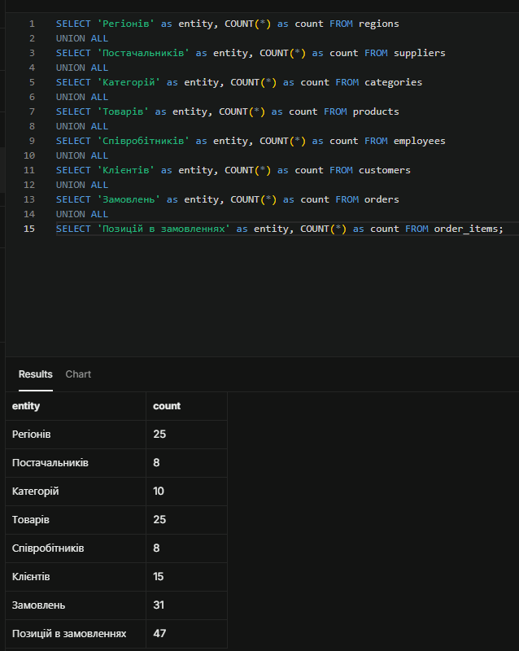

## 2. Виконання завдань: Рівень 1 (Базові вибірки DQL)

### 2.1. Основні SELECT запити<br><br>

#### Завдання 1. Отримати всі записи з таблиці `customers`
Для виведення повної інформації про всіх зареєстрованих покупців використано базовий оператор вибірки з метасимволом *, який повертає всі стовпці таблиці.

**SQL-запит:**
```sql
SELECT * FROM customers;
```

Результат виконання:
Система повернула повний перелік з 15 клієнтів інтернет-магазину (включно з фізичними особами та корпоративними замовниками), із зазначенням їхніх контактних даних, адрес та дат реєстрації.<br><br>

Скріншот:

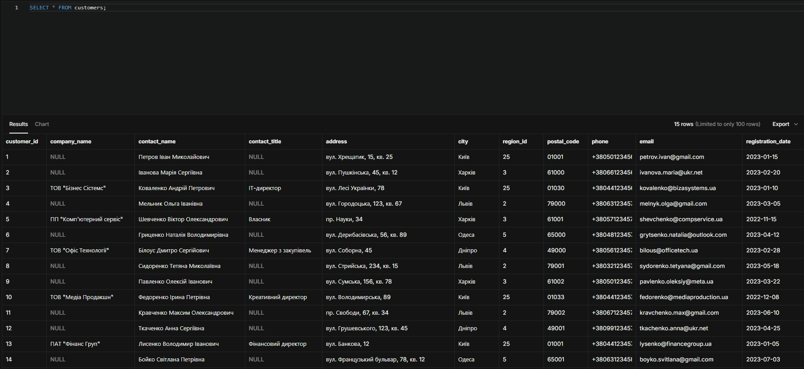


#### Завдання 2. Вивести тільки назви товарів і їхні ціни з таблиці
Щоб уникнути завантаження зайвої інформації (описів, артикулів чи залишків на складі), застосовано проекцію конкретних атрибутів — product_name та unit_price.
SQL-запит:
```sql
SELECT product_name, unit_price FROM products;
```
Результат виконання:
Сформовано компактний прайс-лист із 25 товарних позицій, де відображаються виключно найменування техніки та їхня актуальна вартість.

Скріншот:

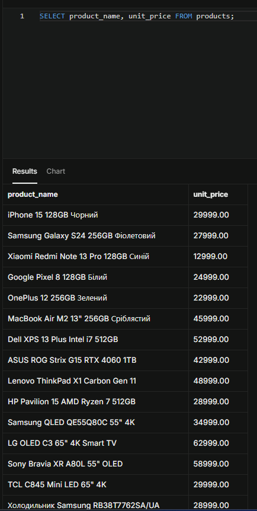

#### Завдання 3. Показати контактні дані всіх співробітників
Для формування довідника контактів персоналу виконано вибірку обмеженого набору полів (first_name, last_name, phone, email) із таблиці employees.
SQL-запит:
```sql
SELECT first_name, last_name, phone, email FROM employees;
```

Результат виконання:
Отримано структурований список усіх 8 співробітників компанії з їхніми іменами, прізвищами, номерами телефонів та корпоративними електронними адресами.

Скріншот:

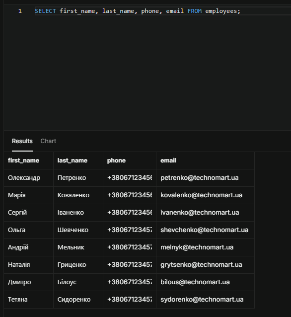

### 2.2. Прості умови WHERE<br><br>

#### Завдання 1. Знайти всіх клієнтів з міста Київ
Для відбору покупців лише з певного населеного пункту застосовано умову фільтрації `WHERE` із порівнянням текстового поля `city` зі значенням `'Київ'`.

**SQL-запит:**
```sql
SELECT * FROM customers WHERE city = 'Київ';
```

Результат виконання:
Отримано вибірку з 4 клієнтів, зареєстрованих у Києві (як фізичних осіб, так і представників компаній), з усіма їхніми контактними даними та адресами.<br><br>

Скріншот:

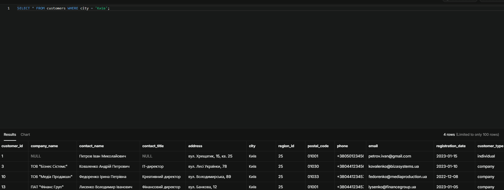<br><br>


#### Завдання 2. Вивести товари, які коштують більше 25000 грн
Для пошуку товарів вищого цінового сегмента використано оператор порівняння `>` над числовим полем `unit_price` у блоці `WHERE`.

**SQL-запит:**
```sql
SELECT * FROM products WHERE unit_price > 25000;
```

Результат виконання:
Система повернула 13 товарів із вартістю понад 25 000 грн (зокрема смартфони, ноутбуки, телевізори, планшети та побутову техніку).<br><br>

Скріншот:

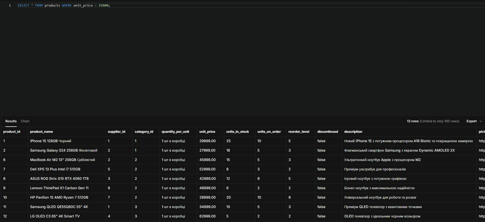<br><br>


#### Завдання 3. Показати всі замовлення зі статусом 'delivered'
Для відбору вже виконаних і доставлених замовлень використано фільтр за полем `order_status` зі значенням `'delivered'`.

**SQL-запит:**
```sql
SELECT * FROM orders WHERE order_status = 'delivered';
```

Результат виконання:
Отримано 26 замовлень зі статусом `'delivered'` разом із датами оформлення, відправки, службами доставки та адресами отримувачів.<br><br>

Скріншот:

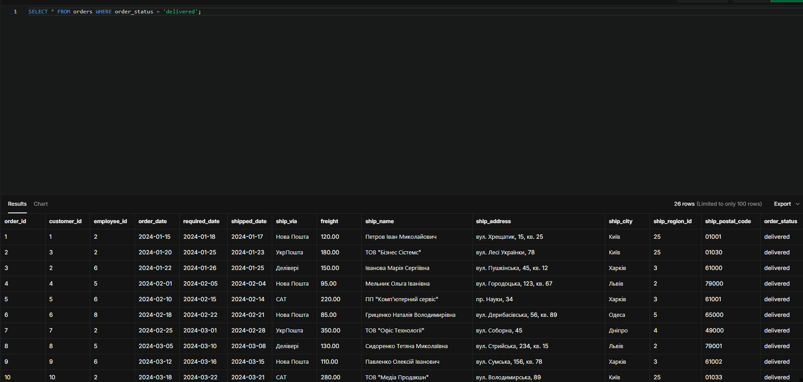<br><br>


#### Завдання 4. Знайти співробітників, які працюють у відділі продажів (посада містить слово "продаж")
Для пошуку за частковим збігом тексту без урахування регістру застосовано оператор `ILIKE` із шаблоном `'%продаж%'` по полю `title`.

**SQL-запит:**
```sql
SELECT * FROM employees WHERE title ILIKE '%продаж%';
```

Результат виконання:
Знайдено 3 співробітників на посаді «Менеджер з продажу» (Марія Коваленко, Андрій Мельник та Наталія Гриценко) з їхніми даними та містами роботи.<br><br>

Скріншот:

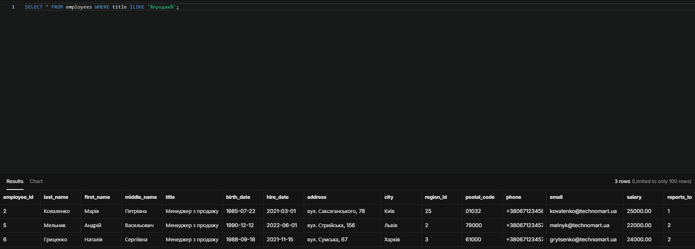<br><br>

### 2.3. Базове сортування ORDER BY<br><br>

#### Завдання 1. Відсортувати товари за зростанням ціни
Для впорядкування каталогу продукції від найдешевшої до найдорожчої позиції застосовано оператор `ORDER BY` по стовпцю `unit_price` із модифікатором `ASC` (сортування за зростанням).

**SQL-запит:**
```sql
SELECT * FROM products ORDER BY unit_price ASC;
```

Результат виконання:
Отримано всі 25 товарів, розташованих у порядку збільшення вартості — починаючи від зарядного кабелю USB-C (699.00 грн) та клавіатури (3999.00 грн) до найдорожчих моделей телевізорів.<br><br>

Скріншот:

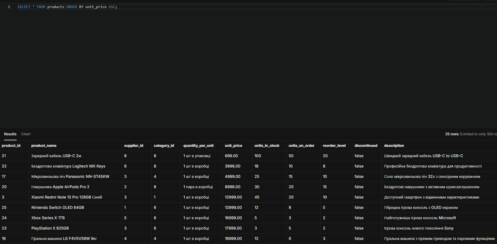<br><br>


#### Завдання 2. Показати клієнтів в алфавітному порядку за іменем контактної особи
Для систематизації клієнтської бази за прізвищами та іменами контактних осіб використано сортування `ORDER BY contact_name ASC`.

**SQL-запит:**
```sql
SELECT * FROM customers ORDER BY contact_name ASC;
```

Результат виконання:
Система впорядкувала всіх 15 клієнтів за українським алфавітом за полем `contact_name` (від Білоуса Дмитра Сергійовича до Федоренко Ірини Петрівни).<br><br>

Скріншот:

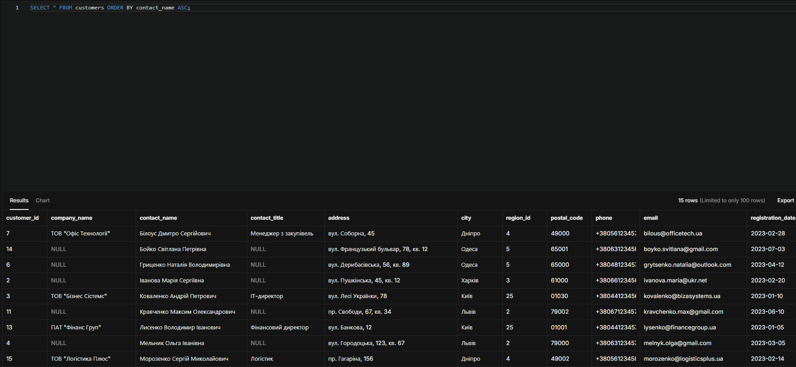<br><br>


#### Завдання 3. Вивести замовлення від найновіших до найстаріших
Для перегляду останніх надходжень у хронологічному порядку зворотної послідовності застосовано сортування за полем `order_date` із ключовим словом `DESC` (за спаданням).

**SQL-запит:**
```sql
SELECT * FROM orders ORDER BY order_date DESC;
```

Результат виконання:
Виведено 31 замовлення, де першими відображаються найсвіжіші замовлення за серпень 2024 року (від `2024-08-20`), а нижче — більш ранні за попередні місяці.<br><br>

Скріншот:

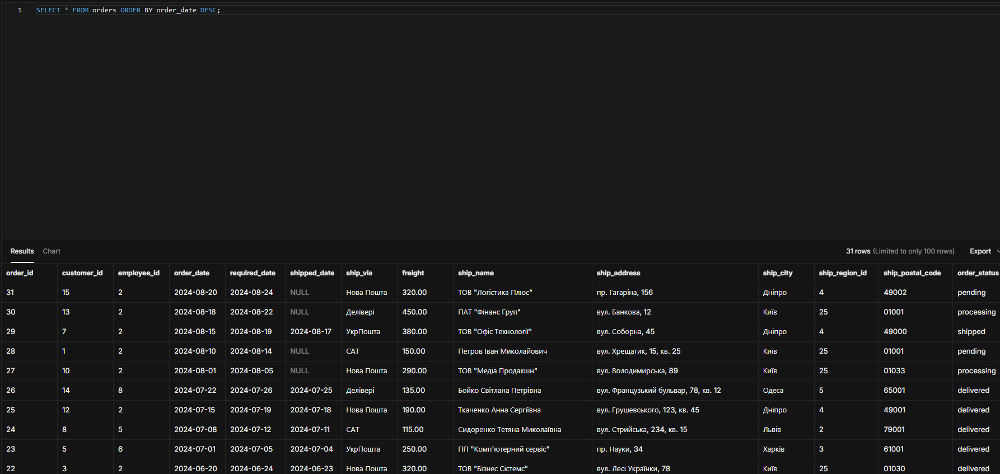<br><br>

### 2.4. Обмеження результатів LIMIT<br><br>

#### Завдання 1. Показати перші 10 найдорожчих товарів
Для отримання топ-10 найбільш вартісних позицій каталогу поєднано сортування за спаданням ціни (`ORDER BY unit_price DESC`) та обмеження кількості рядків (`LIMIT 10`).

**SQL-запит:**
```sql
SELECT * FROM products ORDER BY unit_price DESC LIMIT 10;
```

Результат виконання:
Отримано 10 найдорожчих товарів магазину — від телевізора LG OLED C3 65" (62999.00 грн) до смартфона iPhone 15 128GB (29999.00 грн).<br><br>

Скріншот:

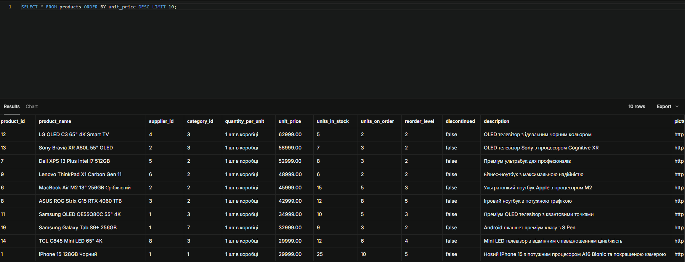<br><br>


#### Завдання 2. Вивести 5 останніх замовлень (за датою)
Для перегляду п'яти найсвіжіших замовлень застосовано зворотне сортування за датою оформлення (`ORDER BY order_date DESC`) з обмеженням вибірки `LIMIT 5`.

**SQL-запит:**
```sql
SELECT * FROM orders ORDER BY order_date DESC LIMIT 5;
```

Результат виконання:
Виведено 5 останніх замовлень (з `order_id` 31 по 27), датованих періодом з `2024-08-01` по `2024-08-20`, у різних статусах обробки та доставки.<br><br>

Скріншот:

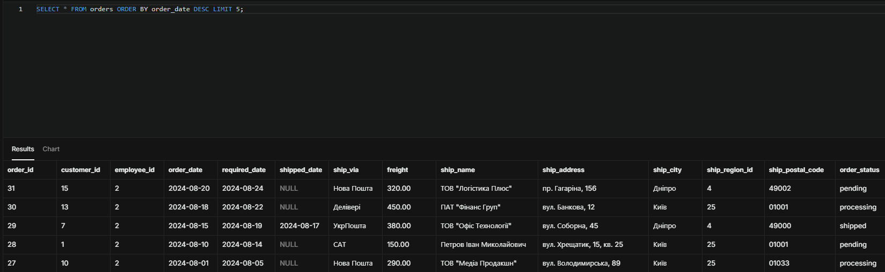<br><br>


#### Завдання 3. Отримати перших 8 клієнтів в алфавітному порядку
Для вибірки перших восьми клієнтів за алфавітом використано сортування за полем `contact_name ASC` та обмеження `LIMIT 8`.

**SQL-запит:**
```sql
SELECT * FROM customers ORDER BY contact_name ASC LIMIT 8;
```

Результат виконання:
Система повернула перших 8 клієнтів в алфавітному порядку за контактною особою — від Білоуса Дмитра Сергійовича до Мельник Ольги Іванівни.<br><br>

Скріншот:

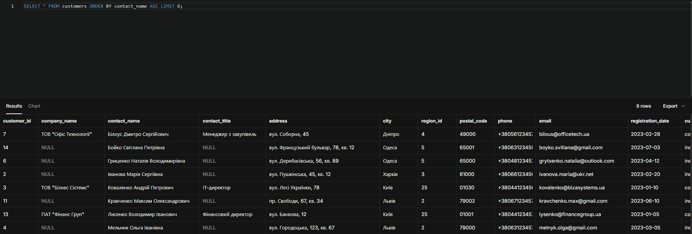<br><br>
## 3. Виконання завдань: Рівень 2 (Розширені вибірки та фільтрація)

### 3.1. Пошук за зразком з LIKE<br><br>

#### Завдання 1. Знайти всіх клієнтів, чиї імена починаються на "Іван"
Для пошуку записів за префіксом у текстовому полі `contact_name` застосовано оператор `LIKE` із шаблоном `'Іван%'`, де символ `%` означає будь-яку послідовність наступних символів.

**SQL-запит:**
```sql
SELECT * FROM customers WHERE contact_name LIKE 'Іван%';
```

Результат виконання:
Знайдено 1 запис, поле `contact_name` якого починається з «Іван» — «Іванова Марія Сергіївна» (м. Харків).<br><br>

Скріншот:

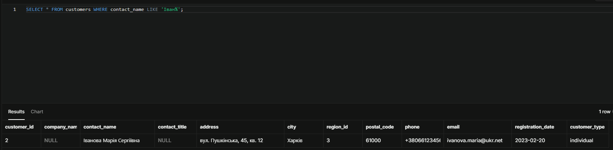<br><br>


#### Завдання 2. Вивести товари, в назві яких є слово "phone" або "телефон"
Для пошуку без урахування регістру символів у назві товару (`product_name`) використано оператор `ILIKE` із шаблонами `'%phone%'` та `'%телефон%'`, об'єднаними логічним оператором `OR`.

**SQL-запит:**
```sql
SELECT * FROM products WHERE product_name ILIKE '%phone%' OR product_name ILIKE '%телефон%';
```

Результат виконання:
Отримано 1 товарну позицію — «iPhone 15 128GB Чорний», у назві якої міститься підрядок `phone`.<br><br>

Скріншот:

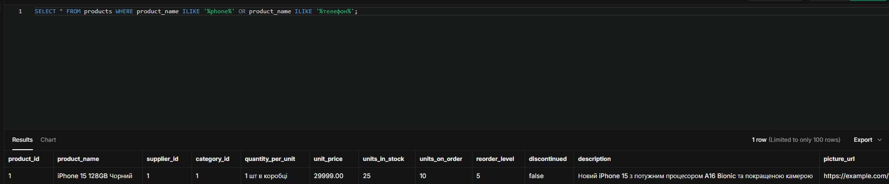<br><br>


#### Завдання 3. Самостійний запит 1 (пошук за початком рядка: `LIKE 'Samsung%'`)
Для відбору продукції конкретного бренду, назва якого стоїть на самому початку `product_name`, використано шаблон `'Samsung%'`.

**SQL-запит:**
```sql
SELECT * FROM products WHERE product_name LIKE 'Samsung%';
```

Результат виконання:
Система повернула 3 товари лінійки Samsung (смартфон Galaxy S24, телевізор QLED та планшет Galaxy Tab S9+).<br><br>

Скріншот:

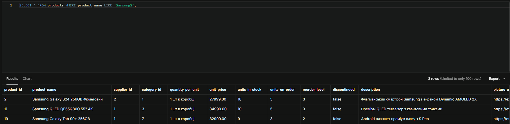<br><br>


#### Завдання 4. Самостійний запит 2 (пошук за кінцем рядка: `LIKE '%@gmail.com'`)
Для фільтрації клієнтів за поштовим доменом використано шаблон `'%@gmail.com'` по полю `email`, який перевіряє закінчення рядка.

**SQL-запит:**
```sql
SELECT * FROM customers WHERE email LIKE '%@gmail.com';
```

Результат виконання:
Виявлено 5 клієнтів, електронна пошта яких закінчується на `@gmail.com`.<br><br>

Скріншот:

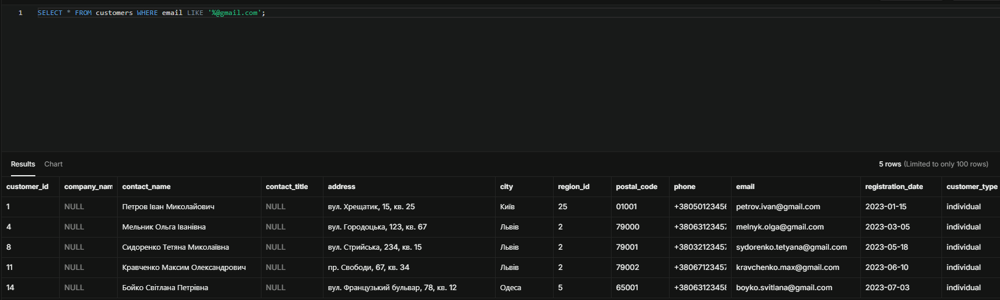<br><br>


#### Завдання 5. Самостійний запит 3 (пошук підрядка всередині назви: `ILIKE '%pro%'`)
Для пошуку моделей із позначенням `Pro` у будь-якій частині назви застосовано оператор `ILIKE` із символами `%` з обох боків шаблону.

**SQL-запит:**
```sql
SELECT * FROM products WHERE product_name ILIKE '%pro%';
```

Результат виконання:
Знайдено 2 товари — «Xiaomi Redmi Note 13 Pro 128GB Синій» та «Навушники Apple AirPods Pro 2».<br><br>

Скріншот:

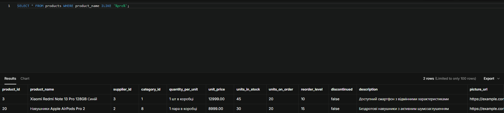<br><br>

### 3.2. Логічні оператори AND, OR, NOT<br><br>

#### Завдання 1. Знайти товари дорожчі за 15000 грн і дешевші за 50000 грн
Для обмеження цінового діапазону використано два умови порівняння (`unit_price > 15000` та `unit_price < 50000`), об'єднані логічним оператором `AND`.

**SQL-запит:**
```sql
SELECT * FROM products WHERE unit_price > 15000 AND unit_price < 50000;
```

Результат виконання:
Отримано 16 товарів, вартість яких перебуває строго в межах від 15 000 до 50 000 грн.<br><br>

Скріншот:

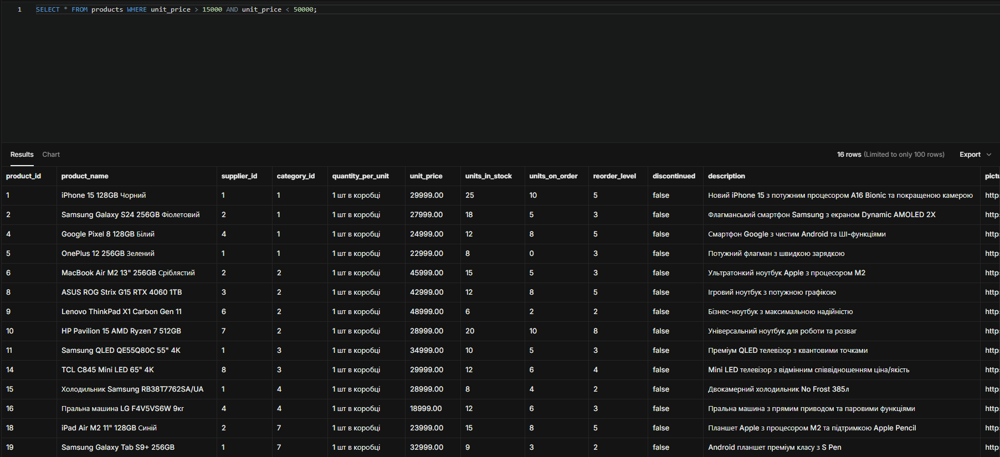<br><br>


#### Завдання 2. Вивести клієнтів з Києва або Львова, які є юридичними особами
Для коректного пріоритету логічних операцій умову вибору міста взято в дужки (`city = 'Київ' OR city = 'Львів'`) та поєднано через `AND` із перевіркою `customer_type = 'company'`.

**SQL-запит:**
```sql
SELECT * FROM customers WHERE (city = 'Київ' OR city = 'Львів') AND customer_type = 'company';
```

Результат виконання:
Знайдено 3 клієнтів-компаній (ТОВ «Бізнес Сістемс», ТОВ «Медіа Продакшн» та ПАТ «Фінанс Груп»).<br><br>

Скріншот:

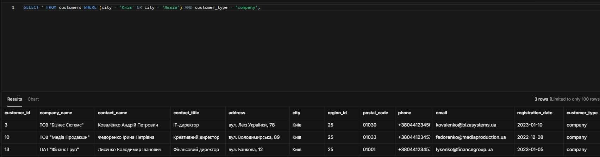<br><br>


#### Завдання 3. Самостійний запит 1 (доставлені замовлення не через «Нова Пошта» з доставкою понад 150 грн)
Поєднано перевірку статусу `'delivered'`, заперечення оператора `NOT ship_via = 'Нова Пошта'` та умову `freight > 150` через логічне `AND`.

**SQL-запит:**
```sql
SELECT * FROM orders WHERE order_status = 'delivered' AND NOT ship_via = 'Нова Пошта' AND freight > 150;
```

Результат виконання:
Повернуто 10 доставлених замовлень, відправлених іншими службами доставки (УкрПошта, САТ, Делівері) із вартістю доставки понад 150 грн.<br><br>

Скріншот:

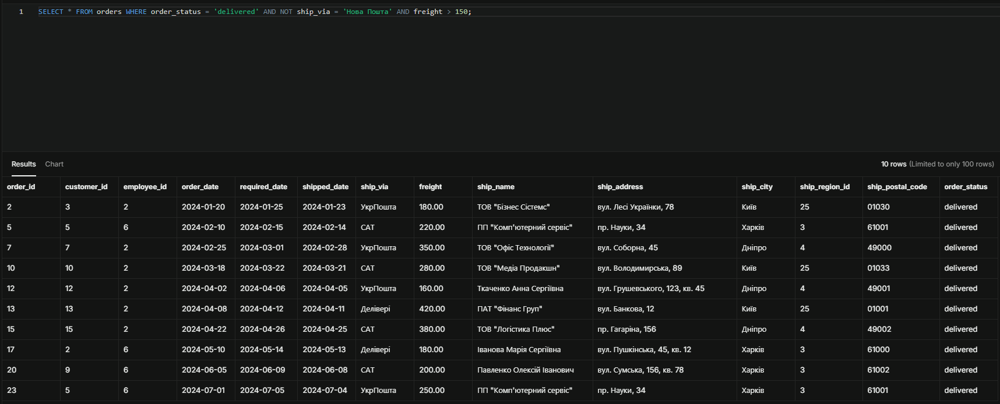<br><br>


#### Завдання 4. Самостійний запит 2 (співробітники з Києва або із зарплатою понад 25 000 грн, крім генерального директора)
Використано комбінацію дужок з `OR`, оператора `AND` та заперечення `NOT title = 'Генеральний директор'` над таблицею `employees`.

**SQL-запит:**
```sql
SELECT * FROM employees WHERE (city = 'Київ' OR salary > 25000) AND NOT title = 'Генеральний директор';
```

Результат виконання:
Отримано 4 співробітників, які відповідають заданим критеріям, без урахування посади генерального директора.<br><br>

Скріншот:

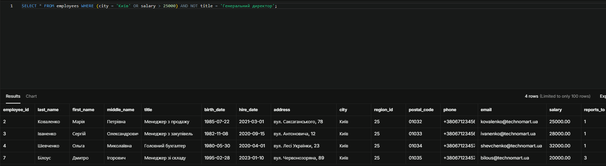<br><br>


#### Завдання 5. Самостійний запит 3 (активні товари з високим залишком або замовленням постачальнику)
Умова `OR` перевіряє запас на складі (`units_in_stock >= 15`) або кількість в очікуванні (`units_on_order >= 10`), а `AND NOT discontinued` відсікає зняті з виробництва позиції.

**SQL-запит:**
```sql
SELECT * FROM products WHERE (units_in_stock >= 15 OR units_on_order >= 10) AND NOT discontinued;
```

Результат виконання:
Знайдено 10 актуальних товарів із достатнім запасом або запланованою поставкою.<br><br>

Скріншот:

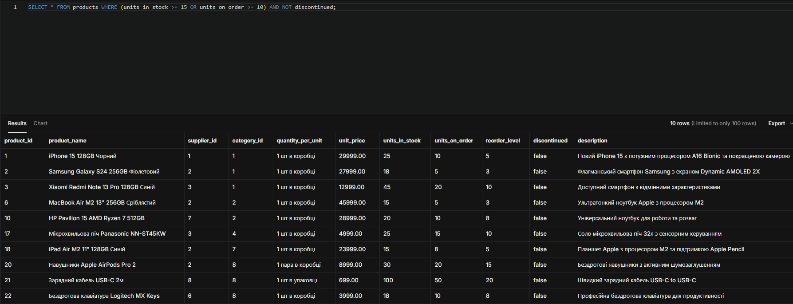<br><br>


#### Завдання 6. Самостійний запит 4 (постачальники зі Львова або Харкова, крім «ПП»)
Зібрано постачальників із двох міст через `OR` та виключено приватні підприємства за допомогою `AND NOT company_name LIKE 'ПП%'`.

**SQL-запит:**
```sql
SELECT * FROM suppliers WHERE (city = 'Львів' OR city = 'Харків') AND NOT company_name LIKE 'ПП%';
```

Результат виконання:
Отримано 2 постачальників (ТОВ «Мобільний світ» у Харкові та ТОВ «Львівські комп'ютери» у Львові).<br><br>

Скріншот:

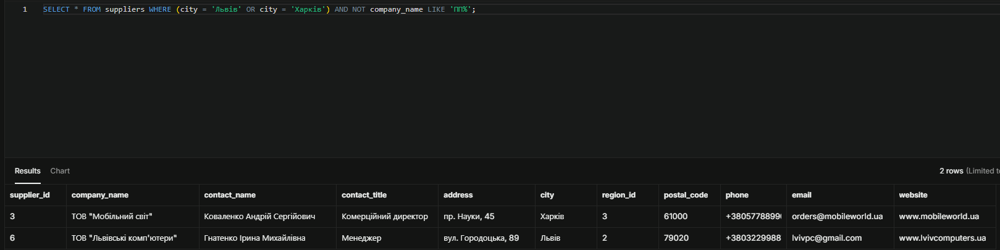<br><br>

### 3.3. Оператори IN, BETWEEN, IS NULL<br><br>

#### Завдання 1. Вивести клієнтів з міст Київ, Харків, Одеса, Дніпро
Для перевірки належності значення поля `city` одному з перелічених міст застосовано оператор `IN` зі списком рядкових значень.

**SQL-запит:**
```sql
SELECT * FROM customers WHERE city IN ('Київ', 'Харків', 'Одеса', 'Дніпро');
```

Результат виконання:
Отримано 12 клієнтів із зазначених чотирьох міст разом із їхніми контактними даними, адресами та типом клієнта.<br><br>

Скріншот:

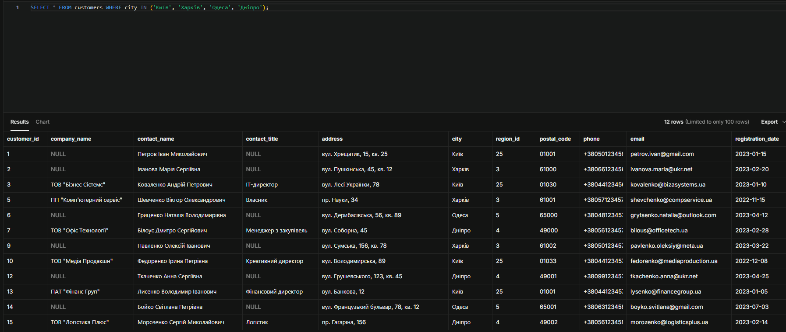<br><br>


#### Завдання 2. Знайти товари в ціновому діапазоні від 10000 до 30000 грн
Для відбору позицій за включним числовим проміжком використано оператор `BETWEEN 10000 AND 30000` по стовпцю `unit_price`.

**SQL-запит:**
```sql
SELECT * FROM products WHERE unit_price BETWEEN 10000 AND 30000;
```

Результат виконання:
Система повернула 13 товарів, вартість яких становить від 10 000 до 30 000 грн включно.<br><br>

Скріншот:

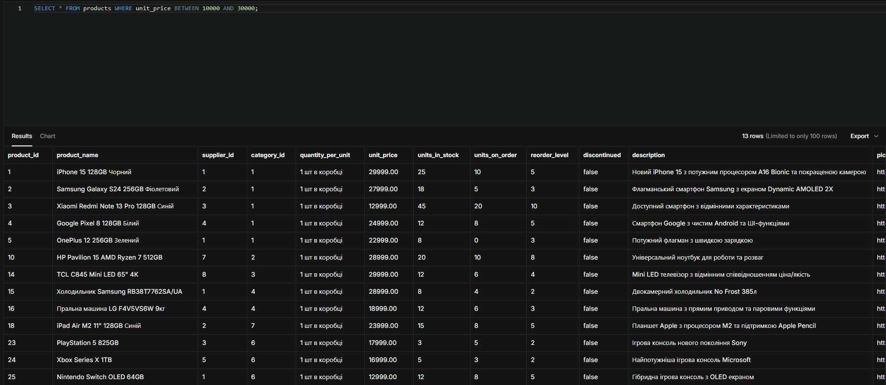<br><br>


#### Завдання 3. Самостійний запит з IN 1 (замовлення зі статусами pending або processing)
Застосовано оператор `IN ('pending', 'processing')` по полю `order_status` для вибірки замовлень, які ще перебувають на етапі обробки або очікування.

**SQL-запит:**
```sql
SELECT * FROM orders WHERE order_status IN ('pending', 'processing');
```

Результат виконання:
Знайдено 4 замовлення у статусах `pending` та `processing` (усі з не заповненою датою відправки `shipped_date`).<br><br>

Скріншот:

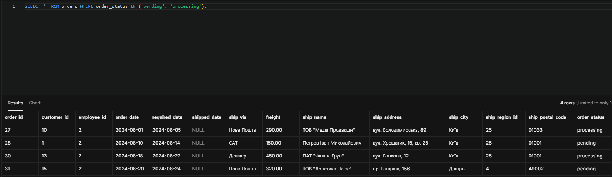<br><br>


#### Завдання 4. Самостійний запит з IN 2 (товари з категорій 1, 2 або 6)
Використано оператор `IN (1, 2, 6)` по полю `category_id` для одночасного вибору товарів із трьох вибраних категорій.

**SQL-запит:**
```sql
SELECT * FROM products WHERE category_id IN (1, 2, 6);
```

Результат виконання:
Отримано 13 товарів, що належать до категорій з ідентифікаторами `1`, `2` та `6`.<br><br>

Скріншот:

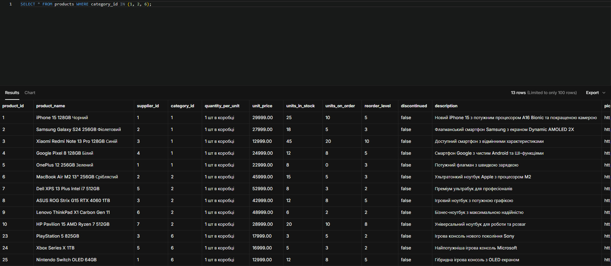<br><br>


#### Завдання 5. Самостійний запит з BETWEEN 1 (замовлення за лютий 2024 року)
Для фільтрації записів за календарним діапазоном застосовано оператор `BETWEEN '2024-02-01' AND '2024-02-29'` по стовпцю `order_date`.

**SQL-запит:**
```sql
SELECT * FROM orders WHERE order_date BETWEEN '2024-02-01' AND '2024-02-29';
```

Результат виконання:
Повернуто 4 замовлення (`order_id` з 4 по 7), оформлені протягом лютого 2024 року.<br><br>

Скріншот:

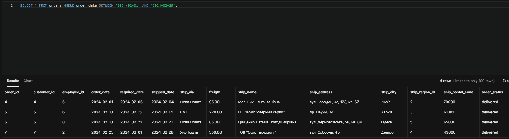<br><br>


#### Завдання 6. Самостійний запит з BETWEEN 2 (співробітники із зарплатою від 22000 до 30000 грн)
Застосовано оператор `BETWEEN 22000 AND 30000` по числовому полю `salary` у таблиці `employees`.

**SQL-запит:**
```sql
SELECT * FROM employees WHERE salary BETWEEN 22000 AND 30000;
```

Результат виконання:
Знайдено 5 співробітників, чия заробітна плата входить у діапазон від 22 000 до 30 000 грн включно.<br><br>

Скріншот:

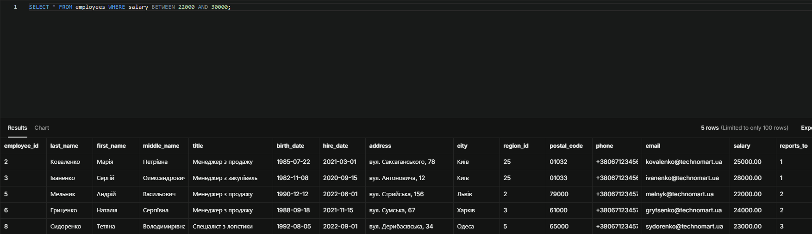<br><br>


#### Завдання 7. Самостійний запит з IS NULL 1 (непередані у доставку замовлення)
Для пошуку записів із відсутнім значенням дати відправки використано перевірку `shipped_date IS NULL`.

**SQL-запит:**
```sql
SELECT * FROM orders WHERE shipped_date IS NULL;
```

Результат виконання:
Отримано 4 замовлення, для яких поле `shipped_date` має значення `NULL` (вони ще не відправлені).<br><br>

Скріншот:

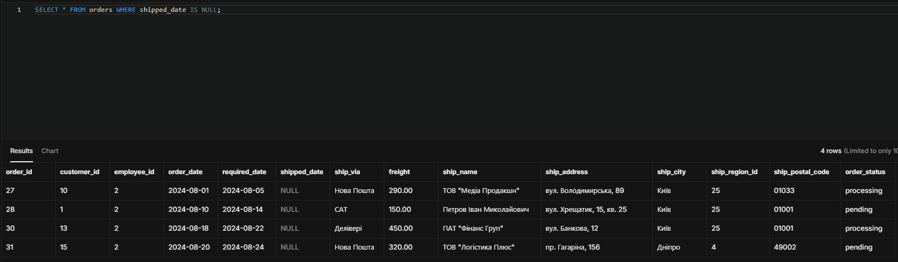<br><br>


#### Завдання 8. Самостійний запит з IS NULL 2 (клієнти без назви компанії)
Застосовано умову `company_name IS NULL` для відбору клієнтів-фізичних осіб, у яких не заповнено реквізит компанії.

**SQL-запит:**
```sql
SELECT * FROM customers WHERE company_name IS NULL;
```

Результат виконання:
Система повернула 9 клієнтів зі значенням `NULL` у стовпці `company_name`.<br><br>

Скріншот:

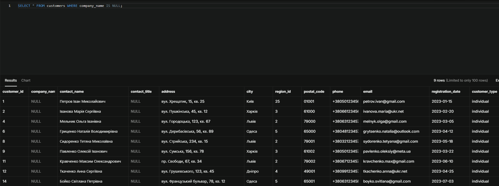<br><br>


#### Завдання 9. Самостійний запит з IS NOT NULL 1 (співробітники, що підпорядковуються керівнику)
Для вибірки працівників із заповненим полем керівника застосовано оператор `reports_to IS NOT NULL`.

**SQL-запит:**
```sql
SELECT * FROM employees WHERE reports_to IS NOT NULL;
```

Результат виконання:
Знайдено 7 співробітників, які мають вказаного керівника (`reports_to` не дорівнює `NULL`).<br><br>

Скріншот:

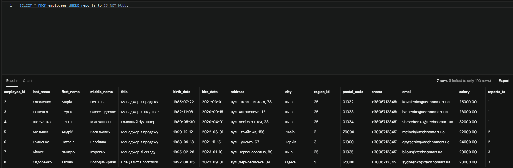<br><br>


#### Завдання 10. Самостійний запит з IS NOT NULL 2 (клієнти із зазначеною посадою контактної особи)
Використано перевірку `contact_title IS NOT NULL` у таблиці `customers` для відбору записів із заповненою посадою контактної особи.

**SQL-запит:**
```sql
SELECT * FROM customers WHERE contact_title IS NOT NULL;
```

Результат виконання:
Отримано 6 клієнтів (представників компаній), у яких заповнено поле `contact_title`.<br><br>

Скріншот:

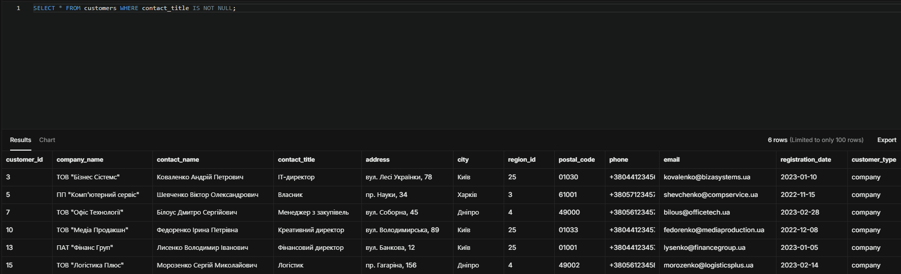<br><br>

### 3.4. Комбінування умов<br><br>

#### Завдання 1. Самостійний запит 1 (`LIKE` + `OR` + `AND` + `NOT` у таблиці `products`)
Поєднано перевірку початку назви бренду через `LIKE` та `OR` у дужках із числовим обмеженням ціни (`unit_price > 20000`) і логічним запереченням `NOT discontinued`.

**SQL-запит:**
```sql
SELECT * FROM products
WHERE (product_name LIKE 'Samsung%' OR product_name LIKE 'Apple%')
  AND unit_price > 20000
  AND NOT discontinued;
```

Результат виконання:
Отримано 3 актуальні товарні позиції Samsung преміального цінового сегмента (смартфон Galaxy S24, телевізор QLED та планшет Galaxy Tab S9+).<br><br>

Скріншот:

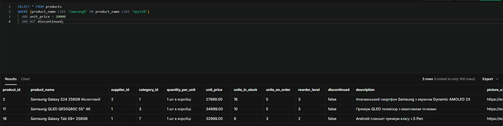<br><br>


#### Завдання 2. Самостійний запит 2 (`BETWEEN` + `IN` + `AND` у таблиці `orders`)
Для вибірки виконаних відправлень за перші п'ять місяців року через вибрані поштові служби поєднано діапазон дат `BETWEEN`, список перевізників `IN` та фільтр за статусом `order_status = 'delivered'`.

**SQL-запит:**
```sql
SELECT * FROM orders
WHERE order_date BETWEEN '2024-01-01' AND '2024-05-31'
  AND ship_via IN ('Нова Пошта', 'УкрПошта')
  AND order_status = 'delivered';
```

Результат виконання:
Система повернула 12 доставлених замовлень, оформлених з січня по травень 2024 року та відправлених службами «Нова Пошта» або «УкрПошта».<br><br>

Скріншот:

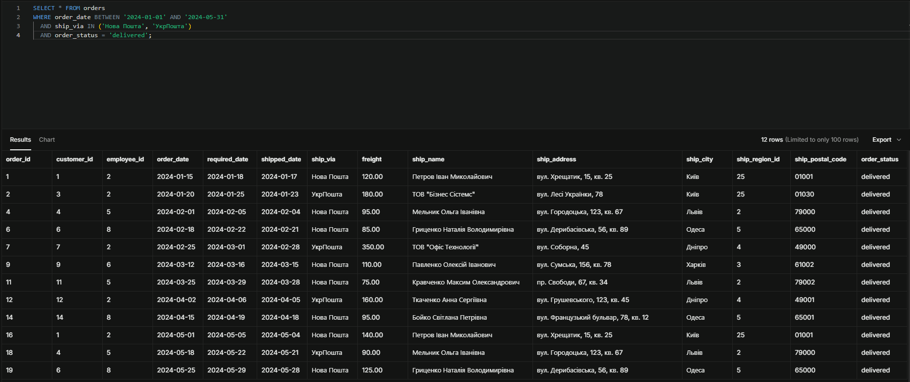<br><br>


#### Завдання 3. Самостійний запит 3 (`IS NOT NULL` + `LIKE` + `OR` + `BETWEEN` у таблиці `customers`)
У запиті скомбіновано перевірку наявності назви компанії (`company_name IS NOT NULL`), фільтрацію поштових доменів за шаблонами `LIKE` у дужках та календарний проміжок реєстрації `BETWEEN`.

**SQL-запит:**
```sql
SELECT * FROM customers
WHERE company_name IS NOT NULL
  AND (email LIKE '%.ua' OR email LIKE '%@gmail.com')
  AND registration_date BETWEEN '2022-11-01' AND '2023-03-01';
```

Результат виконання:
Знайдено 6 корпоративних клієнтів з українськими поштовими доменами `.ua`, зареєстрованих у зазначений період.<br><br>

Скріншот:

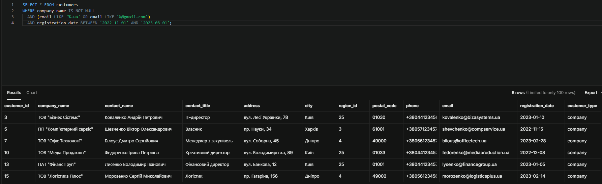<br><br>


#### Завдання 4. Самостійний запит 4 (`IN` + `BETWEEN` + `AND` + `ORDER BY` у таблиці `products`)
Поєднано фільтр за списком категорій `IN (1, 2, 3, 4)`, ціновий діапазон `BETWEEN 15000 AND 45000`, мінімальний залишок на складі `units_in_stock > 5` та сортування результатів `ORDER BY unit_price DESC`.

**SQL-запит:**
```sql
SELECT * FROM products
WHERE category_id IN (1, 2, 3, 4)
  AND unit_price BETWEEN 15000 AND 45000
  AND units_in_stock > 5
ORDER BY unit_price DESC;
```

Результат виконання:
Виведено 10 товарів із чотирьох основних категорій техніки впорядковано від найдорожчого (42 999.00 грн) до найдешевшого (18 999.00 грн).<br><br>

Скріншот:

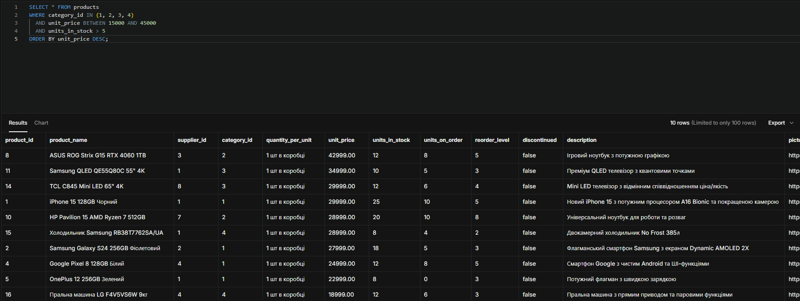<br><br>


#### Завдання 5. Самостійний запит 5 (`IS NOT NULL` + `NOT IN` + `LIKE` у таблиці `employees`)
Застосовано одночасну фільтрацію за наявністю керівника (`reports_to IS NOT NULL`), виключенням міста через `NOT IN ('Київ')` та двома текстовими шаблонами `LIKE` для посади й телефонного коду оператора.

**SQL-запит:**
```sql
SELECT * FROM employees
WHERE reports_to IS NOT NULL
  AND city NOT IN ('Київ')
  AND title LIKE '%Менеджер%'
  AND phone LIKE '+38067%';
```

Результат виконання:
Знайдено 2 регіональних менеджерів з продажу (Мельник Андрій у Львові та Гриценко Наталія у Харкові), які відповідають усім чотирьом умовам.<br><br>

Скріншот:

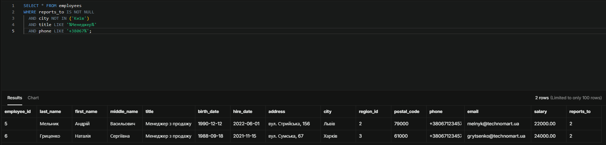<br><br>

### 3.5. Складне сортування та пагінація<br><br>

#### Завдання 1. Сортування за кількома полями (таблиця `products`: категорія за зростанням, ціна за спаданням)
Застосовано багатокритеріальне сортування `ORDER BY category_id ASC, unit_price DESC`, яке спочатку групує товари за ідентифікатором категорії, а в межах кожної категорії впорядковує їх від найдорожчих до найдешевших.

**SQL-запит:**
```sql
SELECT * FROM products
ORDER BY category_id ASC, unit_price DESC;
```

Результат виконання:
Отримано всі 25 товарів, згрупованих за зростанням `category_id` із внутрішнім спаданням ціни `unit_price` у кожній категорії.<br><br>

Скріншот:

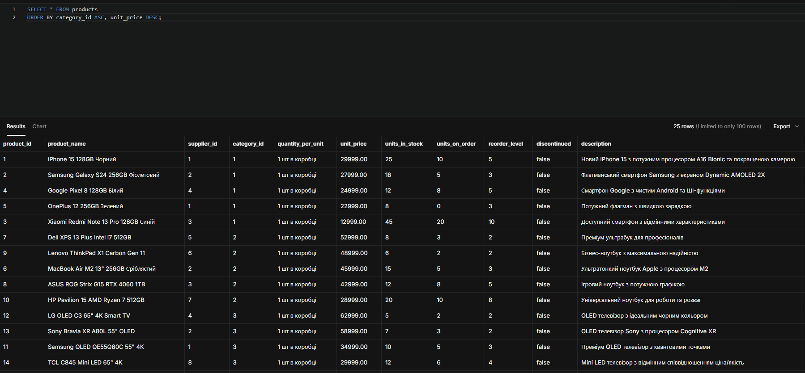<br><br>


#### Завдання 2. Сортування за кількома полями (таблиця `orders`: статус, дата замовлення та вартість доставки)
Використано сортування за трьома стовпцями: спочатку за статусом замовлення в алфавітному порядку (`order_status ASC`), потім за датою від новіших до старіших (`order_date DESC`) і за вартістю доставки за спаданням (`freight DESC`).

**SQL-запит:**
```sql
SELECT * FROM orders
ORDER BY order_status ASC, order_date DESC, freight DESC;
```

Результат виконання:
Виведено 31 замовлення, упорядковані за статусом (`delivered`, `pending`, `processing` тощо), датою оформлення та сумою доставки.<br><br>

Скріншот:

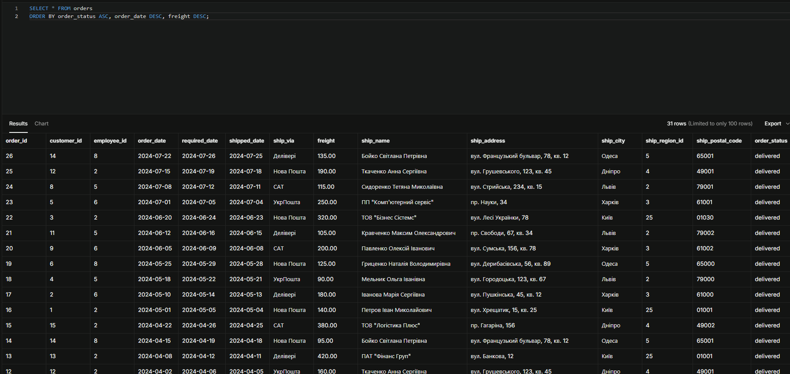<br><br>


#### Завдання 3. Сортування за кількома полями (таблиця `customers`: тип клієнта, місто та контактна особа)
Застосовано комбінацію `ORDER BY customer_type ASC, city ASC, contact_name ASC` для ієрархічного впорядкування клієнтів спочатку за типом (`company` / `individual`), потім за містом і за ПІБ контактної особи.

**SQL-запит:**
```sql
SELECT * FROM customers
ORDER BY customer_type ASC, city ASC, contact_name ASC;
```

Результат виконання:
Система повернула всіх 15 клієнтів, згрупованих за типом клієнта та містом з алфавітним порядком імен контактних осіб усередині груп.<br><br>

Скріншот:

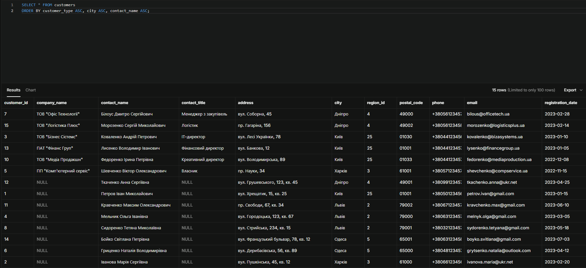<br><br>


#### Завдання 4. Пагінація з OFFSET (таблиця `products`: сторінка №2 по 5 найдорожчих товарів)
Для реалізації пагінації використано `ORDER BY unit_price DESC, product_id ASC` разом із `OFFSET 5` (пропуск перших 5 записів) та `LIMIT 5` (вибірка наступних 5 записів).

**SQL-запит:**
```sql
SELECT * FROM products
ORDER BY unit_price DESC, product_id ASC
LIMIT 5 OFFSET 5;
```

Результат виконання:
Отримано 5 товарів, що відповідають другій сторінці списку найдорожчих позицій каталогу (з 6-ї по 10-ту позицію).<br><br>

Скріншот:

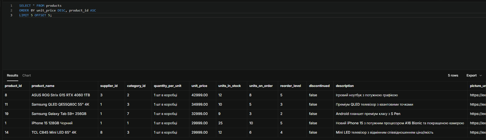<br><br>


#### Завдання 5. Пагінація з OFFSET (таблиця `orders`: сторінка №3 по 4 замовлення)
Застосовано сортування `ORDER BY order_date DESC, order_id DESC` у поєднанні з `OFFSET 8` та `LIMIT 4`, що пропускає перші 8 найновіших замовлень і повертає наступні 4.

**SQL-запит:**
```sql
SELECT * FROM orders
ORDER BY order_date DESC, order_id DESC
LIMIT 4 OFFSET 8;
```

Результат виконання:
Виведено 4 замовлення (`order_id` 23, 22, 21, 20), які формують третю сторінку хронологічного списку.<br><br>

Скріншот:

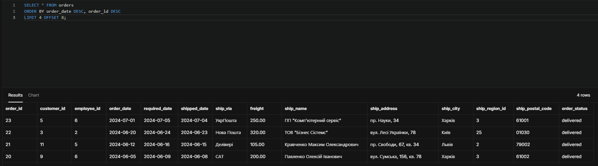<br><br>

## 4. Виконання завдань: Рівень 3 (Складні запити, аналітика та оптимізація)

### 4.1. Складні комбінації LIKE з логічними операторами<br><br>

#### Завдання 1. Знайти товари, в назві яких є "Samsung" або "Apple", але немає слова "чохол"
Використано групування умов `ILIKE '%Samsung%' OR ILIKE '%Apple%'` у дужках та виключення позицій зі словом «чохол» через `AND product_name NOT ILIKE '%чохол%'`.

**SQL-запит:**
```sql
SELECT * FROM products
WHERE (product_name ILIKE '%Samsung%' OR product_name ILIKE '%Apple%')
  AND product_name NOT ILIKE '%чохол%';
```

Результат виконання:
Отримано 5 товарів брендів Samsung та Apple без згадки слова «чохол» у назві.<br><br>

Скріншот:

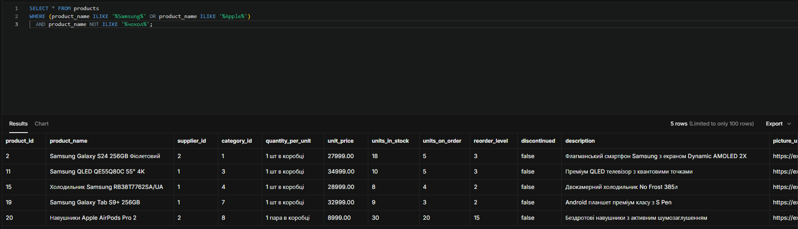<br><br>


#### Завдання 2. Самостійний запит 1 (`ILIKE` + `OR` + `AND NOT` у таблиці `customers`)
Відібрано клієнтів із поштовими адресами на `@gmail.com` або `.ua`, при цьому виключено записи, де `contact_name` починається з `Петров`.

**SQL-запит:**
```sql
SELECT * FROM customers
WHERE (email ILIKE '%@gmail.com' OR email ILIKE '%.ua')
  AND contact_name NOT ILIKE 'Петров%';
```

Результат виконання:
Знайдено 11 клієнтів, які задовольняють умовам за доменом пошти та не починаються на «Петров».<br><br>

Скріншот:

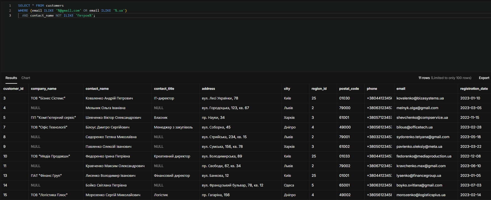<br><br>


#### Завдання 3. Самостійний запит 2 (`ILIKE` + `AND` + `OR` у таблиці `products`)
Поєднано дві групи умов через `AND`: у полі `description` шукається «процесор» або «екран», а в `product_name` — «Pro» або «OLED».

**SQL-запит:**
```sql
SELECT * FROM products
WHERE (description ILIKE '%процесор%' OR description ILIKE '%екран%')
  AND (product_name ILIKE '%Pro%' OR product_name ILIKE '%OLED%');
```

Результат виконання:
Система повернула 2 товари («Sony Bravia XR A80L 55" OLED» та «Nintendo Switch OLED 64GB»), які відповідають обом групам критеріїв.<br><br>

Скріншот:

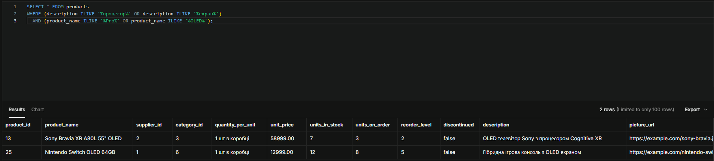<br><br>


#### Завдання 4. Самостійний запит 3 (`LIKE` + `AND` + `NOT LIKE` у таблиці `employees`)
Застосовано фільтрацію за корпоративним доменом `technomart.ua` та послідовно виключено посади зі словом «Менеджер» і ті, що починаються на «Генеральний».

**SQL-запит:**
```sql
SELECT * FROM employees
WHERE email LIKE '%technomart.ua%'
  AND title NOT LIKE '%Менеджер%'
  AND title NOT LIKE 'Генеральний%';
```

Результат виконання:
Отримано 2 співробітників (головний бухгалтер та спеціаліст з логістики), які не є ні менеджерами, ні генеральним директором.<br><br>

Скріншот:

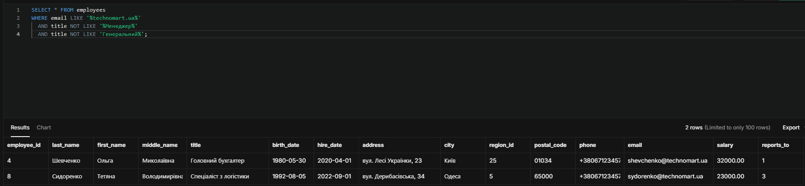<br><br>


#### Завдання 5. Самостійний запит 4 (`LIKE` + `OR` + `AND NOT LIKE` у таблиці `orders`)
Відібрано замовлення на адресу компаній (`ТОВ` або `ПАТ` у `ship_name`), доставка яких здійснюється не службами, що починаються на `Укр`.

**SQL-запит:**
```sql
SELECT * FROM orders
WHERE (ship_name LIKE '%ТОВ%' OR ship_name LIKE '%ПАТ%')
  AND ship_via NOT LIKE 'Укр%';
```

Результат виконання:
Знайдено 7 замовлень для юридичних осіб, відправлених через інші служби доставки (САТ, Делівері, Нова Пошта).<br><br>

Скріншот:

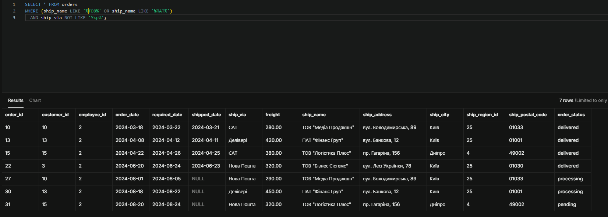<br><br>

### 4.2. Вкладені логічні умови<br><br>

#### Завдання 1. Знайти товари дорожчі 20000 грн (категорії 1 або 2) АБО товари дешевші 5000 грн будь-якої категорії
Використано дужки для виділення першої складної умови (`unit_price > 20000 AND category_id IN (1, 2)`), яка поєднана через `OR` із другою умовою (`unit_price < 5000`) без обмеження за категорією.

**SQL-запит:**
```sql
-- Преміальні товари з 1-ї та 2-ї категорій (> 20000 грн) або бюджетні товари будь-якої категорії (< 5000 грн)
SELECT *
FROM products
WHERE (unit_price > 20000 AND category_id IN (1, 2))
   OR unit_price < 5000;
```

Результат виконання:
Отримано 12 товарів: 9 дорогих позицій із першої та другої категорій і 3 недорогі товари вартістю до 5 000 грн з інших категорій.<br><br>

Скріншот:

<br><br>


#### Завдання 2. Самостійний запит 1 — «Логістичний аудит проблемних відправок» (`orders`)
**Бізнес-логіка:** Відділ логістики відстежує потенційні вузькі місця доставки: перевіряє замовлення, які ще не відправлено (`shipped_date IS NULL`) у статусах `'processing'` або `'pending'`, а також уже доставлені замовлення (`'delivered'`), де вартість доставки перевищує `250` грн.

**SQL-запит:**
```sql
-- Вкладені умови: невідправлені замовлення в обробці/очікуванні АБО доставлені з дорогою доставкою (> 250)
SELECT *
FROM orders
WHERE (shipped_date IS NULL AND order_status IN ('processing', 'pending'))
   OR (order_status = 'delivered' AND freight > 250);
```

Результат виконання:
Знайдено 9 замовлень, які потребують уваги логістів через статус обробки/очікування без дати відправки або високу вартість перевезення.<br><br>

Скріншот:

<br><br>


#### Завдання 3. Самостійний запит 2 — «Пошук ключових корпоративних контактів за регіонами та датами» (`customers`)
**Бізнес-логіка:** Account-менеджер формує вибірку клієнтів-компаній (`company_name IS NOT NULL`) для персонального супроводу: бере давніших клієнтів (реєстрація до `2023-02-01`) з Києва або Харкова, а також компанії зі Львова чи Дніпра, для яких у картці вказано посаду контактної особи.

**SQL-запит:**
```sql
-- Вкладені умови групують два сценарії відбору клієнтів-компаній з заповненою назвою
SELECT *
FROM customers
WHERE company_name IS NOT NULL
  AND (
    (city IN ('Київ', 'Харків') AND registration_date < '2023-02-01')
    OR (city IN ('Львів', 'Дніпро') AND contact_title IS NOT NULL)
  );
```

Результат виконання:
Система повернула 6 корпоративних клієнтів, що відповідають заданим регіонально-часовим та контактним критеріям.<br><br>

Скріншот:

<br><br>


#### Завдання 4. Самостійний запит 3 — «Контроль дефіциту топ-техніки та популярних новинок у дорозі» (`products`)
**Бізнес-логіка:** Товарний аналітик контролює активний асортимент (`NOT discontinued`), щоб вчасно реагувати на малий залишок (`< 10` од.) дорогих товарів (`> 20000` грн) у ключових категоріях `1`, `2`, `6` або відстежувати недорогі позиції (`< 15000` грн), за якими вже їде велика партія постачальника (`units_on_order >= 10`).

**SQL-запит:**
```sql
-- Вкладені умови для активних товарів: дефіцит дорогих позицій у топ-категоріях АБО популярні недорогі позиції в дорозі
SELECT *
FROM products
WHERE NOT discontinued
  AND (
    (category_id IN (1, 2, 6) AND unit_price > 20000 AND units_in_stock < 10)
    OR (unit_price < 15000 AND units_on_order >= 10)
  );
```

Результат виконання:
Отримано 8 активних товарів, які потрапили під один із двох аналітичних сценаріїв контролю залишків і поставок.<br><br>

Скріншот:

<br><br>

### 4.3. Комплексні аналітичні запити<br><br>

#### Завдання 1. Самостійний запит 1 — «Радар ліквідної техніки з високим чеком і свіжою поставкою» (звіт товарів із 6 умовами)
**Бізнес-логіка:** Керівник напрямку продажів формує аналітичний зріз активних товарів (`NOT discontinued`), які коштують від `10 000` до `50 000` грн (`BETWEEN`), належать до основних категорій `1, 2, 3, 4` (`IN`), мають на складі мінімум `5` одиниць, уже замовлені в постачальників (`units_on_order > 0`) і не містять у назві слова «чохол» (`NOT ILIKE`), з упорядкуванням від найдорожчих до найдешевших.

**SQL-запит:**
```sql
-- Комплексний аналітичний звіт товарів: активні, ціна 10k-50k, категорії 1-4, залишок >= 5, є замовлення в дорозі, без "чохол"
SELECT product_id,
       product_name,
       category_id,
       unit_price,
       units_in_stock,
       units_on_order
FROM products
WHERE NOT discontinued
  AND unit_price BETWEEN 10000 AND 50000
  AND category_id IN (1, 2, 3, 4)
  AND units_in_stock >= 5
  AND units_on_order > 0
  AND product_name NOT ILIKE '%чохол%'
ORDER BY unit_price DESC, product_name ASC;
```

Результат виконання:
Отримано 12 ліквідних товарних позицій, які одночасно відповідають усім шести критеріям фільтрації та впорядковані за спаданням ціни.<br><br>

Скріншот:

<br><br>


#### Завдання 2. Самостійний запит 2 — «Сегментація клієнтів з міських центрів для B2B/B2C-кампанії» (аналіз клієнтської бази)
**Бізнес-логіка:** Відділ розвитку бізнесу аналізує клієнтську базу в ключових містах (`'Київ'`, `'Львів'`, `'Харків'`, `'Одеса'`, `'Дніпро'`), відбираючи тих, хто зареєструвався з початку `2023` року (`>= '2023-01-01'`), має поштову скриньку з доменом `.ua` або `@gmail.com` та або є юридичною особою (`customer_type = 'company'`), або ж є фізичною особою з Києва чи Львова.

**SQL-запит:**
```sql
-- Аналіз клієнтської бази: ключові міста, реєстрація з 2023 року, актуальні поштові домени та вкладений сегмент клієнтів
SELECT customer_id,
       contact_name,
       company_name,
       customer_type,
       city,
       email,
       registration_date
FROM customers
WHERE city IN ('Київ', 'Львів', 'Харків', 'Одеса', 'Дніпро')
  AND registration_date >= '2023-01-01'
  AND (email LIKE '%.ua' OR email LIKE '%@gmail.com')
  AND (
    customer_type = 'company'
    OR (customer_type = 'individual' AND city IN ('Київ', 'Львів'))
  )
ORDER BY registration_date DESC, contact_name ASC;
```

Результат виконання:
Система повернула 8 клієнтів із цільового сегмента, відсортованих за датою реєстрації від новіших до давніших та за ПІБ.<br><br>

Скріншот:

<br><br>

### 4.4. Дослідження даних та пошук закономірностей<br><br>

#### Завдання 1. Ціновий сегмент «Бюджетний вхід у каталог (до 10 000 грн)» (`products`)
**Бізнес-логіка:** Категорійний менеджер оцінює стартові позиції з ціною до `10 000` грн, щоб перевірити доступність товарів для імпульсних покупок та акційних пропозицій.

**SQL-запит:**
```sql
-- Ціновий сегмент "Бюджетний": активні товари до 10 000 грн, впорядковані за зростанням ціни
SELECT product_id,
       product_name,
       category_id,
       unit_price,
       units_in_stock
FROM products
WHERE NOT discontinued
  AND unit_price <= 10000
ORDER BY unit_price ASC, product_name ASC;
```

Результат виконання:
Отримано 4 активні товари бюджетного сегмента (від 699.00 до 8 999.00 грн) із високими складськими залишками.<br><br>

Скріншот:

<br><br>


#### Завдання 2. Ціновий сегмент «Середній чек та масовий попит (10 000 – 30 000 грн)» (`products`)
**Бізнес-логіка:** Комерційний відділ аналізує основний обсяг асортименту у середньому ціновому діапазоні (`10 000` – `30 000` грн), де поєднуються помірна вартість і стабільний оборот.

**SQL-запит:**
```sql
-- Ціновий сегмент "Середній": товари від 10 000 до 30 000 грн з аналізом залишків і замовлень
SELECT product_id,
       product_name,
       category_id,
       unit_price,
       units_in_stock,
       units_on_order
FROM products
WHERE unit_price BETWEEN 10000 AND 30000
ORDER BY unit_price DESC, units_in_stock DESC;
```

Результат виконання:
Система повернула 13 товарів середнього цінового сегмента, відсортованих за спаданням ціни та складського залишку.<br><br>

Скріншот:

<br><br>


#### Завдання 3. Ціновий сегмент «Верхній середній клас (30 001 – 45 000 грн)» (`products`)
**Бізнес-логіка:** Маркетолог вивчає позиції верхнього середнього сегмента (`> 30 000` та `<= 45 000` грн), щоб підібрати моделі для програм розстрочки та трейд-ін.

**SQL-запит:**
```sql
-- Ціновий сегмент "Верхній середній": товари строго дорожчі за 30 000 грн і до 45 000 грн включно
SELECT product_id,
       product_name,
       category_id,
       unit_price,
       units_in_stock
FROM products
WHERE unit_price > 30000
  AND unit_price <= 45000
ORDER BY unit_price DESC;
```

Результат виконання:
Знайдено 3 товари верхнього середнього сегмента (ігровий ноутбук ASUS, QLED-телевізор Samsung та планшет Samsung Galaxy Tab S9+).<br><br>

Скріншот:

<br><br>


#### Завдання 4. Ціновий сегмент «Флагманський преміум (понад 45 000 грн)» (`products`)
**Бізнес-логіка:** Керівництво контролює найдорожчі флагманські пристрої (`> 45 000` грн), де кожна одиниця має високу маржинальність і вимагає точного контролю наявності на складі.

**SQL-запит:**
```sql
-- Ціновий сегмент "Преміум": флагманські товари дорожчі за 45 000 грн
SELECT product_id,
       product_name,
       category_id,
       unit_price,
       units_in_stock,
       units_on_order
FROM products
WHERE unit_price > 45000
ORDER BY unit_price DESC, product_name ASC;
```

Результат виконання:
Отримано 5 флагманських позицій із ціною від 45 999.00 до 62 999.00 грн, упорядкованих за спаданням вартості.<br><br>

Скріншот:

<br><br>


#### Завдання 5. Географічний зріз «Столичний центр тяжіння (клієнти з Києва)» (`customers`)
**Бізнес-логіка:** Команда продажів аналізує київський сегмент, щоб побачити співвідношення компаній і приватних клієнтів у столиці та оцінити потенціал самовивозу й кур'єрської доставки.

**SQL-запит:**
```sql
-- Географічний зріз: усі клієнти з міста Київ, згруповані візуально через сортування за типом клієнта
SELECT customer_id,
       contact_name,
       company_name,
       customer_type,
       address,
       registration_date
FROM customers
WHERE city = 'Київ'
ORDER BY customer_type ASC, registration_date DESC;
```

Результат виконання:
Виведено 4 клієнтів із Києва (3 компанії та 1 приватного клієнта), впорядкованих за типом і датою реєстрації.<br><br>

Скріншот:

<br><br>


#### Завдання 6. Географічний зріз «Західний хаб (львівська аудиторія)» (`customers`)
**Бізнес-логіка:** Регіональний координатор досліджує клієнтів у Львові, щоб перевірити активність західного напрямку та виявити локальні контакти для партнерських пропозицій.

**SQL-запит:**
```sql
-- Географічний зріз: клієнти зі Львова, відсортовані за датою реєстрації від новіших до старіших
SELECT customer_id,
       contact_name,
       company_name,
       customer_type,
       email,
       registration_date
FROM customers
WHERE city = 'Львів'
ORDER BY registration_date DESC, contact_name ASC;
```

Результат виконання:
Отримано 3 клієнтів зі Львова (усі типу `individual`), відсортованих за спаданням дати реєстрації.<br><br>

Скріншот:

<br><br>


#### Завдання 7. Географічний зріз «Схід та Південь (Харків, Одеса та Дніпро)» (`customers`)
**Бізнес-логіка:** Логісти та маркетологи порівнюють клієнтів у трьох великих нестоличних центрах (`Харків`, `Одеса`, `Дніпро`), щоб оцінити географічне покриття поза Києвом і Львовом.

**SQL-запит:**
```sql
-- Географічний зріз: клієнти з Харкова, Одеси та Дніпра з упорядкуванням за містом і типом клієнта
SELECT customer_id,
       city,
       contact_name,
       company_name,
       customer_type,
       registration_date
FROM customers
WHERE city IN ('Харків', 'Одеса', 'Дніпро')
ORDER BY city ASC, customer_type ASC, contact_name ASC;
```

Результат виконання:
Система повернула 8 клієнтів із Дніпра, Одеси та Харкова, згрупованих за містом і типом клієнта.<br><br>

Скріншот:

<br><br>


#### Завдання 8. Географічний пошук закономірностей «Поза великою п'ятіркою міст» (`customers`)
**Бізнес-логіка:** Аналітик перевіряє, чи є в базі клієнти за межами п'яти основних міст (`Київ`, `Львів`, `Харків`, `Одеса`, `Дніпро`) або з порожнім полем міста, щоб виявити нетипові локації чи прогалини в заповненні даних.

**SQL-запит:**
```sql
-- Географічний пошук закономірностей: клієнти поза основними 5 містами або без вказаного міста
SELECT customer_id,
       contact_name,
       company_name,
       city,
       customer_type,
       registration_date
FROM customers
WHERE city IS NULL
   OR city NOT IN ('Київ', 'Львів', 'Харків', 'Одеса', 'Дніпро')
ORDER BY city ASC NULLS FIRST, customer_id ASC;
```

Результат виконання:
Запит повернув 0 рядків (`No rows returned`), що підтверджує: усі клієнти у вибірці зосереджені виключно в п'яти ключових містах і не мають пропущеного міста.<br><br>

Скріншот:

<br><br>


#### Завдання 9. Часовий патерн «Старт року (замовлення Q1 2024: січень–березень)» (`orders`)
**Бізнес-логіка:** Фінансовий аналітик оцінює стартову активність клієнтів у першому кварталі 2024 року, щоб порівняти обсяг, регулярність і вартість доставки замовлень у перші три місяці року.

**SQL-запит:**
```sql
-- Часовий патерн (Q1 2024): замовлення з 1 січня по 31 березня 2024 року у хронологічному порядку
SELECT order_id,
       customer_id,
       order_date,
       shipped_date,
       ship_via,
       freight,
       order_status
FROM orders
WHERE order_date BETWEEN '2024-01-01' AND '2024-03-31'
ORDER BY order_date ASC, order_id ASC;
```

Результат виконання:
Отримано 11 доставлених замовлень (`order_id` з 1 по 11), оформлених у січні–березні 2024 року в хронологічному порядку.<br><br>

Скріншот:

<br><br>


#### Завдання 10. Часовий патерн «Весняний сплеск (замовлення Q2 2024: квітень–червень)» (`orders`)
**Бізнес-логіка:** Керівник відділу продажів перевіряє динаміку замовлень у другому кварталі 2024 року, щоб побачити зміни в вартості доставки (`freight`) та способах пересилання в весняно-літній перехід.

**SQL-запит:**
```sql
-- Часовий патерн (Q2 2024): замовлення з 1 квітня по 30 червня 2024 року
SELECT order_id,
       customer_id,
       order_date,
       shipped_date,
       ship_via,
       freight,
       order_status
FROM orders
WHERE order_date BETWEEN '2024-04-01' AND '2024-06-30'
ORDER BY order_date ASC, order_id ASC;
```

Результат виконання:
Виведено 11 доставлених замовлень (`order_id` з 12 по 22), оформлених протягом другого кварталу 2024 року.<br><br>

Скріншот:

<br><br>


#### Завдання 11. Часовий патерн «Літня хвиля та поточні статуси (замовлення з липня 2024 року)» (`orders`)
**Бізнес-логіка:** Операційний директор аналізує найсвіжіші замовлення (`>= '2024-07-01'`), щоб відстежити перехід від завершених доставок до замовлень, що ще перебувають у роботі.

**SQL-запит:**
```sql
-- Часовий патерн (від липня 2024): новіші замовлення та їхні актуальні статуси
SELECT order_id,
       customer_id,
       order_date,
       required_date,
       shipped_date,
       freight,
       order_status
FROM orders
WHERE order_date >= '2024-07-01'
ORDER BY order_date DESC, order_id DESC;
```

Результат виконання:
Знайдено 9 замовлень із липня–серпня 2024 року, серед яких є як виконані (`delivered`, `shipped`), так і поточні у статусах `processing` та `pending`.<br><br>

Скріншот:

<br><br>


#### Завдання 12. Часовий патерн «Розрив між оформленням і відправкою (>= 3 дні)» (`orders`)
**Бізнес-логіка:** Логістичний аналітик перевіряє відправлені замовлення (`shipped_date IS NOT NULL`), де між датою замовлення (`order_date`) і датою відправки (`shipped_date`) минуло `3` і більше днів, щоб виявити затримки на складі чи при передачі перевізнику.

**SQL-запит:**
```sql
-- Часовий патерн затримок: відправлені замовлення, де відправка відбулася через 3+ дні після оформлення
SELECT order_id,
       customer_id,
       order_date,
       shipped_date,
       (shipped_date - order_date) AS days_to_ship,
       ship_via,
       order_status
FROM orders
WHERE shipped_date IS NOT NULL
  AND (shipped_date - order_date) >= 3
ORDER BY days_to_ship DESC, order_date DESC;
```

Результат виконання:
Виявлено закономірність: більшість відправлених замовлень передаються у доставку рівно за 3 дні, а замовлення №5 (`2024-02-10` -> `2024-02-14`) мало найбільший інтервал у 4 дні.<br><br>

Скріншот:

<br><br>

### 4.5. Креативні завдання<br><br>

#### Завдання 1. Нестандартний запит 1 — «Анти-кризовий детектор (некруглі ціни та дисбаланс запасів)» (`products`)
**Бізнес-логіка:** Фінансовий контролер шукає нестандартні товарні позиції в активному каталозі (`NOT discontinued`), де ціна закінчується не на `.99`, і при цьому або є «заморожений» запас (`units_in_stock >= 20` при `units_on_order = 0`), або навпаки — товар на межі вичерпання (`units_in_stock <= reorder_level`) і при цьому в дорозі вже їде партія від постачальника (`units_on_order >= 5`).

**SQL-запит:**
```sql
-- Нестандартна цінова + складська логіка: нетипове закінчення ціни та два сценарії дисбалансу запасів
SELECT product_id,
       product_name,
       category_id,
       unit_price,
       units_in_stock,
       units_on_order,
       reorder_level
FROM products
WHERE NOT discontinued
  AND CAST(unit_price AS text) NOT LIKE '%.99'
  AND (
    (units_in_stock >= 20 AND units_on_order = 0)
    OR (units_in_stock <= reorder_level AND units_on_order >= 5)
  )
ORDER BY unit_price DESC;
```

Результат виконання:
Запит виконано успішно, повернуто 0 рядків (`Success. No rows returned`), що означає відсутність активних позицій із ціною не на `.99`, які одночасно підпадають під описані сценарії дисбалансу залишків.<br><br>

Скріншот:

<br><br>


#### Завдання 2. Нестандартний запит 2 — «Логістичний детектив (аномалії статусів і дат відправки)» (`orders`)
**Бізнес-логіка:** Керівник служби якості перевіряє замовлення на аномалії в операційному циклі: шукає випадки, коли дата відправки заповнена (`shipped_date IS NOT NULL`), але статус ще не `'delivered'`, або доставка відбулася в день оформлення з вартістю `> 100` грн, або статус `'shipped'` без дати відправки.

**SQL-запит:**
```sql
-- Пошук аномалій життєвого циклу замовлення та логістики через вкладені умови стану й дат
SELECT order_id,
       customer_id,
       order_date,
       shipped_date,
       ship_via,
       freight,
       order_status
FROM orders
WHERE (shipped_date IS NOT NULL AND order_status <> 'delivered')
   OR (shipped_date = order_date AND freight > 100)
   OR (shipped_date IS NULL AND order_status = 'shipped')
ORDER BY order_date DESC;
```

Результат виконання:
Виявлено 1 замовлення (`order_id = 29`), яке має заповнену дату відправки (`2024-08-17`) та поточний статус `shipped` (ще не переведено у `delivered`).<br><br>

Скріншот:

<br><br>


#### Завдання 3. Нестандартний запит 3 — «Цифровий портрет клієнта (аудит узгодженості даних)» (`customers`)
**Бізнес-логіка:** CRM-адміністратор проводить аудит якості даних у базі клієнтів: виявляє випадки, коли заповнена назва компанії (`company_name IS NOT NULL`), але використовується безкоштовна пошта (`@gmail.com`, `@ukr.net`, `@outlook.com`), або компанія відсутня (`company_name IS NULL`), але вказано посаду контактної особи (`contact_title IS NOT NULL`).

**SQL-запит:**
```sql
-- Аудит консистентності даних клієнтів: безкоштовні пошти у компаній або посада у клієнта без компанії
SELECT customer_id,
       contact_name,
       company_name,
       contact_title,
       customer_type,
       email,
       city
FROM customers
WHERE (
    company_name IS NOT NULL
    AND (email LIKE '%@gmail.com' OR email LIKE '%@ukr.net' OR email LIKE '%@outlook.com')
  )
   OR (
    company_name IS NULL
    AND contact_title IS NOT NULL
  )
ORDER BY customer_id ASC;
```

Результат виконання:
Запит повернув 0 рядків (`Success. No rows returned`), що підтверджує відсутність суперечностей між наявністю компанії, типом поштового домену та заповненістю посади контактної особи.<br><br>

Скріншот:

<br><br>


#### Завдання 4. Нестандартний запит 4 — «Кадрова матриця (ієрархія в столиці та досвід у регіонах)» (`employees`)
**Бізнес-логіка:** HR-аналітик досліджує оргструктуру та кадровий склад: відбирає співробітників у Києві, які підпорядковуються не першому керівнику (`reports_to IS NOT NULL AND reports_to <> 1`), або співробітників поза Києвом, які прийшли до `2022-01-01` чи отримують зарплату понад `23 000` грн.

**SQL-запит:**
```sql
-- Нестандартний кадровий зріз: нетипова ієрархія в Києві або досвідчені/високооплачувані фахівці в регіонах
SELECT employee_id,
       last_name,
       first_name,
       title,
       city,
       hire_date,
       salary,
       reports_to
FROM employees
WHERE (
    city = 'Київ'
    AND reports_to IS NOT NULL
    AND reports_to <> 1
  )
   OR (
    city <> 'Київ'
    AND (hire_date < '2022-01-01' OR salary > 23000)
  )
ORDER BY salary DESC, employee_id ASC;
```

Результат виконання:
Отримано 2 співробітників (Наталія Гриценко у Харкові та Дмитро Білоус у Києві), які відповідають заданим комбінаціям умов.<br><br>

Скріншот:

<br><br>


#### Завдання 5. Нестандартний запит 5 — «Омніканальний радар замовлень (висока доставка та комбіновані фільтри)» (`orders`)
**Бізнес-логіка:** Комерційний аналітик відбирає замовлення з вартістю доставки `>= 120` грн, які або оформлені в парні місяці (`-02-`, `-04-`, `-06-`, `-08-`) із доставкою не «Новою Поштою», або адресовані компаніям (`ТОВ`, `ПАТ`, `ПП`) у великих містах і відправлені після `2024-03-01`.

**SQL-запит:**
```sql
-- Комбінований аналіз замовлень: доставка >= 120 та два складні сценарії за датою, перевізником і типом отримувача
SELECT order_id,
       customer_id,
       order_date,
       shipped_date,
       ship_via,
       ship_name,
       ship_city,
       freight,
       order_status
FROM orders
WHERE freight >= 120
  AND (
    (
      (order_date::text LIKE '%-02-%' OR order_date::text LIKE '%-04-%' OR order_date::text LIKE '%-06-%' OR order_date::text LIKE '%-08-%')
      AND ship_via <> 'Нова Пошта'
    )
    OR (
      (ship_name LIKE '%ТОВ%' OR ship_name LIKE '%ПАТ%' OR ship_name LIKE '%ПП%')
      AND ship_city IN ('Київ', 'Харків', 'Одеса', 'Дніпро', 'Львів')
      AND shipped_date > '2024-03-01'
    )
  )
ORDER BY freight DESC, order_date DESC;
```

Результат виконання:
Система повернула 12 замовлень із доставкою від 120 грн, які підпадають під один із двох комплексних бізнес-сценаріїв.<br><br>

Скріншот:

<br><br>

## 5. Контрольні запитання

### 1. Що таке SQL і для чого він призначений? Поясніть різницю між декларативною та імперативною мовами програмування на прикладі SQL.
**SQL (Structured Query Language)** — це стандартна мова для роботи з реляційними базами даних. Вона використовується для створення та зміни структури таблиць (DDL), вставки, оновлення та видалення даних (DML), вибірки й аналізу даних (DQL), а також керування правами доступу та транзакціями (DCL, TCL).

Різниця між парадигмами на прикладі SQL:
* **Декларативний підхід (властивий SQL):** ми описуємо *який саме результат* хочемо отримати, а не покроковий алгоритм його обчислення. Наприклад, у запиті `SELECT product_name, unit_price FROM products WHERE unit_price > 20000 ORDER BY unit_price DESC;` ми вказуємо потрібні поля, умову фільтрації та порядок сортування, а планувальник запитів PostgreSQL сам обирає оптимальний план читання таблиці чи індексів.
* **Імперативний підхід (наприклад, C, C++, Python):** ми явно задаємо *послідовність дій і керуючих конструкцій* (цикли, умови, тимчасові змінні, індекси масивів), крок за кроком описуючи, як саме програма має дійти до результату.

### 2. Опишіть порядок виконання частин SELECT запиту. Чому важливо розуміти цю послідовність при написанні складних запитів?
У SQL порядок написання клаузул у тексті запиту відрізняється від логічного порядку їх виконання рушієм бази даних:
1. `FROM` / `JOIN` — визначення вихідних таблиць і об'єднання даних.
2. `WHERE` — фільтрація окремих рядків до групування.
3. `GROUP BY` — об'єднання рядків у групи за заданими стовпцями.
4. `HAVING` — фільтрація вже сформованих груп (часто з агрегатними функціями).
5. `SELECT` — обчислення виразів, псевдонімів (`AS`) і формування підсумкового набору стовпців.
6. `DISTINCT` — видалення дублікатів рядків.
7. `ORDER BY` — фінальне впорядкування результату.
8. `LIMIT` / `OFFSET` — відсікання та пагінація вибірки.

Розуміти цю послідовність критично важливо, оскільки:
* у `WHERE` ще недоступні псевдоніми стовпців, задані в `SELECT` (на відміну від `ORDER BY`, який виконується після `SELECT`);
* фільтрація в `WHERE` відбувається *до* групування, тому агрегатні умови потрібно ставити в `HAVING`;
* від порядку `ORDER BY` та `LIMIT`/`OFFSET` залежить, які саме рядки потраплять на конкретну сторінку пагінації.

### 3. У чому різниця між операторами = та LIKE? Наведіть приклади, коли доцільно використовувати кожен з них.
Оператор `=` перевіряє **точну рівність** значень (для чисел, дат, булевих полів або точних рядків), тоді як `LIKE` виконує **шаблонний пошук у рядках** за допомогою спеціальних підстановочних символів (`%` та `_`).
* Використовувати `=` доцільно при пошуку за ідентифікатором, статусом, містом або точною назвою: `WHERE city = 'Київ'` або `WHERE order_status = 'delivered'`.
* Використовувати `LIKE` доцільно при пошуку за префіксом, суфіксом, фрагментом тексту чи маскою: `WHERE email LIKE '%@gmail.com'` або `WHERE product_name LIKE 'Samsung%'`.

### 4. Поясніть призначення wildcards % та _ в операторі LIKE. Чи можна їх комбінувати в одному шаблоні?
У шаблонах `LIKE` / `ILIKE`:
* `%` (відсоток) — позначає **будь-яку послідовність із нуля, одного або багатьох символів**;
* `_` (нижнє підкреслення) — позначає **рівно один довільний символ**.

Так, `%` та `_` можна вільно комбінувати в одному шаблоні. Наприклад, шаблон `A_c%` знайде будь-який рядок, де перший символ — `A`, другий — довільний один символ, третій — `c`, а далі може бути будь-яка кількість будь-яких символів.

### 5. Чому оператор WHERE company_name = NULL не працює для пошуку записів з відсутніми значеннями? Як правильно працювати з NULL значеннями в SQL?
У тризначній логіці SQL `NULL` означає «невідоме або відсутнє значення», а не конкретне значення чи порожній рядок. Порівняння `company_name = NULL` не повертає `TRUE` навіть для рядків із `NULL` — результат виразу виявляється `UNKNOWN` (невизначеним), тому рядки не відбираються.

Для коректної роботи з відсутніми значеннями використовують:
* `IS NULL` — для пошуку рядків із відсутнім значенням (`WHERE company_name IS NULL`);
* `IS NOT NULL` — для пошуку заповнених значень (`WHERE shipped_date IS NOT NULL`);
* функції `COALESCE(col, 'default')` або `IS DISTINCT FROM` — коли потрібно підставити значення за замовчуванням або безпечно порівняти два вирази з урахуванням `NULL`.

### 6. Поясніть різницю між логічними операторами AND та OR. Як впливає пріоритет операторів на результат запиту A OR B AND C?
* `AND` (логічне «І») повертає істину лише тоді, коли **обидві** умови істинні.
* `OR` (логічне «АБО») повертає істину, якщо істинна **хоча б одна** з умов.

Оператор `AND` має **вищий пріоритет**, ніж `OR` (а `NOT` — найвищий серед цих трьох). Тому запит `A OR B AND C` обчислюється як:
`A OR (B AND C)`
тобто умова `A` спрацьовує сама по собі, навіть якщо `B AND C` хибне. Якщо ж за логікою завдання потрібно спочатку об'єднати `A OR B`, а потім застосувати `C`, необхідно явно написати дужки: `(A OR B) AND C`.

### 7. У яких випадках оператор BETWEEN включає граничні значення, а в яких — ні? Як написати умову для виключення границь діапазону?
У стандарті SQL та в PostgreSQL оператор `BETWEEN x AND y` **завжди включає обидві граничні значення** і є еквівалентом виразу `>= x AND <= y` (для числових, часових та текстових типів).

Щоб **виключити** обидві межі діапазону, використовують строгі нерівності:
```sql
WHERE unit_price > 10000 AND unit_price < 30000;
```
Якщо ж потрібно виключити лише одну межу (наприклад, ліву чи праву), записують комбінацію `>` або `<` з `<=` чи `>=` відповідно.

### 8. Для чого використовується LIMIT та OFFSET? Напишіть формулу для розрахунку OFFSET при пагінації, якщо відома сторінка та розмір сторінки.
* `LIMIT N` обмежує максимальну кількість рядків, яку поверне запит (`N`).
* `OFFSET M` пропускає перші `M` рядків перед початком вибірки.
Разом вони дозволяють реалізувати посторінкову навігацію (пагінацію) по великих наборах даних.

Формула розрахунку `OFFSET` (де `page` — номер поточної сторінки, починаючи з `1`, а `page_size` — кількість записів на одній сторінці):
```text
OFFSET = (page - 1) * page_size
```
Наприклад, для 3-ї сторінки (`page = 3`) при розмірі сторінки 4 записи (`page_size = 4`): `OFFSET = (3 - 1) * 4 = 8`.

### 9. Чому важливо використовувати ORDER BY разом з LIMIT? Що може статися, якщо не вказати сортування при обмеженні кількості записів?
Таблиця в реляційній базі даних є невпорядкованою множиною рядків. Якщо використати `LIMIT` і `OFFSET` **без `ORDER BY`**, PostgreSQL може повертати рядки в довільному або змінному фізичному порядку (наприклад, після оновлення даних, вакууму чи зміни плану виконання запиту). У результаті:
* запити на кшталт «топ-5 найдорожчих товарів» або «останні 10 замовлень» стають непередбачуваними;
* під час пагінації записи можуть дублюватися на сусідніх сторінках або пропускатися.
Крім того, якщо значення поля сортування повторюється, корисно додавати вторинний унікальний ключ (наприклад, `ORDER BY unit_price DESC, product_id ASC`) для повної детермінованості.

### 10. Поясніть різницю між LIKE та ILIKE в PostgreSQL. В яких ситуаціях кожен з них буде більш доцільним?
* `LIKE` виконує пошук **з урахуванням регістру** символів (`'Samsung'` не збіжиться з `'samsung'`).
* `ILIKE` (розширення PostgreSQL) виконує пошук **без урахування регістру** символів (`'pro'` знайде і `'Pro'`, і `'PRO'`, і `'pro'`).

`LIKE` доцільно застосовувати, коли регістр має значення (наприклад, специфічні коди, абревіатури чи оптимізація через стандартні індекси), а `ILIKE` — у пошукових рядках каталогу або фільтрах, де користувач може ввести назву чи ключове слово у будь-якому регістрі.

### 11. Як PostgreSQL обробляє NULL значення при сортуванні за замовчуванням? Як це можна змінити за допомогою NULLS FIRST/LAST?
За замовчуванням у PostgreSQL:
* при сортуванні за зростанням (`ASC`) значення `NULL` розміщуються **в кінці** (`NULLS LAST`);
* при сортуванні за спаданням (`DESC`) значення `NULL` розміщуються **на початку** (`NULLS FIRST`).

Цю поведінку можна явно змінити ключовими словами `NULLS FIRST` або `NULLS LAST` після напрямку сортування:
```sql
SELECT * FROM customers
ORDER BY city ASC NULLS FIRST, customer_id ASC;
```

### 12. Наведіть приклад бізнес-сценарію, де потрібно використати складну комбінацію умов з дужками. Поясніть, як неправильне групування логічних операторів може призвести до некоректних результатів.
**Бізнес-сценарій:** Відділу продажів «ТехноМарту» потрібно знайти замовлення, які або ще не відправлено (`shipped_date IS NULL`) і перебувають у статусі `'processing'` чи `'pending'`, або вже доставлені (`order_status = 'delivered'`) з вартістю доставки понад `250` грн.

Коректний запит із дужками:
```sql
SELECT * FROM orders
WHERE (shipped_date IS NULL AND order_status IN ('processing', 'pending'))
   OR (order_status = 'delivered' AND freight > 250);
```

**Наслідок неправильного групування:** якщо забути дужки і написати:
```sql
SELECT * FROM orders
WHERE shipped_date IS NULL AND order_status IN ('processing', 'pending') OR order_status = 'delivered' AND freight > 250;
```
то завдяки вищому пріоритету `AND` умова `order_status = 'delivered'` об'єднається з `freight > 250`, а не з першою частиною — і система може відібрати рядки, які зовсім не відповідають задуманому бізнес-правилу (наприклад, замовлення без дати відправки чи зі зміщеними умовами по статусах). Дужки роблять логіку прозорою, явною та захищеною від помилок пріоритету.

---

## Висновки

**Самооцінка:** 5/5

**Обґрунтування:** Під час виконання лабораторної роботи на базі «ТехноМарт» у PostgreSQL я розібрався, як нормально фільтрувати та витягувати потрібні дані, а не дивитися на всю таблицю підряд. Навчився впевнено працювати з `LIKE` та `ILIKE` з `%` і `_`, коректно обробляти `NULL` через `IS NULL` / `IS NOT NULL`, правильно будувати складні умови з дужками (`AND`, `OR`, `NOT`, `IN`, `BETWEEN`) і зрозумів, чому для `LIMIT` та `OFFSET` обов'язково потрібен `ORDER BY`. У третьому рівні вже попрактикувався дивитися на запити під кутом бізнес-задач: аналізував цінові сегменти товарів, географію клієнтів, строки доставки замовлень і перевіряв дані на нестиковки. Усі завдання рівнів 1–3 виконано, задокументовано скріншотами та підкріплено поясненнями.