### Лабораторна робота 2. Створення складних SQL запитів
## Загальна інформація
Здобувач освіти: [Бугайчук Дмитро Петрович]<br>
Група: [ІПЗ-32]<br>
Обраний рівень складності: [3]

## 1. Виконання завдань: Рівень 1

### 1.1. З'єднання таблиць

#### Завдання 1.1: INNER JOIN - список товарів з категоріями та постачальниками
Для отримання каталогу товарів разом із назвами їхніх категорій та постачальників використано два послідовні `INNER JOIN` за зовнішніми ключами `category_id` та `supplier_id`, а також сортування за категорією та назвою товару.

**SQL-запит:**
```sql
SELECT 
    p.product_id,
    p.product_name,
    c.category_name,
    s.company_name AS supplier_name,
    p.unit_price,
    p.units_in_stock
FROM products p
INNER JOIN categories c ON p.category_id = c.category_id
INNER JOIN suppliers s ON p.supplier_id = s.supplier_id
ORDER BY c.category_name, p.product_name;
```

Результат виконання:
Запит повернув перелік усіх 25 товарів інтернет-магазину з актуальними цінами, залишками на складі, назвами категорій та компаній-постачальників. Товари з категорій, у яких немає позицій у таблиці `products`, до вибірки не потрапили через умову внутрішнього з'єднання.

Скріншот:

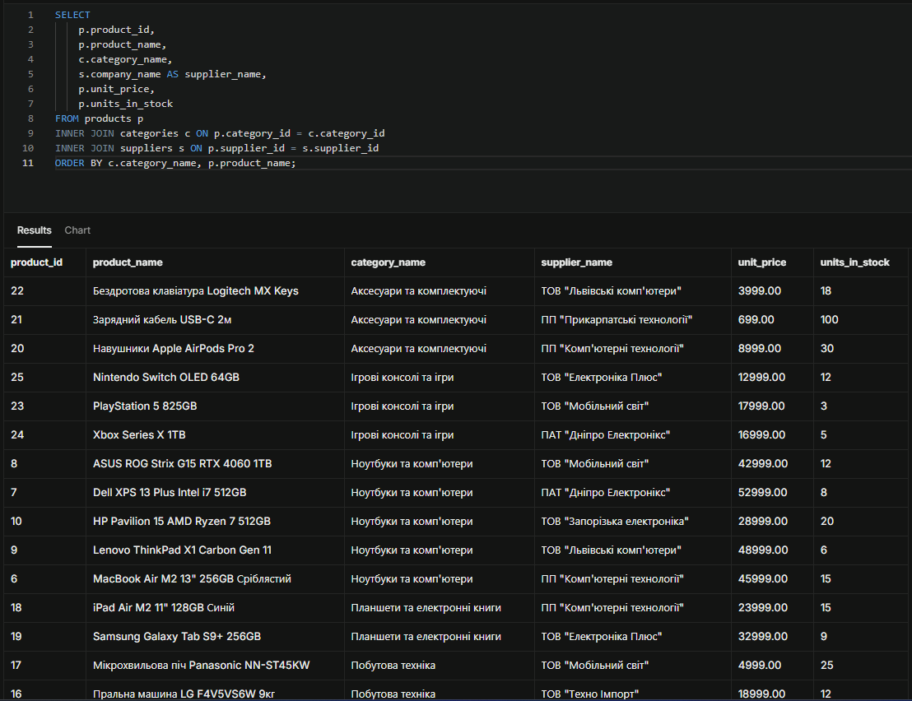<br>

#### Завдання 1.2: LEFT JOIN - клієнти з кількістю замовлень
Для підрахунку кількості замовлень для кожного клієнта (включно з тими, у кого замовлень немає) використано `LEFT JOIN` від таблиці `customers` до `orders` та `regions`, функцію `COALESCE` для заміни `NULL` у полі `company_name` на `'Фізична особа'` і групування `GROUP BY`.

**SQL-запит:**
```sql
SELECT 
    c.customer_id,
    c.contact_name,
    COALESCE(c.company_name, 'Фізична особа') AS company_name,
    c.customer_type,
    r.region_name,
    COUNT(o.order_id) AS order_count
FROM customers c
LEFT JOIN orders o ON c.customer_id = o.customer_id
LEFT JOIN regions r ON c.region_id = r.region_id
GROUP BY c.customer_id, c.contact_name, c.company_name, c.customer_type, r.region_name
ORDER BY order_count DESC, c.contact_name;
```

Результат виконання:
Отримано зведення по всіх 15 клієнтах із зазначенням типу клієнта, регіону та кількості оформлених замовлень (від 3 замовлень у Петрова Івана Миколайовича та по 2 в інших клієнтів). На відміну від `INNER JOIN`, який відкидає рядки без збігів, `LEFT JOIN` зберігає всіх клієнтів із лівої таблиці та підставляє `0` для `COUNT(o.order_id)`, якщо замовлень немає.

Скріншот:

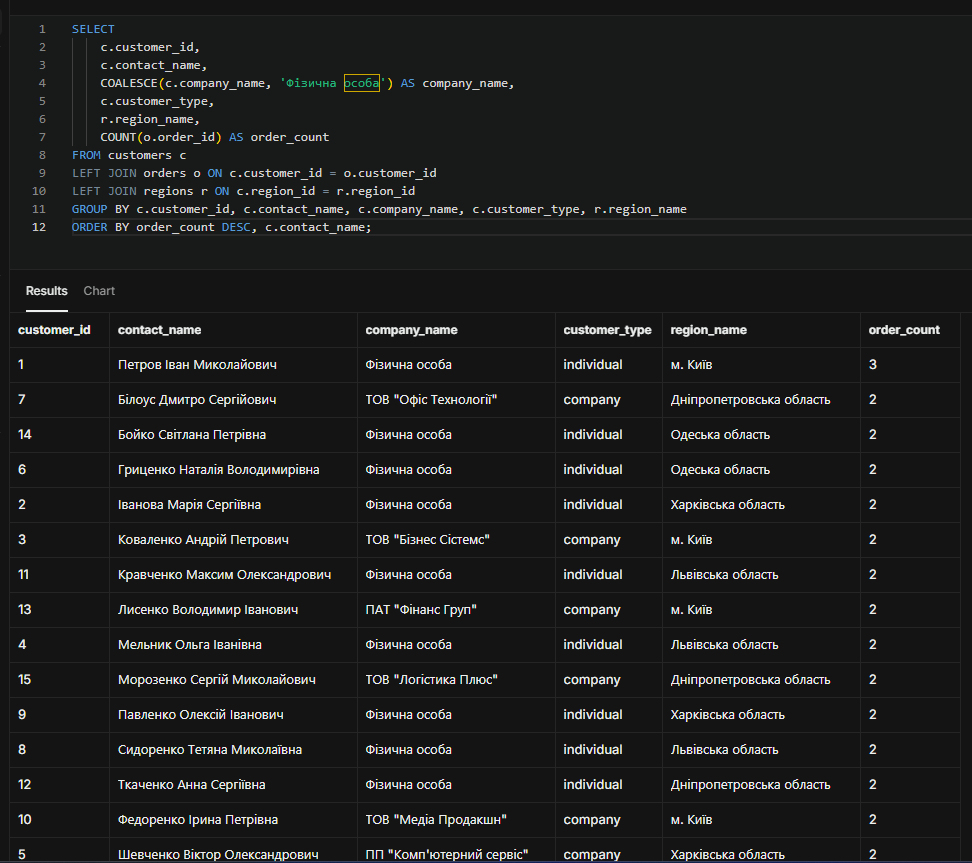<br>

#### Завдання 1.3: Множинне з'єднання - детальна інформація про замовлення
Для формування детального звіту по позиціях кожного замовлення виконано з'єднання 5 таблиць (`orders`, `customers`, `order_items`, `products`, `categories`) та обчислено підсумкову вартість позиції з урахуванням кількості й знижки (`line_total`).

**SQL-запит:**
```sql
SELECT 
    o.order_id,
    o.order_date,
    o.order_status,
    cu.contact_name AS customer_name,
    p.product_name,
    c.category_name,
    oi.quantity,
    oi.unit_price,
    oi.discount,
    ROUND(oi.quantity * oi.unit_price * (1 - oi.discount), 2) AS line_total
FROM orders o
INNER JOIN customers cu ON o.customer_id = cu.customer_id
INNER JOIN order_items oi ON o.order_id = oi.order_id
INNER JOIN products p ON oi.product_id = p.product_id
INNER JOIN categories c ON p.category_id = c.category_id
ORDER BY o.order_id, p.product_name;
```

Результат виконання:
Запит повернув деталізований список із 47 позицій замовлень (починаючи із замовлення №1 від `2024-01-15`) з датою, статусом, клієнтом, товаром, категорією, кількістю, ціною, знижкою та розрахованою сумою по рядку. Послідовність з'єднань іде від замовлення до клієнта та позицій замовлення (`order_items`), а далі — до картки товару та його категорії. Складність запиту помірна: за наявності індексів на зовнішніх ключах він виконується швидко, але потребує з'єднання п'яти таблиць і сортування за двома полями.

Скріншот:

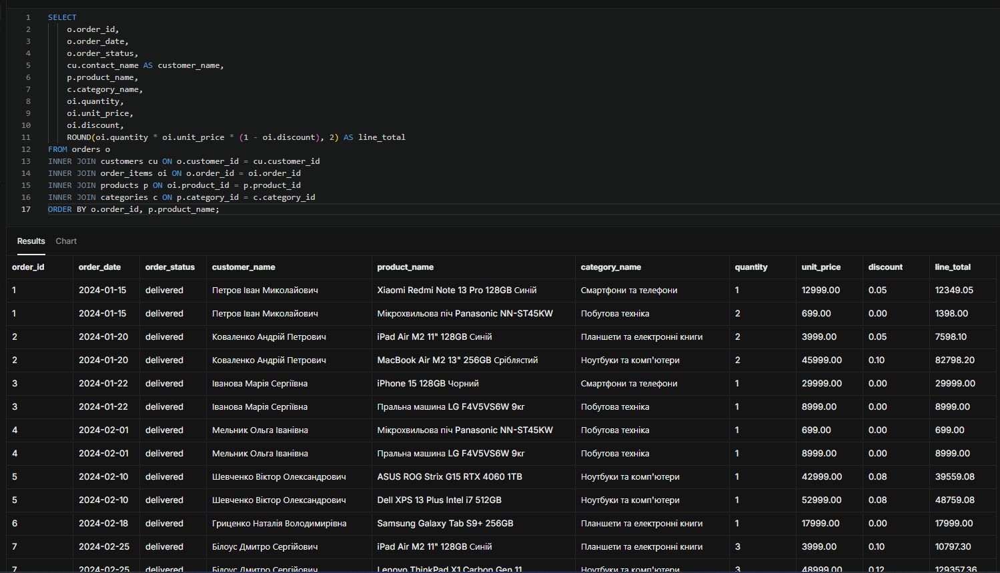<br><br>
### 1.2. Агрегатні функції

#### Завдання 2.1: Статистика товарів за категоріями
Для аналізу асортименту та цінового діапазону в кожній категорії застосовано `LEFT JOIN` від таблиці `categories` до `products`, агрегатні функції `COUNT`, `AVG`, `MIN`, `MAX` із округленням середньої ціни через `ROUND(..., 2)` та групування `GROUP BY`.

**SQL-запит:**
```sql
SELECT 
    c.category_name,
    COUNT(p.product_id) AS product_count,
    ROUND(AVG(p.unit_price), 2) AS avg_price,
    MIN(p.unit_price) AS min_price,
    MAX(p.unit_price) AS max_price
FROM categories c
LEFT JOIN products p ON c.category_id = p.category_id
GROUP BY c.category_id, c.category_name
ORDER BY product_count DESC, c.category_name;
```

Результат виконання:
Запит повернув статистику по всіх 10 категоріях товарів. Найбільше товарів у категоріях «Ноутбуки та комп'ютери» та «Смартфони та телефони» (по 5 позицій), а для порожніх категорій («Розумний дім», «Спортивні технології», «Фото та відео») виведено `0` товарів і `NULL` для цінових показників завдяки `LEFT JOIN`.

Скріншот:

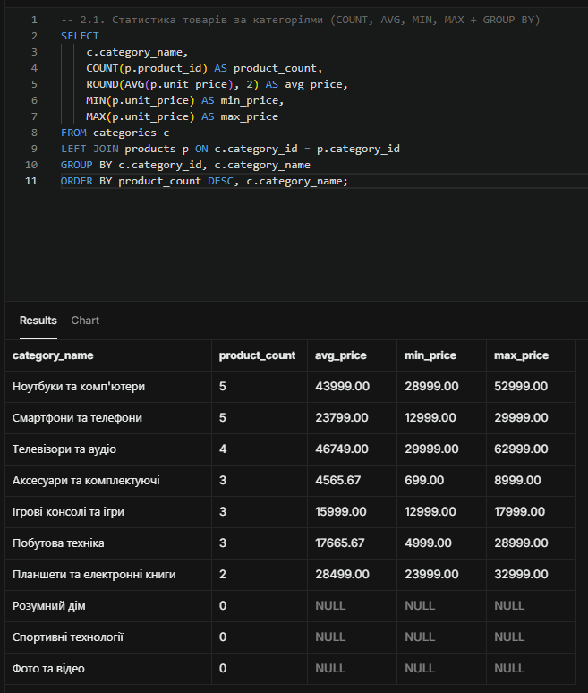<br>

#### Завдання 2.2: Продажі за регіонами з використанням HAVING
Для оцінки обсягу доставлених продажів (`order_status = 'delivered'`) за регіонами використано з'єднання таблиць `regions`, `customers`, `orders` та `order_items`, фільтрацію рядків до групування через `WHERE`, агрегацію `SUM` і `COUNT(DISTINCT ...)` та фільтрацію груп після агрегації за допомогою `HAVING` з порогом понад `50000`.

**SQL-запит:**
```sql
SELECT 
    r.region_name,
    COUNT(DISTINCT o.order_id) AS orders_count,
    ROUND(SUM(oi.quantity * oi.unit_price * (1 - oi.discount)), 2) AS total_sales
FROM regions r
INNER JOIN customers cu ON r.region_id = cu.region_id
INNER JOIN orders o ON cu.customer_id = o.customer_id
INNER JOIN order_items oi ON o.order_id = oi.order_id
WHERE o.order_status = 'delivered'
GROUP BY r.region_id, r.region_name
HAVING SUM(oi.quantity * oi.unit_price * (1 - oi.discount)) > 50000
ORDER BY total_sales DESC;
```

Результат виконання:
У вибірку потрапили 5 регіонів із сумою доставлених продажів понад 50 000 грн: лідером є «м. Київ» (`622387.68`, 6 замовлень), далі йдуть «Дніпропетровська область» (`361779.15`, 4 замовлення), «Харківська область» (`333315.00`, 6 замовлень), «Одеська область» (`90796.05`, 4 замовлення) та «Львівська область» (`64062.75`, 6 замовлень).

Скріншот:

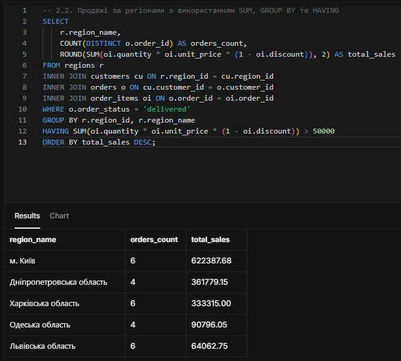<br>

#### Завдання 2.3: Постачальники з кількістю товарів більше 2
Для вибору ключових постачальників з широким асортиментом використано з'єднання `suppliers` і `products`, підрахунок кількості позицій через `COUNT(p.product_id)`, середню ціну товару постачальника та умову `HAVING COUNT(p.product_id) > 2`.

**SQL-запит:**
```sql
SELECT 
    s.supplier_id,
    s.company_name,
    s.city,
    COUNT(p.product_id) AS products_count,
    ROUND(AVG(p.unit_price), 2) AS avg_product_price
FROM suppliers s
INNER JOIN products p ON s.supplier_id = p.supplier_id
GROUP BY s.supplier_id, s.company_name, s.city
HAVING COUNT(p.product_id) > 2
ORDER BY products_count DESC, s.company_name;
```

Результат виконання:
Запит повернув 4 постачальників, у яких понад 2 товарні позиції в каталозі: ТОВ "Електроніка Плюс" (6 товарів), ПП "Комп'ютерні технології" (5 товарів), ТОВ "Мобільний світ" (4 товари) та ТОВ "Техно Імпорт" (3 товари) із зазначенням їхнього міста та середньої вартості товарів.

Скріншот:

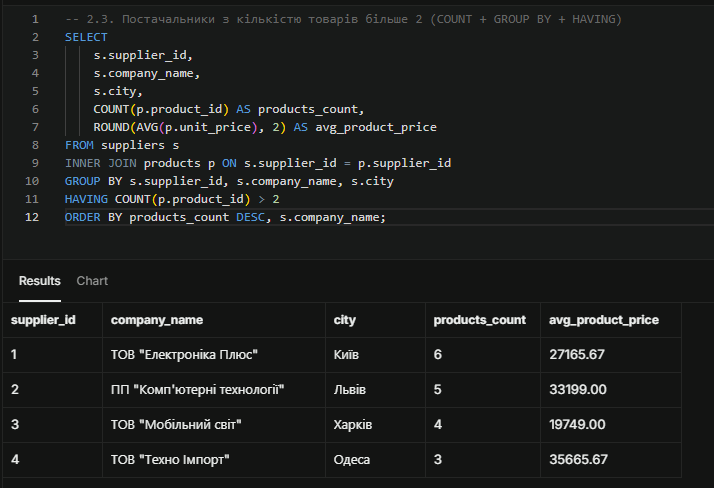<br><br>

### 1.3. Базові підзапити

#### Завдання 3.1: Товари з ціною вище середньої по категорії
Для відбору позицій, вартість яких перевищує середню ціну товарів у відповідній категорії, використано корельований підзапит у розділі `WHERE`, який для кожного товару обчислює `AVG(p2.unit_price)` по його `category_id`.

**SQL-запит:**
```sql
SELECT 
    p.product_name,
    p.unit_price,
    c.category_name
FROM products p
INNER JOIN categories c ON p.category_id = c.category_id
WHERE p.unit_price > (
    SELECT AVG(p2.unit_price)
    FROM products p2
    WHERE p2.category_id = p.category_id
)
ORDER BY c.category_name, p.unit_price DESC;
```

Результат виконання:
Запит повернув товари, ціна яких вища за середнє значення у власній категорії (наприклад, `iPhone 15 128GB Чорний` — `29999.00`, `Dell XPS 13 Plus Intel i7 512GB` — `52999.00`, `LG OLED C3 65" 4K Smart TV` — `62999.00`). Результати відсортовано за назвою категорії та спаданням ціни.

Скріншот:

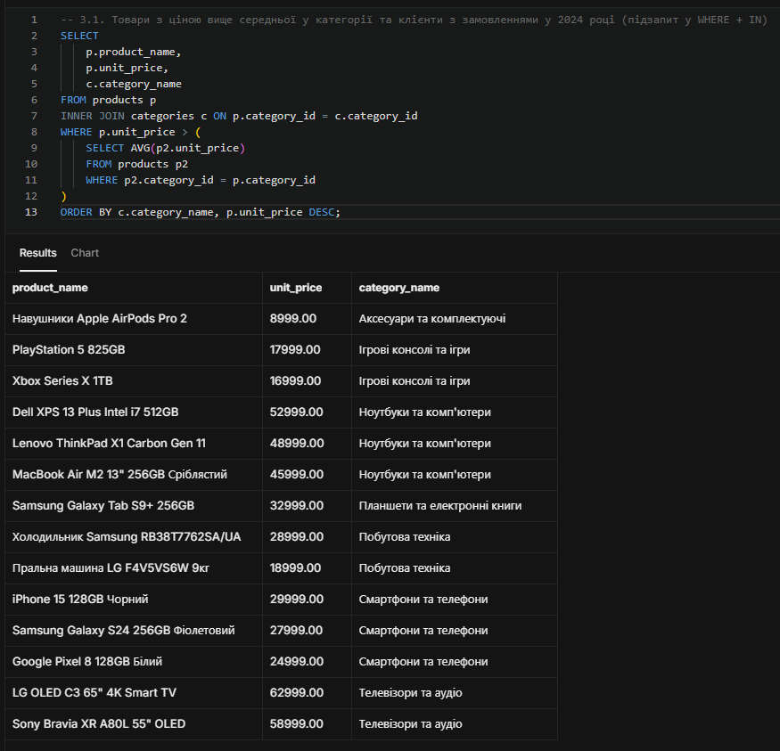<br>

#### Завдання 3.2: Клієнти, які мають замовлення зі статусом `delivered` (оператор EXISTS)
Для перевірки наявності хоча б одного доставленого замовлення у кожного клієнта застосовано оператор `EXISTS` із корельованим підзапитом до таблиці `orders` за умовою `o.customer_id = c.customer_id` та `o.order_status = 'delivered'`.

**SQL-запит:**
```sql
SELECT 
    c.customer_id,
    c.contact_name,
    COALESCE(c.company_name, 'Фізична особа') AS company_name,
    c.city,
    c.customer_type
FROM customers c
WHERE EXISTS (
    SELECT 1
    FROM orders o
    WHERE o.customer_id = c.customer_id
      AND o.order_status = 'delivered'
)
ORDER BY c.customer_id;
```

Результат виконання:
Отримано перелік клієнтів, які мають підтверджені доставлені замовлення, з відображенням імені/назви компанії через `COALESCE`, міста та типу клієнта. Оператор `EXISTS` зупиняє пошук для конкретного клієнта щойно знаходить перший відповідний рядок у `orders`.

Скріншот:

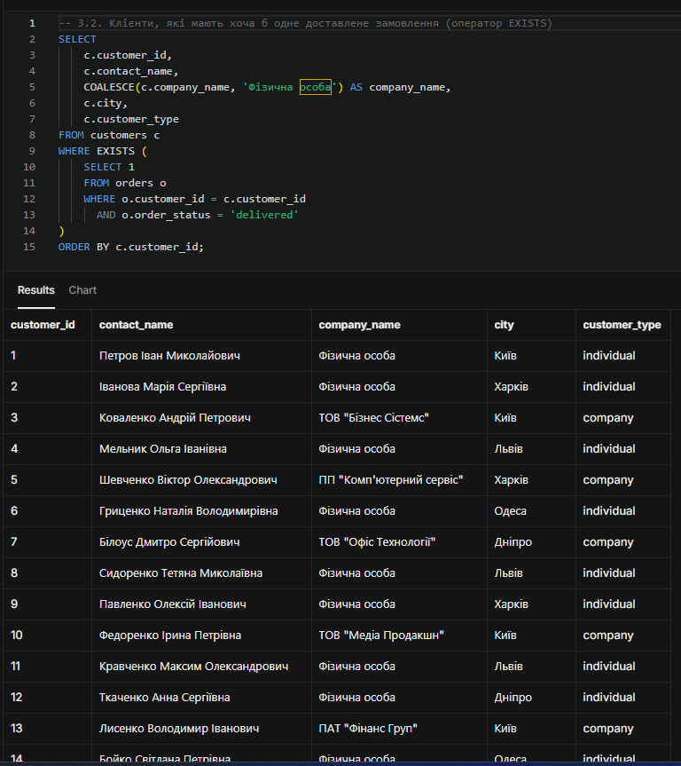<br>

#### Завдання 3.3: Товари з загальною кількістю продажів
Для додавання обчислюваного поля із загальною кількістю проданих одиниць кожного товару використано скалярний підзапит у розділі `SELECT` із функцією `COALESCE(SUM(oi.quantity), 0)` по таблиці `order_items`.

**SQL-запит:**
```sql
SELECT 
    p.product_id,
    p.product_name,
    p.unit_price,
    (
        SELECT COALESCE(SUM(oi.quantity), 0)
        FROM order_items oi
        WHERE oi.product_id = p.product_id
    ) AS total_sold_quantity
FROM products p
ORDER BY total_sold_quantity DESC, p.product_name;
```

Результат виконання:
Запит повернув усі товари каталогу разом із сумарною кількістю проданих одиниць (найбільше продажів у `iPad Air M2 11" 128GB Синій` — 19 шт., `MacBook Air M2 13" 256GB Сріблястий` — 15 шт., `Мікрохвильова піч Panasonic NN-ST45KW` — 13 шт.). Якщо продажів ще не було, підзапит повертає `0`.

Скріншот:

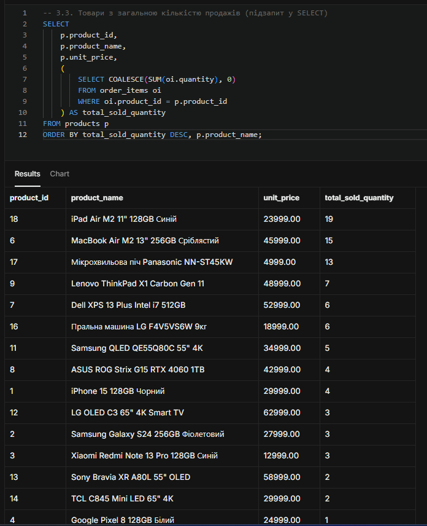<br><br>
## 2. Виконання завдань: Рівень 2

### 2.1. Складні з'єднання та аналіз

#### Завдання 4.1а: RIGHT JOIN - аналіз категорій товарів та їх наявності
Для виведення всіх категорій товарів незалежно від наявності в них позицій використано `RIGHT JOIN` від таблиці `products` до `categories`, агрегацію `COUNT(p.product_id)` і `ROUND(AVG(p.unit_price), 2)` із заміною `NULL` на `0` через `COALESCE`.

**SQL-запит:**
```sql
SELECT 
    c.category_name,
    COUNT(p.product_id) AS products_count,
    COALESCE(ROUND(AVG(p.unit_price), 2), 0) AS avg_price
FROM products p
RIGHT JOIN categories c ON p.category_id = c.category_id
GROUP BY c.category_id, c.category_name
ORDER BY products_count DESC, c.category_name;
```

Результат виконання:
Запит повернув усі 10 категорій каталогу. Для категорій без товарів («Розумний дім», «Спортивні технології», «Фото та відео») відображається кількість `0` та середня ціна `0`.

Скріншот:

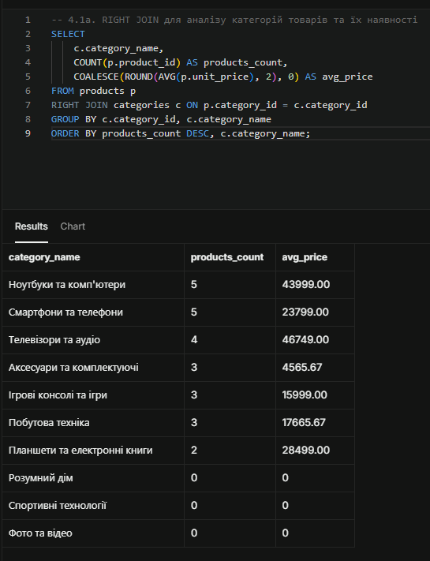<br>

#### Завдання 4.1б: FULL OUTER JOIN - повне зіставлення категорій та товарів
Для отримання повного об'єднання даних із таблиць `products` та `categories` (збереження всіх товарів і всіх категорій навіть за відсутності збігів з іншого боку) застосовано `FULL OUTER JOIN` із сортуванням за назвою категорії та товару.

**SQL-запит:**
```sql
SELECT 
    c.category_name,
    p.product_name,
    p.unit_price
FROM products p
FULL OUTER JOIN categories c ON p.category_id = c.category_id
ORDER BY c.category_name NULLS LAST, p.product_name NULLS LAST;
```

Результат виконання:
Отримано повне зіставлення товарних позицій із їхніми категоріями (включаючи категорії без товарів, де поля товару та ціни містять `NULL`).

Скріншот:

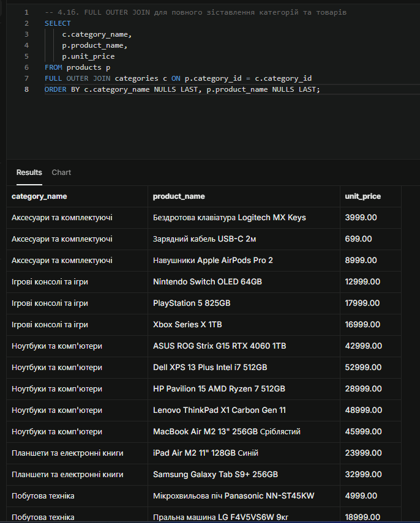<br>

#### Завдання 4.2: Self-join - співробітники та їх керівники
Для побудови зв'язку кожного працівника зі своїм безпосереднім керівником реалізовано самоз'єднання (`LEFT JOIN`) таблиці `employees` самої на себе (`e1` та `e2`) за полем `e1.reports_to = e2.employee_id`, а відсутність керівника у генерального директора оброблено через `COALESCE`.

**SQL-запит:**
```sql
SELECT 
    e1.first_name || ' ' || e1.last_name AS employee,
    e1.title AS employee_title,
    COALESCE(e2.first_name || ' ' || e2.last_name, 'Без керівника') AS manager,
    COALESCE(e2.title, '-') AS manager_title
FROM employees e1
LEFT JOIN employees e2 ON e1.reports_to = e2.employee_id
ORDER BY e2.last_name NULLS FIRST, e1.last_name;
```

Результат виконання:
Запит повернув усіх 8 співробітників із зазначенням їхніх посад та керівників: для Олександра Петренка («Генеральний директор») вказано «Без керівника», а для решти працівників — відповідні керівники та їхні посади.

Скріншот:

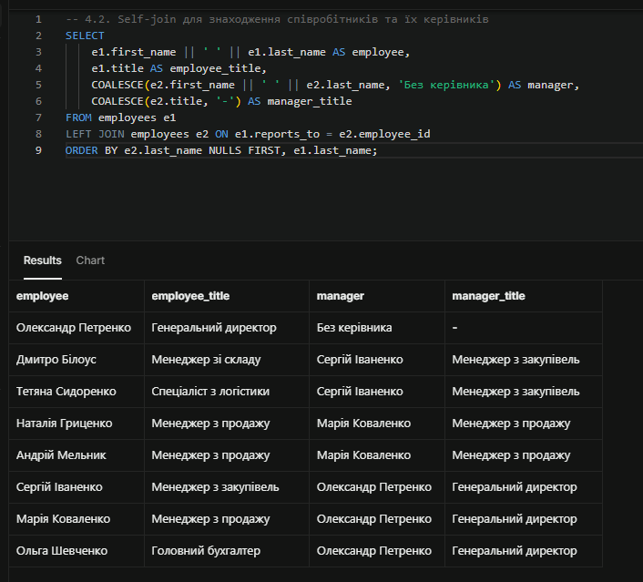<br>

#### Завдання 4.3: Умовне з'єднання (з додатковою умовою в ON) - клієнти та їх доставлені замовлення
Для виведення всіх клієнтів разом лише з їхніми доставленими замовленнями (`order_status = 'delivered'`) застосовано `LEFT JOIN` із додатковою умовою фільтрації безпосередньо в клаузулі `ON`. На відміну від фільтрації в `WHERE`, умова в `ON` зберігає всіх клієнтів у вибірці, навіть якщо в них немає замовлень зі статусом `delivered`.

**SQL-запит:**
```sql
SELECT 
    c.customer_id,
    c.contact_name,
    c.city,
    o.order_id,
    o.order_date,
    o.order_status
FROM customers c
LEFT JOIN orders o 
    ON c.customer_id = o.customer_id 
   AND o.order_status = 'delivered'
ORDER BY c.customer_id, o.order_date NULLS LAST;
```

Результат виконання:
Запит повернув клієнтів разом із даними їхніх доставлених замовлень (зокрема, для клієнтів з `customer_id` 1–8 видно замовлення зі статусом `delivered`, відсортовані за ID клієнта та датою замовлення).

Скріншот:

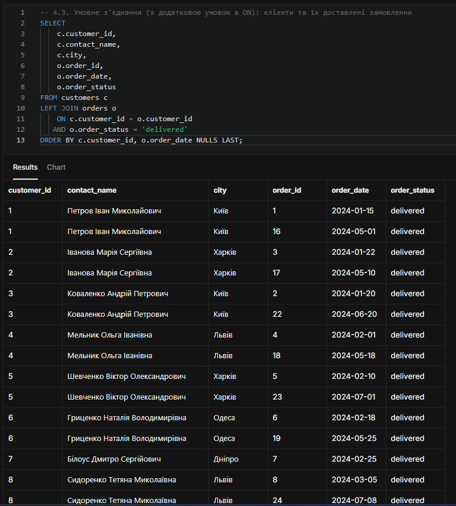<br><br>
### 2.2. Віконні функції та аналітика

#### Завдання 5.1: Ранжування товарів за ціною в межах категорії
Для ранжування товарів за спаданням ціни (`ORDER BY p.unit_price DESC`) у розрізі кожної категорії (`PARTITION BY c.category_name`) застосовано три віконні функції ранжування: `RANK()`, `DENSE_RANK()` та `ROW_NUMBER()`.

**SQL-запит:**
```sql
SELECT 
    p.product_name,
    c.category_name,
    p.unit_price,
    RANK() OVER (PARTITION BY c.category_name ORDER BY p.unit_price DESC) AS price_rank,
    DENSE_RANK() OVER (PARTITION BY c.category_name ORDER BY p.unit_price DESC) AS price_dense_rank,
    ROW_NUMBER() OVER (PARTITION BY c.category_name ORDER BY p.unit_price DESC) AS row_num
FROM products p
JOIN categories c ON p.category_id = c.category_id
ORDER BY c.category_name, p.unit_price DESC;
```

Результат виконання:
Запит повернув товари з присвоєними позиціями всередині кожної категорії без згортання рядків. Для унікальних цін у кожній категорії усі три ранги збігаються (наприклад, у «Ноутбуки та комп'ютери» найдорожчий `Dell XPS 13 Plus Intel i7 512GB` має ранг `1`, `Lenovo ThinkPad X1 Carbon Gen 11` — `2`, а `HP Pavilion 15 AMD Ryzen 7 512GB` — `5`).

Скріншот:

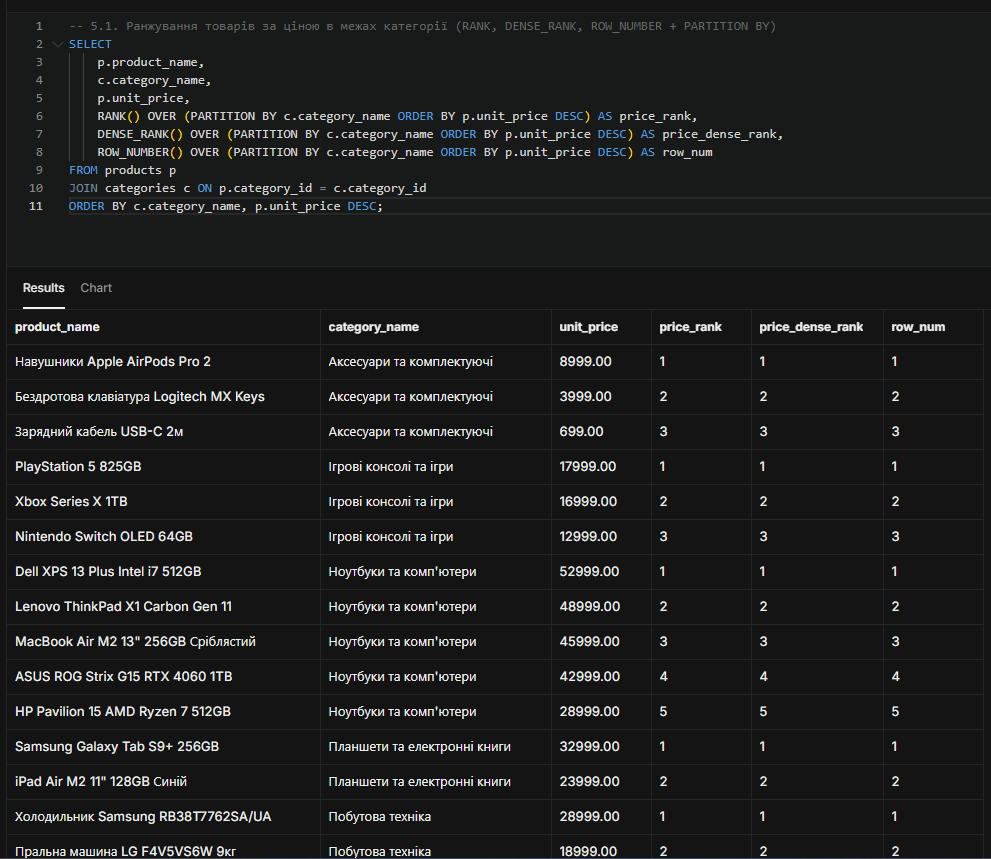<br>

#### Завдання 5.2: Порівняння замовлень кожного клієнта з попереднім та наступним за датою
Для хронологічного аналізу замовлень кожного окремого клієнта використано секцію `PARTITION BY o.customer_id ORDER BY o.order_date, o.order_id` разом із функціями зміщення `LAG()` (отримання дати та вартості доставки попереднього замовлення) та `LEAD()` (отримання дати наступного замовлення).

**SQL-запит:**
```sql
SELECT 
    o.order_id,
    o.customer_id,
    cu.contact_name AS customer_name,
    o.order_date,
    o.freight,
    LAG(o.order_date) OVER (PARTITION BY o.customer_id ORDER BY o.order_date, o.order_id) AS prev_order_date,
    LEAD(o.order_date) OVER (PARTITION BY o.customer_id ORDER BY o.order_date, o.order_id) AS next_order_date,
    LAG(o.freight) OVER (PARTITION BY o.customer_id ORDER BY o.order_date, o.order_id) AS prev_freight
FROM orders o
JOIN customers cu ON o.customer_id = cu.customer_id
ORDER BY o.customer_id, o.order_date, o.order_id;
```

Результат виконання:
Запит показав послідовність замовлень у розрізі клієнтів із прив'язкою до попередніх та наступних дат (наприклад, для клієнта №1 «Петров Іван Миколайович» видно перехід з `2024-01-15` на `2024-05-01` і далі на `2024-08-10`, а для першого й останнього замовлень у ланцюжку відповідні поля зміщення повертають `NULL`).

Скріншот:

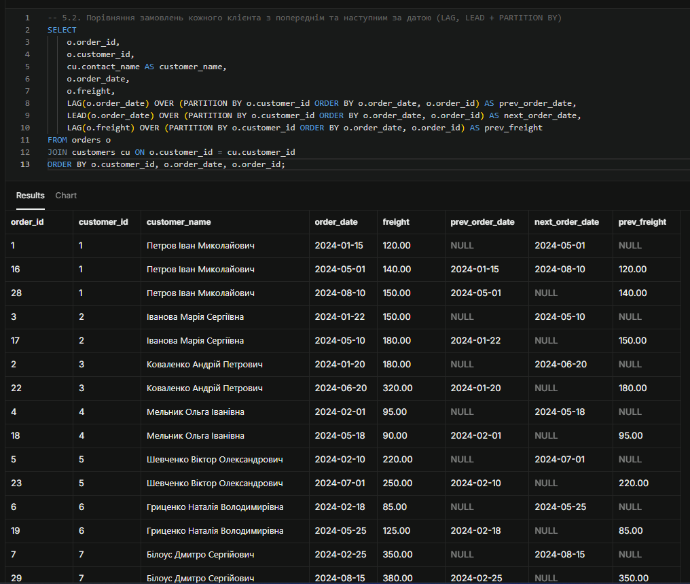<br>

#### Завдання 5.3: Аналіз у розрізах категорій з PARTITION BY
Для порівняння ціни кожного товару із середнім показником по його категорії та оцінки сумарного складського запасу в категорії без втрати деталізації застосовано агрегатні віконні функції `AVG()` і `SUM()` із розбиттям `PARTITION BY c.category_id`.

**SQL-запит:**
```sql
SELECT 
    p.product_name,
    c.category_name,
    p.unit_price,
    ROUND(AVG(p.unit_price) OVER (PARTITION BY c.category_id), 2) AS category_avg_price,
    ROUND(p.unit_price - AVG(p.unit_price) OVER (PARTITION BY c.category_id), 2) AS diff_from_avg,
    SUM(p.units_in_stock) OVER (PARTITION BY c.category_id) AS category_total_stock
FROM products p
JOIN categories c ON p.category_id = c.category_id
ORDER BY c.category_name, p.unit_price DESC;
```

Результат виконання:
Запит вивів для кожного товару середню ціну його категорії, абсолютну різницю між ціною товару та середнім по категорії (`diff_from_avg`), а також загальний залишок товарів на складі в межах категорії (`category_total_stock`, наприклад, `148` для «Аксесуари та комплектуючі» та `61` для «Ноутбуки та комп'ютери»).

Скріншот:

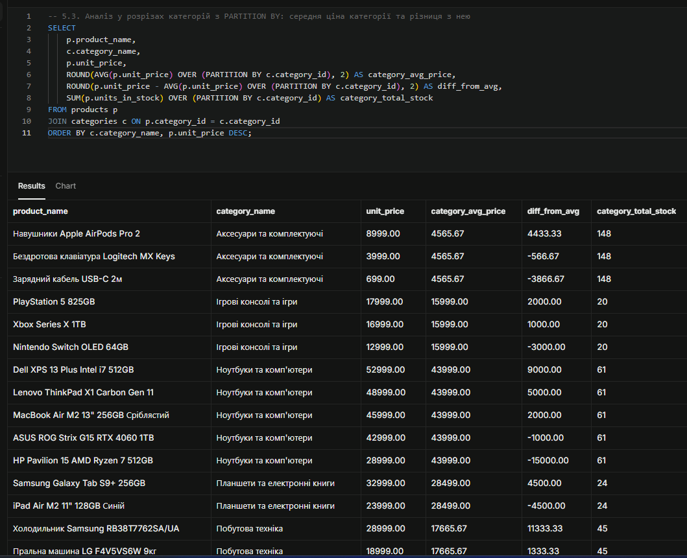<br><br>
## 3. Виконання завдань: Рівень 3

### 3.1. Оптимізація та складна аналітика

#### Завдання 6.1: Матеріалізоване представлення для аналізу продажів
Для прискорення повторних аналітичних запитів по доставлених замовленнях (`order_status = 'delivered'`) у розрізі років, місяців, категорій та регіонів створено матеріалізоване представлення `mv_monthly_sales` та B-tree індекс `idx_mv_monthly_sales_date` за полями `(year, month)`.

**SQL-запит:**
```sql
DROP MATERIALIZED VIEW IF EXISTS mv_monthly_sales;

CREATE MATERIALIZED VIEW mv_monthly_sales AS
SELECT
    EXTRACT(YEAR FROM o.order_date)::INT AS year,
    EXTRACT(MONTH FROM o.order_date)::INT AS month,
    c.category_name,
    r.region_name,
    ROUND(SUM(oi.quantity * oi.unit_price * (1 - oi.discount)), 2) AS total_revenue,
    COUNT(DISTINCT o.order_id) AS orders_count,
    ROUND(AVG(oi.quantity * oi.unit_price * (1 - oi.discount)), 2) AS avg_order_value
FROM orders o
JOIN order_items oi ON o.order_id = oi.order_id
JOIN products p ON oi.product_id = p.product_id
JOIN categories c ON p.category_id = c.category_id
JOIN customers cu ON o.customer_id = cu.customer_id
LEFT JOIN regions r ON cu.region_id = r.region_id
WHERE o.order_status = 'delivered'
GROUP BY year, month, c.category_name, r.region_name;

CREATE INDEX idx_mv_monthly_sales_date ON mv_monthly_sales(year, month);

SELECT * FROM mv_monthly_sales ORDER BY year, month, total_revenue DESC;
```

Результат виконання:
Матеріалізоване представлення успішно створено та заповнено агрегованими даними по доставлених замовленнях (зокрема за січень і лютий 2024 року з розбивкою по категоріях, регіонах, сумі виручки, кількості замовлень та середньому чеку позиції). На відміну від звичайного `VIEW`, матеріалізоване представлення зберігає обчислений результат фізично на диску, що дозволяє читати його без повторного багатотабличного з'єднання й агрегації, але потребує оновлення через `REFRESH MATERIALIZED VIEW` при появі нових даних.

Скріншот:

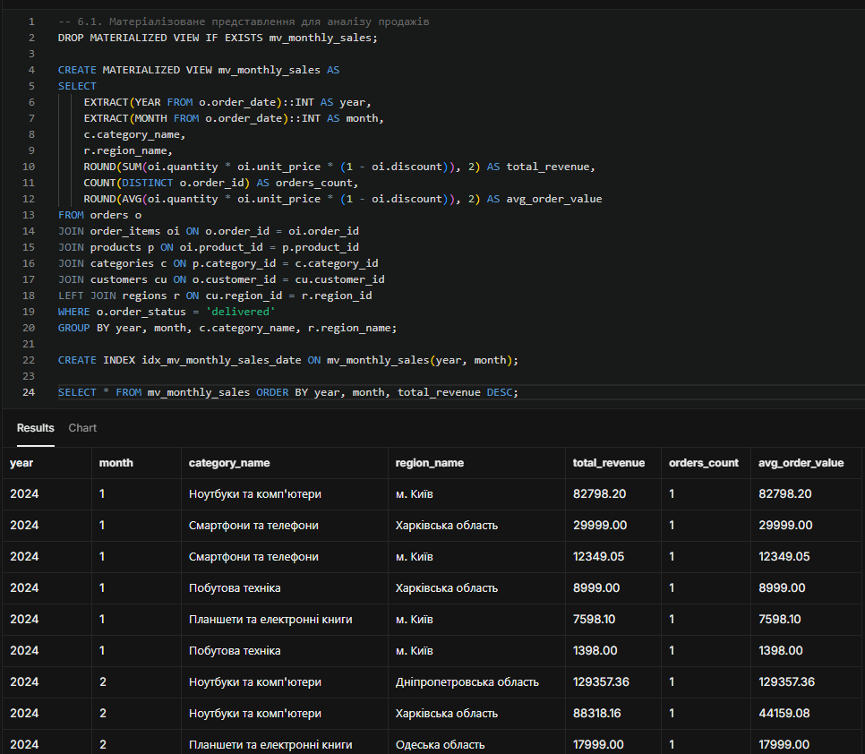<br>

#### Завдання 6.2: Рекурсивний запит для ієрархії співробітників
Для побудови повної організаційної ієрархії від керівників до підлеглих будь-якої глибини вкладеності використано рекурсивний вираз `WITH RECURSIVE employee_hierarchy`, що об'єднує базовий запит (`reports_to IS NULL`) та рекурсивну гілку (`e.reports_to = eh.employee_id`) із розрахунком рівня `level` і текстового шляху `hierarchy_path`.

**SQL-запит:**
```sql
WITH RECURSIVE employee_hierarchy AS (
    SELECT
        employee_id,
        first_name,
        last_name,
        title,
        reports_to,
        0 AS level,
        CAST(last_name || ' ' || first_name AS VARCHAR(1000)) AS hierarchy_path
    FROM employees
    WHERE reports_to IS NULL

    UNION ALL

    SELECT
        e.employee_id,
        e.first_name,
        e.last_name,
        e.title,
        e.reports_to,
        eh.level + 1,
        CAST(eh.hierarchy_path || ' -> ' || e.last_name || ' ' || e.first_name AS VARCHAR(1000))
    FROM employees e
    JOIN employee_hierarchy eh ON e.reports_to = eh.employee_id
)
SELECT * FROM employee_hierarchy ORDER BY hierarchy_path;
```

Результат виконання:
Запит повернув дерево підпорядкування співробітників компанії: на нульовому рівні (`level = 0`) розміщено генерального директора Олександра Петренка, на першому (`level = 1`) — безпосередніх керівників напрямів (Сергія Іваненка, Марію Коваленко, Ольгу Шевченко), а на другому (`level = 2`) — підлеглих їм спеціалістів (Дмитра Білоуса, Тетяну Сидоренко, Наталію Гриценко, Андрія Мельника) з наочним шляхом у `hierarchy_path`.

Скріншот:

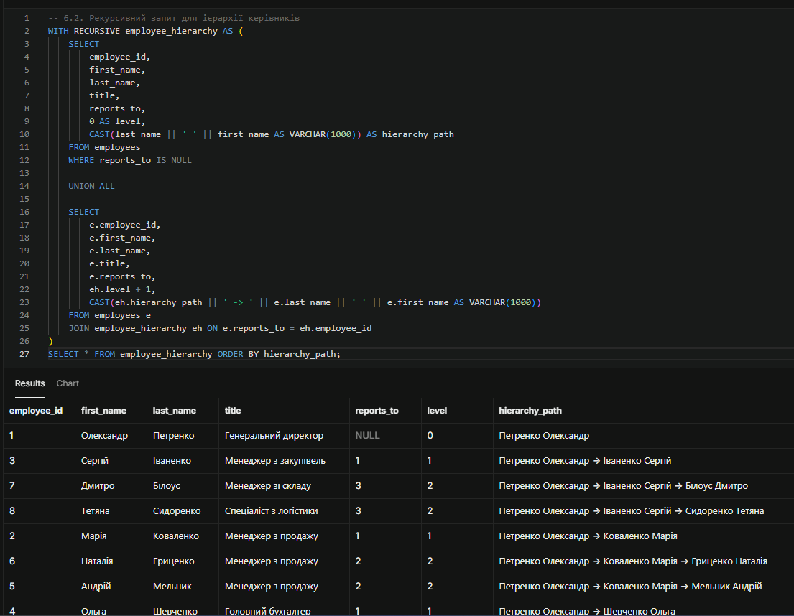<br>

#### Завдання 6.3: Динамічний SQL для параметризованої аналітики продажів за регіонами
Для виконання аналітичних вибірок з параметрами статусу замовлення та мінімальної суми виручки створено функцію `get_region_sales_dynamic(p_status, p_min_revenue)` мовою `PL/pgSQL`, яка формує текст SQL-запиту та виконує його через `EXECUTE ... USING` із безпечною передачею параметрів (`$1`, `$2`).

**SQL-запит:**
```sql
CREATE OR REPLACE FUNCTION get_region_sales_dynamic(
    p_status VARCHAR DEFAULT 'delivered',
    p_min_revenue NUMERIC DEFAULT 0
)
RETURNS TABLE (
    region_name VARCHAR,
    orders_count BIGINT,
    total_revenue NUMERIC
)
LANGUAGE plpgsql
AS $$
DECLARE
    v_sql TEXT;
BEGIN
    v_sql := '
        SELECT
            COALESCE(r.region_name, ''Не вказано'')::VARCHAR AS region_name,
            COUNT(DISTINCT o.order_id) AS orders_count,
            ROUND(SUM(oi.quantity * oi.unit_price * (1 - oi.discount)), 2) AS total_revenue
        FROM orders o
        JOIN order_items oi ON o.order_id = oi.order_id
        JOIN customers cu ON o.customer_id = cu.customer_id
        LEFT JOIN regions r ON cu.region_id = r.region_id
        WHERE o.order_status = $1
        GROUP BY r.region_name
        HAVING SUM(oi.quantity * oi.unit_price * (1 - oi.discount)) >= $2
        ORDER BY total_revenue DESC
    ';
    RETURN QUERY EXECUTE v_sql USING p_status, p_min_revenue;
END;
$$;

SELECT * FROM get_region_sales_dynamic('delivered', 50000);
```

Результат виконання:
Функція успішно виконана з параметрами `'delivered'` та `50000` і повернула 5 регіонів з виручкою від `64062.75` (Львівська область) до `622387.68` (м. Київ). Використання `EXECUTE ... USING` дозволяє гнучко змінювати критерії фільтрації під час виклику та захищає від SQL-ін'єкцій завдяки прив'язці параметрів.

Скріншот:

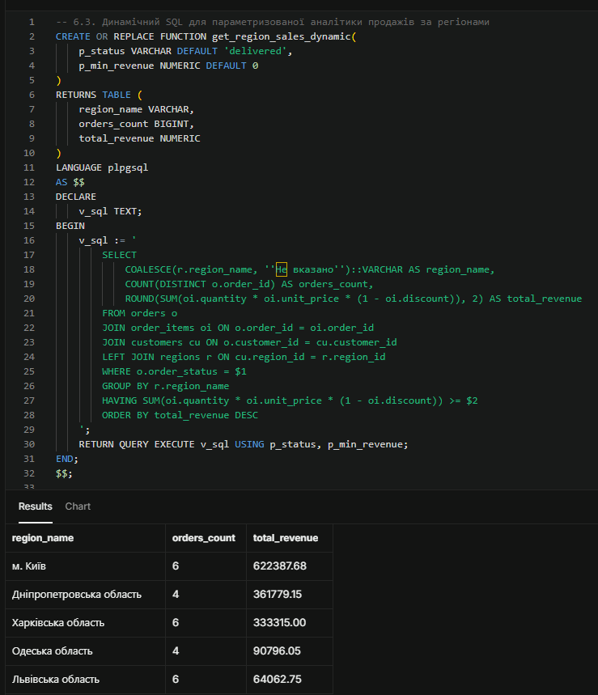<br><br>
### 3.2. Аналіз продуктивності

#### Дослідження планів виконання

**Найповільніший запит:**
```sql
SELECT 
    r.region_name,
    COUNT(DISTINCT o.order_id) AS orders_count,
    ROUND(SUM(oi.quantity * oi.unit_price * (1 - oi.discount)), 2) AS total_sales
FROM regions r
INNER JOIN customers cu ON r.region_id = cu.region_id
INNER JOIN orders o ON cu.customer_id = o.customer_id
INNER JOIN order_items oi ON o.order_id = oi.order_id
WHERE o.order_status = 'delivered'
GROUP BY r.region_id, r.region_name
HAVING SUM(oi.quantity * oi.unit_price * (1 - oi.discount)) > 50000
ORDER BY total_sales DESC;
```

**План виконання (EXPLAIN ANALYZE):**
```text
Sort (cost=5.35..5.36 rows=1 width=162) (actual time=0.280..0.283 rows=5 loops=1)
  Sort Key: (round(sum((((oi.quantity)::numeric * oi.unit_price) * ('1'::numeric - oi.discount))), 2)) DESC
  Sort Method: quicksort  Memory: 25kB
  Buffers: shared hit=61
  ->  GroupAggregate (cost=5.27..5.34 rows=1 width=162) (actual time=0.229..0.235 rows=5 loops=1)
        Group Key: r.region_id
        Filter: (sum((((oi.quantity)::numeric * oi.unit_price) * ('1'::numeric - oi.discount))) > 50000)
        Buffers: shared hit=58
        ->  Sort (cost=5.27..5.27 rows=2 width=158) (actual time=0.212..0.216 rows=39 loops=1)
              Sort Key: r.region_id, o.order_id
              Sort Method: quicksort  Memory: 27kB
              Buffers: shared hit=58
              ->  Hash Join (cost=3.60..5.26 rows=2 width=158) (actual time=0.161..0.175 rows=39 loops=1)
                    Hash Cond: (oi.order_id = o.order_id)
                    Buffers: shared hit=55
```

Скріншот:

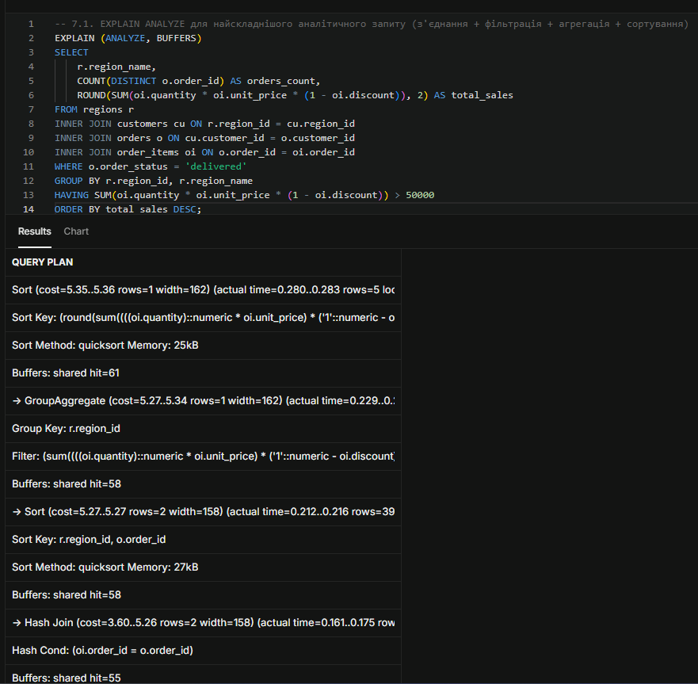<br>

**Запропоновані оптимізації:**
1. **Індексування ключів з'єднання та фільтрації:** створення складених індексів на `orders(order_status, customer_id)` та `order_items(order_id, product_id)` дозволяє швидше відбирати доставлені замовлення та зв'язувати їх із позиціями.
2. **Попередня агрегація через матеріалізоване представлення:** для регулярних аналітичних звітів по місяцях, категоріях та регіонах варто використовувати матеріалізоване представлення `mv_monthly_sales`, щоб не виконувати багатотабличні з'єднання й підрахунки `SUM` щоразу заново.
3. **Уникнення дублювання складного арифметичного виразу:** вираз розрахунку суми позиції зі знижкою `oi.quantity * oi.unit_price * (1 - oi.discount)` використовується і в `SELECT`, і в `HAVING` — на великих обсягах даних вигідніше рахувати його на рівні проміжного CTE або матеріалізованого представлення.

#### Створені індекси

**Індекс 1:**
```sql
CREATE INDEX IF NOT EXISTS idx_orders_status_customer ON orders(order_status, customer_id);
```
**Обґрунтування:** Запити часто фільтрують замовлення за статусом (наприклад, `o.order_status = 'delivered'`) та з'єднують їх із клієнтами за `customer_id`. Складений індекс допомагає прискорити відбір потрібних замовлень і з'єднання таблиць при зростанні бази.

**Індекс 2:**
```sql
CREATE INDEX IF NOT EXISTS idx_order_items_order_product ON order_items(order_id, product_id);
```
**Обґрунтування:** Таблиця `order_items` активно бере участь у з'єднаннях із `orders` за `order_id` та з `products` за `product_id` (зокрема в запитах з агрегацією продажів та підзапитами). Цей індекс прискорює пошук позицій замовлення та з'єднання за зовнішніми ключами.

---

## 4. Порівняльний аналіз

#### Ефективність різних підходів

**Завдання:** Знайти топ-5 найдорожчих товарів у кожній категорії

**Підхід 1: Віконні функції**
```sql
EXPLAIN ANALYZE
WITH ranked_products AS (
    SELECT 
        p.product_name,
        c.category_name,
        p.unit_price,
        DENSE_RANK() OVER (PARTITION BY c.category_id ORDER BY p.unit_price DESC) AS rnk
    FROM products p
    JOIN categories c ON p.category_id = c.category_id
)
SELECT product_name, category_name, unit_price, rnk
FROM ranked_products
WHERE rnk <= 5
ORDER BY category_name, unit_price DESC;
```

Скріншот:

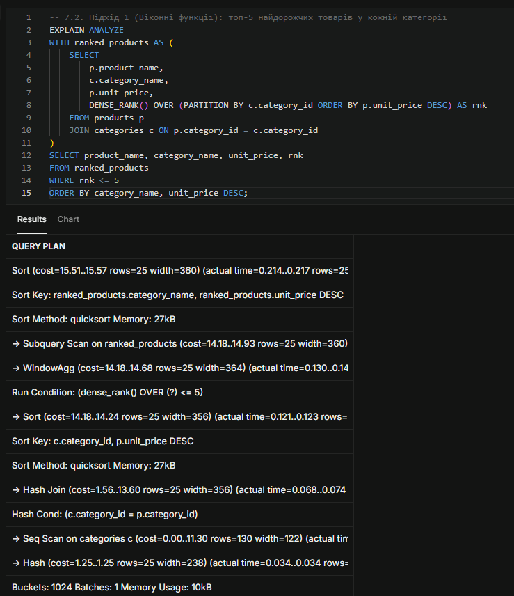<br>

**Підхід 2: Корельований підзапит**
```sql
EXPLAIN ANALYZE
SELECT 
    p.product_name,
    c.category_name,
    p.unit_price
FROM products p
JOIN categories c ON p.category_id = c.category_id
WHERE (
    SELECT COUNT(DISTINCT p2.unit_price)
    FROM products p2
    WHERE p2.category_id = p.category_id
      AND p2.unit_price > p.unit_price
) < 5
ORDER BY c.category_name, p.unit_price DESC;
```

Скріншот:

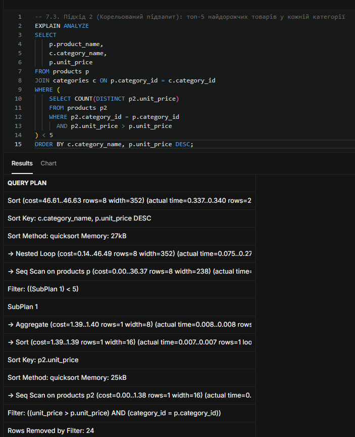<br>

**Час виконання:**
- Віконні функції: `0.214..0.217 ms` (вартість плану `cost=15.51..15.57`)
- Корельований підзапит: `0.337..0.340 ms` (вартість плану `cost=46.61..46.63`)

**Висновок:** Підхід із віконними функціями (`DENSE_RANK()`) є ефективнішим як за часом виконання (`0.217 ms` проти `0.340 ms`), так і за оцінкою вартості плану (`15.57` проти `46.63`), оскільки обчислює ранги в межах категорій за один прохід віконної агрегації замість запуску вкладеного підплану для кожного рядка.

---
## Контрольні запитання

### 1. В чому різниця між INNER JOIN та LEFT JOIN? Коли доцільно використовувати кожен з них в контексті навчальної бази даних?
**INNER JOIN** повертає лише ті рядки, для яких знайдено відповідність за умовою з'єднання в обох таблицях (рядки без пари відкидаються). **LEFT JOIN** повертає всі рядки з лівої таблиці та відповідні рядки з правої; якщо збігу немає, поля правої таблиці заповнюються значеннями `NULL`.

У контексті бази даних `TechnoMart`:
- **INNER JOIN** доцільно використовувати, коли потрібні лише коректно зв'язані дані, наприклад, товари разом із їхніми категоріями та постачальниками або замовлення з позиціями.
- **LEFT JOIN** доцільно застосовувати для аналізу повноти даних, наприклад, щоб вивести всіх клієнтів (`customers`), включаючи тих, хто ще не оформив жодного замовлення (`orders`), або всі категорії (`categories`), навіть якщо в них немає товарів (`products`).

### 2. Чому не можна використовувати WHERE для фільтрації результатів агрегатних функцій? Яка роль HAVING при аналізі продажів товарів?
У логічному порядку виконання SQL-запиту розділ `WHERE` обробляє окремі рядки **до** групування (`GROUP BY`) та обчислення агрегатних функцій (`SUM`, `COUNT`, `AVG`), тому на етапі `WHERE` підсумкові значення груп ще не сформовані.

Розділ **`HAVING`** виконується **після** `GROUP BY` та агрегації, тому дозволяє відфільтрувати вже сформовані групи за обчисленими показниками. При аналізі продажів товарів або регіонів `HAVING` дає змогу відібрати, наприклад, лише регіони із загальною сумою продажів понад заданий поріг або постачальників із кількістю товарів більше ніж `2`.

### 3. Як працюють корельовані підзапити і чим вони відрізняються від звичайних? Наведіть приклад для знаходження товарів з ціною вище середньої по категорії.
**Звичайний (некорельований) підзапит** є незалежним від зовнішнього запиту: його можна виконати окремо, і він повертає результат для всього зовнішнього запиту загалом. **Корельований підзапит** посилається на стовпці зовнішнього запиту і логічно обчислюється у прив'язці до поточного рядка зовнішньої таблиці.

Приклад пошуку товарів із ціною вищою за середню ціну у своїй категорії:
```sql
SELECT 
    p.product_name,
    p.unit_price,
    c.category_name
FROM products p
INNER JOIN categories c ON p.category_id = c.category_id
WHERE p.unit_price > (
    SELECT AVG(p2.unit_price)
    FROM products p2
    WHERE p2.category_id = p.category_id
)
ORDER BY c.category_name, p.unit_price DESC;
```

### 4. В яких ситуаціях доцільно використовувати віконні функції замість GROUP BY при аналізі замовлень клієнтів?
Віконні функції варто використовувати тоді, коли потрібно зберегти **кожний окремий рядок замовлення** та водночас отримати по ньому аналітику в межах групи (`PARTITION BY`) або в хронологічному порядку (`ORDER BY`). Звичайний `GROUP BY` згортає рядки до рівня групи і приховує деталі окремих замовлень.

При аналізі замовлень клієнтів віконні функції (`LAG`, `LEAD`, `ROW_NUMBER`, `RANK`, `SUM() OVER (...)`) зручні для порівняння поточного замовлення клієнта з попереднім чи наступним за датою, оцінки зміни вартості доставки (`freight`) або нумерації замовлень кожного клієнта без втрати самих записів про замовлення.

### 5. Що таке матеріалізовані представлення і які переваги вони дають для аналітичних запитів по продажах у навчальній базі даних?
**Матеріалізоване представлення** (`MATERIALIZED VIEW`) — це об'єкт бази даних, який не лише зберігає текст SQL-запиту, а й фізично записує результат його виконання на диск (наприклад, створене у роботі представлення `mv_monthly_sales`).

Переваги для аналітики продажів:
- **Швидше читання:** звітні запити читають уже готовий агрегований результат без повторного виконання важких багатотабличних з'єднань та обчислень `SUM`/`AVG`.
- **Можливість індексування:** на матеріалізованому представленні можна створювати індекси (наприклад, за роком і місяцем), що додатково прискорює вибірки.
- **Контрольоване оновлення:** дані оновлюються цілеспрямовано командою `REFRESH MATERIALIZED VIEW` у потрібний момент, не навантажуючи щоразу транзакційні таблиці під час читання звітів.

### 6. Як можна оптимізувати запити з множинними з'єднаннями таблиць orders, order_items, products, customers для покращення продуктивності?
Для оптимізації таких запитів доцільно:
- **Створити індекси** на зовнішні ключі та поля фільтрації (наприклад, `orders(order_status, customer_id)`, `order_items(order_id, product_id)`, `customers(region_id)`), щоб пришвидшити з'єднання та відбір потрібних записів.
- **Фільтрувати дані якомога раніше** (наприклад, відбирати потрібні замовлення за статусом чи датою ще до агрегації або через індексовані умови).
- **Використовувати матеріалізовані представлення або проміжні агрегації**, якщо аналітика по продажах запускається регулярно, а також перевіряти плани виконання через `EXPLAIN ANALYZE` для виявлення дорогих сканувань чи зайвих сортувань.

### 7. Яка різниця між RANK() та DENSE_RANK() при ранжуванні товарів за ціною? Наведіть приклад з конкретними даними.
Обидві функції призначають однакові ранги рядкам з однаковим значенням у `ORDER BY`, але по-різному поводяться після «нічиєї»:
- **`RANK()`** залишає пропуски в нумерації наступних рангів (наприклад, якщо два товари ділять 1-ше місце, наступний отримує ранг `3`).
- **`DENSE_RANK()`** не залишає пропусків і присвоює наступний послідовний ранг (після двох позицій з рангом `1` наступний товар отримує ранг `2`).

Наприклад, якщо в категорії є товари з цінами `52999.00`, `48999.00`, `45999.00`, `42999.00` та `28999.00` (як у категорії «Ноутбуки та комп'ютери»), то при різних цінах обидві функції дають позиції `1`, `2`, `3`, `4`, `5`, а якби два товари мали однакову максимальну ціну `52999.00`, то `RANK()` дав би `1`, `1`, `3`, а `DENSE_RANK()` — `1`, `1`, `2`.

---
## 5. Висновки

Під час виконання лабораторної роботи №2 на базі навчальної бази даних `TechnoMart` у PostgreSQL (Supabase) я самостійно реалізував та протестував SQL-запити трьох рівнів складності. У ході роботи я попрактикувався у різних видах з'єднань (`INNER JOIN`, `LEFT JOIN`, `RIGHT JOIN`, `FULL OUTER JOIN`, самоз'єднання та умовні з'єднання з додатковою умовою в `ON`), використанні агрегатних функцій разом із `GROUP BY` та `HAVING`, написанні корельованих і скалярних підзапитів (зокрема з `EXISTS`), а також віконних функцій (`RANK`, `DENSE_RANK`, `ROW_NUMBER`, `LAG`, `LEAD`, `PARTITION BY`). На третьому рівні я створив матеріалізоване представлення `mv_monthly_sales` з індексом, реалізував рекурсивний CTE `employee_hierarchy` для перегляду ієрархії співробітників і написав функцію на `PL/pgSQL` з динамічним SQL (`EXECUTE ... USING`), після чого проаналізував плани виконання через `EXPLAIN ANALYZE`, створив індекси та порівняв два підходи до вибірки топ-5 найдорожчих товарів у категоріях.

**Самооцінка:** 5

**Обґрунтування:** Усі заплановані завдання рівнів 1–3 виконано та перевірено на реальних даних у Supabase, кожен запит супроводжується поясненням, аналізом результату та скріншотом, а також проведено аналіз планів виконання, створено індекси та виконано порівняння двох підходів до аналітичної задачі.
