# Звіт з лабораторної роботи 3. Модифікація даних та транзакції

- **Виконав:** Бугайчук Дмитро
- **Група:** ІПЗ-32
- **Група:** Варіант: Система управління бібліотекою
## Мета роботи

Здобути практичні навички безпечної модифікації даних у реляційних базах даних, опанувати механізми транзакцій для забезпечення цілісності даних, навчитися працювати з обмеженнями цілісності та каскадними операціями при зміні взаємопов'язаних записів.

## Виконання роботи
## Рівень 1. Базові операції модифікації

### Крок 1. Створення структури бази даних

У базі даних `library_lab3` створено чотири основні таблиці системи управління бібліотекою з обмеженнями цілісності (`PRIMARY KEY`, `FOREIGN KEY`, `UNIQUE`, `CHECK`, `NOT NULL`, `DEFAULT`).

#### Таблиця `authors`
```sql
CREATE TABLE authors (
    author_id SERIAL PRIMARY KEY,
    first_name VARCHAR(50) NOT NULL,
    last_name VARCHAR(50) NOT NULL,
    birth_year INTEGER CHECK (birth_year >= 1000 AND birth_year <= EXTRACT(YEAR FROM CURRENT_DATE)),
    country VARCHAR(50),
    created_at TIMESTAMP DEFAULT CURRENT_TIMESTAMP
);
```
- **Результат:** `CREATE TABLE` (`Query returned successfully in 40 msec`).
- **Обмеження:** `PRIMARY KEY` на `author_id`, `NOT NULL` на `first_name` і `last_name`, `CHECK` для коректного року народження (`birth_year`) та значення за замовчуванням `CURRENT_TIMESTAMP` для `created_at`.

Скріншот:<br><br>
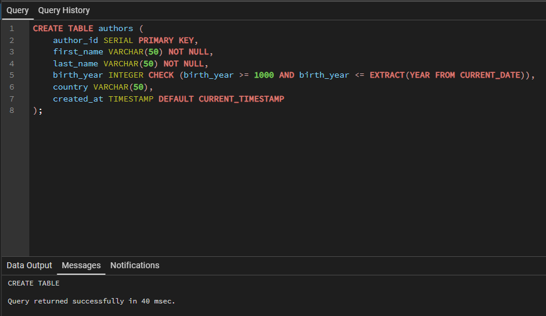<br><br>

#### Таблиця `books`
```sql
CREATE TABLE books (
    book_id SERIAL PRIMARY KEY,
    isbn VARCHAR(17) UNIQUE NOT NULL,
    title VARCHAR(200) NOT NULL,
    author_id INTEGER NOT NULL,
    publication_year INTEGER CHECK (publication_year >= 1450),
    genre VARCHAR(50),
    total_copies INTEGER DEFAULT 1 CHECK (total_copies >= 0),
    available_copies INTEGER DEFAULT 1 CHECK (available_copies >= 0),
    created_at TIMESTAMP DEFAULT CURRENT_TIMESTAMP,
    FOREIGN KEY (author_id) REFERENCES authors(author_id) ON DELETE RESTRICT,
    CHECK (available_copies <= total_copies)
);
```
- **Результат:** `CREATE TABLE` (`Query returned successfully in 928 msec`).
- **Обмеження:** `UNIQUE NOT NULL` для `isbn`, зовнішній ключ `author_id -> authors(author_id)` з `ON DELETE RESTRICT` та перевірки `CHECK` для року видання (`>= 1450`), невід'ємної кількості примірників і умови `available_copies <= total_copies`.

Скріншот:<br><br>
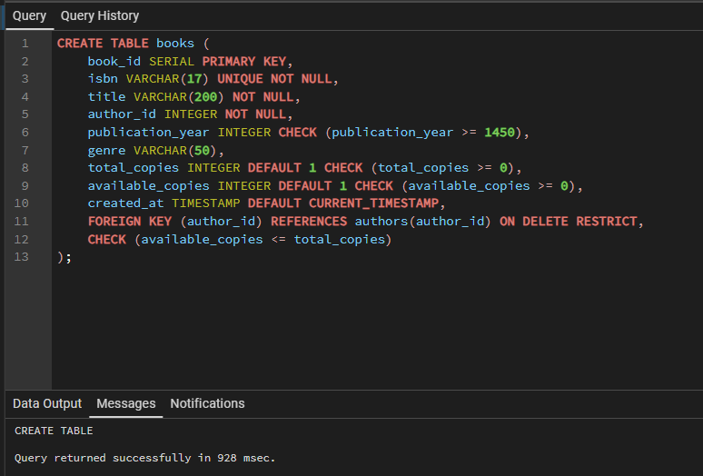<br><br>

#### Таблиця `readers`
```sql
CREATE TABLE readers (
    reader_id SERIAL PRIMARY KEY,
    first_name VARCHAR(50) NOT NULL,
    last_name VARCHAR(50) NOT NULL,
    email VARCHAR(100) UNIQUE NOT NULL,
    phone VARCHAR(20),
    library_card_number VARCHAR(20) UNIQUE NOT NULL,
    registration_date DATE DEFAULT CURRENT_DATE,
    status VARCHAR(20) DEFAULT 'Active' CHECK (status IN ('Active', 'Blocked', 'Inactive'))
);
```
- **Результат:** `CREATE TABLE` (`Query returned successfully in 34 msec`).
- **Обмеження:** `UNIQUE` на `email` та `library_card_number`, обов'язкові імена (`NOT NULL`) і обмеження допустимих статусів `CHECK (status IN ('Active', 'Blocked', 'Inactive'))`.

Скріншот:<br><br>
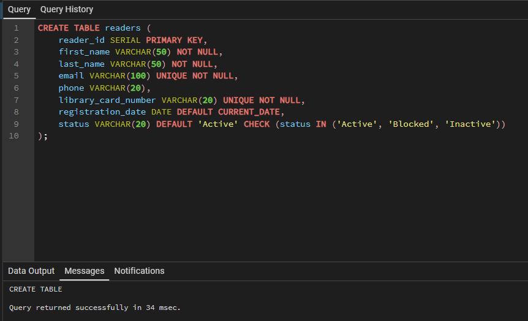<br><br>

#### Таблиця `lendings`
```sql
CREATE TABLE lendings (
    lending_id SERIAL PRIMARY KEY,
    book_id INTEGER NOT NULL,
    reader_id INTEGER NOT NULL,
    lending_date DATE DEFAULT CURRENT_DATE,
    due_date DATE NOT NULL,
    return_date DATE,
    FOREIGN KEY (book_id) REFERENCES books(book_id) ON DELETE RESTRICT,
    FOREIGN KEY (reader_id) REFERENCES readers(reader_id) ON DELETE RESTRICT,
    CHECK (due_date > lending_date),
    CHECK (return_date IS NULL OR return_date >= lending_date)
);
```
- **Результат:** `CREATE TABLE` (`Query returned successfully in 36 msec`).
- **Обмеження:** зовнішні ключі на `books(book_id)` і `readers(reader_id)` з `ON DELETE RESTRICT`, а також перевірки коректності дат (`due_date > lending_date` та `return_date IS NULL OR return_date >= lending_date`).

Скріншот:<br><br>
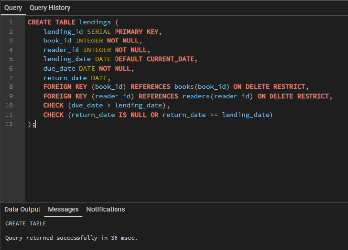<br><br>
### Крок 2. Додавання тестових даних

Виконано наповнення таблиць `authors`, `books` та `readers` початковими тестовими даними з дотриманням усіх обмежень цілісності та зв'язків між таблицями.

#### Додавання авторів (`authors`)
```sql
INSERT INTO authors (first_name, last_name, birth_year, country)
VALUES
    ('Тарас', 'Шевченко', 1814, 'Україна'),
    ('Іван', 'Франко', 1856, 'Україна'),
    ('Леся', 'Українка', 1871, 'Україна'),
    ('Михайло', 'Коцюбинський', 1864, 'Україна'),
    ('Панас', 'Мирний', 1849, 'Україна');
```
- **Результат:** `INSERT 0 5` (`Query returned successfully in 41 msec`) — додано 5 записів авторів.

Скріншот:<br><br>
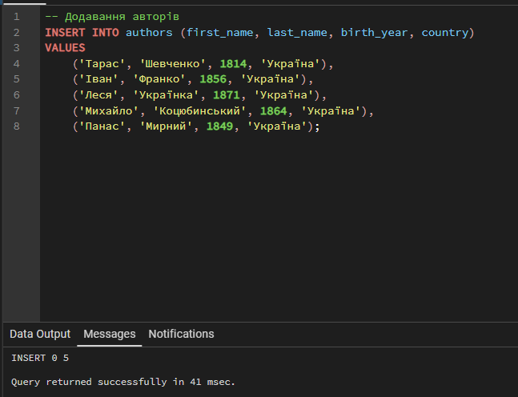<br><br>

#### Додавання книг (`books`)
```sql
INSERT INTO books (isbn, title, author_id, publication_year, genre, total_copies, available_copies)
VALUES
    ('978-966-03-4561-2', 'Кобзар', 1, 1840, 'Поезія', 10, 8),
    ('978-966-03-4562-9', 'Захар Беркут', 2, 1883, 'Історична проза', 5, 4),
    ('978-966-03-4563-6', 'Лісова пісня', 3, 1911, 'Драма', 7, 7),
    ('978-966-03-4564-3', 'Тіні забутих предків', 4, 1911, 'Повість', 6, 5),
    ('978-966-03-4565-0', 'Хіба ревуть воли, як ясла повні', 5, 1880, 'Повість', 4, 4);
```
- **Результат:** `INSERT 0 5` (`Query returned successfully in 33 msec`) — додано 5 записів книг із прив'язкою до існуючих `author_id` та дотриманням умови `available_copies <= total_copies`.

Скріншот:<br><br>
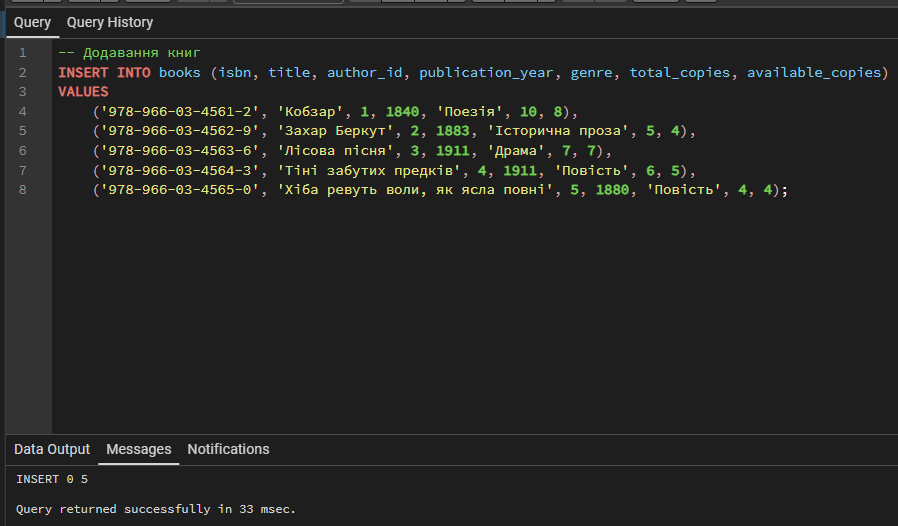<br><br>

#### Додавання читачів (`readers`)
```sql
INSERT INTO readers (first_name, last_name, email, phone, library_card_number)
VALUES
    ('Олена', 'Петренко', 'olena.petrenko@email.com', '+380501234567', 'LIB-2024-001'),
    ('Андрій', 'Коваленко', 'andrii.kovalenko@email.com', '+380502345678', 'LIB-2024-002'),
    ('Марія', 'Сидоренко', 'maria.sydorenko@email.com', '+380503456789', 'LIB-2024-003'),
    ('Іван', 'Мельник', 'ivan.melnyk@email.com', '+380504567890', 'LIB-2024-004');
```
- **Результат:** `INSERT 0 4` (`Query returned successfully in 31 msec`) — додано 4 записи читачів з унікальними email та номерами читацьких квитків.

Скріншот:<br><br>
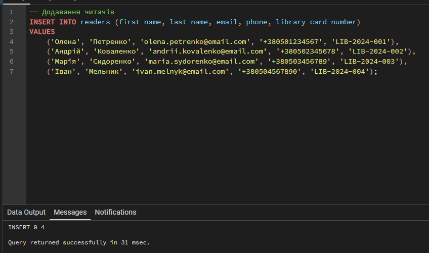<br><br>

### Крок 3. Безпечне оновлення записів

Виконано безпечне оновлення записів у таблиці `books` із використанням умов `WHERE`, попередньою перевіркою стану даних через `SELECT` та контролем кількості рядків перед зміною.

```sql
-- 1. Перевірка поточного стану перед оновленням
SELECT book_id, title, total_copies, available_copies
FROM books
WHERE book_id = 1;

-- 2. Безпечне оновлення кількості доступних примірників з умовою WHERE
UPDATE books
SET available_copies = available_copies - 1
WHERE book_id = 1 AND available_copies > 0;

-- 3. Перевірка результату після оновлення
SELECT book_id, title, total_copies, available_copies
FROM books
WHERE book_id = 1;

-- 4. Перевірка кількості записів перед оновленням за жанром
SELECT COUNT(*)
FROM books
WHERE genre = 'Поезія';

-- 5. Безпечне оновлення тільки для записів з genre = 'Поезія'
UPDATE books
SET total_copies = total_copies + 2
WHERE genre = 'Поезія';

-- 6. Перевірка книги після оновлення total_copies
SELECT book_id, title, total_copies, available_copies
FROM books
WHERE book_id = 1;
```
- **Результат:** Послідовно зменшено `available_copies` для книги з `book_id = 1` («Кобзар») з `8` до `7` за умовою `book_id = 1 AND available_copies > 0`, перевірено кількість записів за умовою `genre = 'Поезія'` (`COUNT(*) = 1`) та збільшено `total_copies` на `2` (з `10` до `12`) лише для відповідних рядків. У вкладці `Data Output` зафіксовано підсумковий рядок: `book_id = 1`, `title = Кобзар`, `total_copies = 12`, `available_copies = 7`.

Скріншот:<br><br>
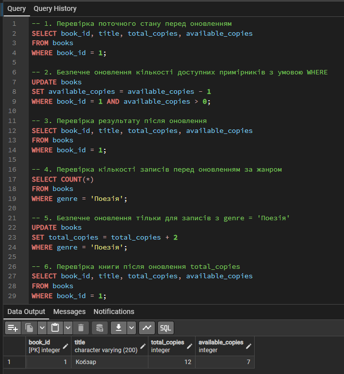<br><br>
### Крок 4. Видалення з урахуванням зовнішніх ключів та прості транзакції

Оскільки в структурі бази даних використано обмеження `ON DELETE RESTRICT` на зовнішніх ключах та відсутня таблиця `reservations` із чернетки методики, видалення та транзакційну логіку реалізовано на наявних таблицях (`authors`, `books`, `readers`, `lendings`) згідно з вимогами рівня.

#### Видалення записів з урахуванням зовнішніх ключів (`ON DELETE RESTRICT`)
```sql
-- 1. Спроба видалити автора, на якого посилається таблиця books (має викликати помилку FK RESTRICT)
DELETE FROM authors
WHERE author_id = 1;

-- 2. Додаємо тимчасового читача і одразу видаляємо його (запис без залежностей у lendings видаляється успішно)
INSERT INTO readers (first_name, last_name, email, phone, library_card_number)
VALUES ('Тест', 'Читач', 'test.reader@email.com', '+380500000000', 'LIB-TEST-999');

DELETE FROM readers
WHERE library_card_number = 'LIB-TEST-999';
```
- **Результат:** Спроба видалити автора з `author_id = 1` заблокована СУБД (`ERROR: оновлення або видалення в таблиці "authors" порушує налаштування RESTRICT зовнішнього ключа "books_author_id_fkey" в таблиці "books"`, `SQL state: 23001`), що підтверджує захист цілісності даних при наявності пов'язаних книг.

Скріншот:<br><br>
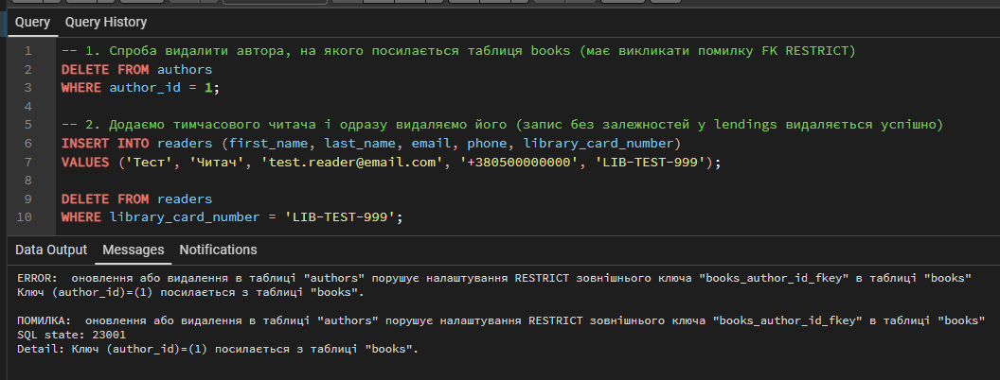<br><br>

#### Проста транзакція для групування операцій видачі книги
```sql
BEGIN;

INSERT INTO lendings (book_id, reader_id, due_date)
VALUES (1, 1, CURRENT_DATE + INTERVAL '14 days')
RETURNING lending_id, book_id, reader_id, due_date;

UPDATE books
SET available_copies = available_copies - 1
WHERE book_id = 1 AND available_copies > 0
RETURNING book_id, title, available_copies;

SELECT l.lending_id, b.title, r.first_name, r.last_name, l.due_date
FROM lendings l
JOIN books b ON l.book_id = b.book_id
JOIN readers r ON l.reader_id = r.reader_id
WHERE l.lending_id = 1;

COMMIT;
```
- **Результат:** `COMMIT` (`Query returned successfully in 43 msec`) — запис про видачу книги (`book_id = 1`, `reader_id = 1`), зменшення кількості доступних примірників (`available_copies - 1`) та контрольна вибірка з `JOIN` виконані як єдина атомарна транзакція

Скріншот:<br><br>
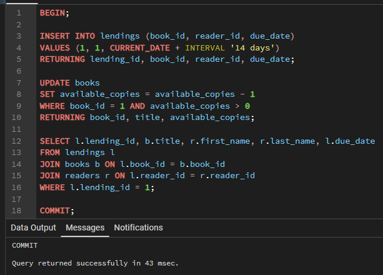<br><br>
### Крок 5. Демонстрація механізму `ROLLBACK` при помилках

Виконано перевірку роботи механізму відкату транзакцій (`ROLLBACK`) у разі виникнення помилки порушення обмеження зовнішнього ключа (`FOREIGN KEY` з `ON DELETE RESTRICT`) під час спроби видалення автора (`author_id = 1`), на якого посилаються записи з таблиці `books`.

```sql
BEGIN;

-- Перевірка чи є книги автора
SELECT book_id, title
FROM books
WHERE author_id = 1;

-- Спроба видалення автора (викликає помилку через FOREIGN KEY / ON DELETE RESTRICT)
DELETE FROM authors
WHERE author_id = 1;

-- Відкат транзакції
ROLLBACK;

-- Перевірка, що дані не змінилися
SELECT *
FROM authors
WHERE author_id = 1;
```
- **Результат:** Після помилки порушення зовнішнього ключа (`books_author_id_fkey`) транзакцію успішно відкочено за допомогою `ROLLBACK`, а контрольний `SELECT` у `Data Output` підтвердив, що запис про автора (`author_id = 1`, `Тарас Шевченко`, `1814`, `Україна`) залишився без змін.

Скріншот:<br><br>
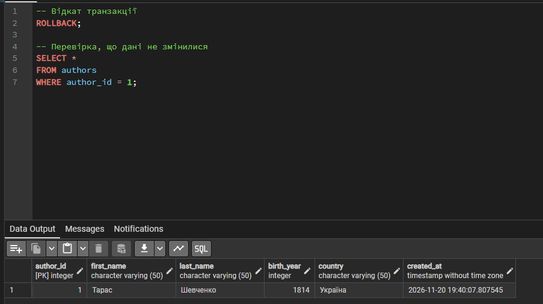<br><br>
## Рівень 2. Розширена функціональність

### Крок 1. Додавання нових таблиць

Створено додаткові таблиці `reservations` (для обліку бронювань книг із каскадним видаленням `ON DELETE CASCADE` при видаленні пов'язаної книги або читача) та `audit_log` (для зберігання історії змін у форматі `JSONB` із фіксацією часу та користувача), а також додано тестове бронювання для перевірки сценарію повернення книги.

```sql
-- КРОК 1: Нові таблиці reservations та audit_log
CREATE TABLE reservations (
    reservation_id SERIAL PRIMARY KEY,
    book_id INTEGER NOT NULL,
    reader_id INTEGER NOT NULL,
    reservation_date TIMESTAMP DEFAULT CURRENT_TIMESTAMP,
    expiration_date TIMESTAMP NOT NULL,
    status VARCHAR(20) DEFAULT 'Active' CHECK (status IN ('Active', 'Fulfilled', 'Cancelled', 'Expired')),
    FOREIGN KEY (book_id) REFERENCES books(book_id) ON DELETE CASCADE,
    FOREIGN KEY (reader_id) REFERENCES readers(reader_id) ON DELETE CASCADE
);

CREATE TABLE audit_log (
    log_id SERIAL PRIMARY KEY,
    table_name VARCHAR(50) NOT NULL,
    operation VARCHAR(10) NOT NULL,
    record_id INTEGER NOT NULL,
    old_data JSONB,
    new_data JSONB,
    changed_at TIMESTAMP DEFAULT CURRENT_TIMESTAMP,
    changed_by VARCHAR(100) DEFAULT CURRENT_USER
);

-- Підготовка бронювання для Кроку 2
INSERT INTO reservations (book_id, reader_id, expiration_date)
VALUES (1, 2, CURRENT_TIMESTAMP + INTERVAL '3 days')
RETURNING reservation_id, book_id, reader_id, status;
```
- **Результат:** Таблиці `reservations` та `audit_log` успішно створені; тестовий запис бронювання отримав `reservation_id = 1`, `book_id = 1`, `reader_id = 2`, `status = Active`.

Скріншот:<br><br>
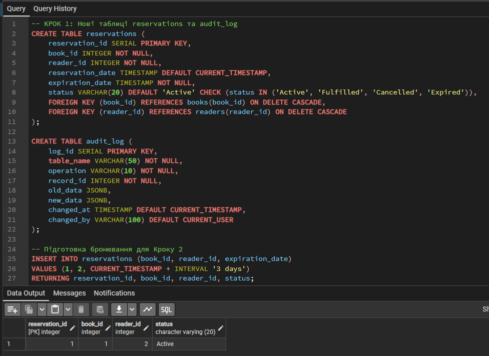<br><br>

### Крок 2. Складні транзакції

Реалізовано процес повернення книги (`lending_id = 1`) як єдину атомарну транзакцію (`BEGIN ... COMMIT`), що одночасно фіксує дату повернення (`return_date = CURRENT_DATE`), збільшує кількість доступних примірників книги (`available_copies + 1`) та переводить активне бронювання у статус `Fulfilled`.

```sql
-- КРОК 2: Складна транзакція повернення книги (lending_id = 1)
BEGIN;

UPDATE lendings
SET return_date = CURRENT_DATE
WHERE lending_id = 1 AND return_date IS NULL
RETURNING lending_id, book_id, reader_id, return_date;

UPDATE books
SET available_copies = available_copies + 1
WHERE book_id = (SELECT book_id FROM lendings WHERE lending_id = 1)
RETURNING book_id, title, available_copies;

UPDATE reservations
SET status = 'Fulfilled'
WHERE reservation_id = (
    SELECT reservation_id
    FROM reservations
    WHERE book_id = (SELECT book_id FROM lendings WHERE lending_id = 1)
      AND status = 'Active'
    ORDER BY reservation_date
    LIMIT 1
)
RETURNING reservation_id, book_id, reader_id, status;

COMMIT;

SELECT
    l.lending_id,
    b.title,
    r1.first_name || ' ' || r1.last_name AS borrower,
    l.return_date,
    r2.first_name || ' ' || r2.last_name AS next_reader,
    res.status AS reservation_status
FROM lendings l
JOIN books b ON l.book_id = b.book_id
JOIN readers r1 ON l.reader_id = r1.reader_id
LEFT JOIN reservations res ON b.book_id = res.book_id
LEFT JOIN readers r2 ON res.reader_id = r2.reader_id
WHERE l.lending_id = 1;
```
- **Результат:** Транзакція зафіксована (`COMMIT`), а контрольний запит у `Data Output` показав: `lending_id = 1`, `title = Кобзар`, `borrower = Олена Петренко`, `return_date = 2026-11-20`, `next_reader = Андрій Коваленко`, `reservation_status = Fulfilled`.

Скріншот:<br><br>
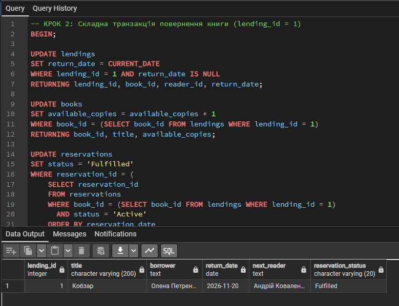<br><br>

### Крок 3. Використання `SAVEPOINT`

Продемонстровано частковий відкат транзакції за допомогою точок збереження (`SAVEPOINT after_author`, `SAVEPOINT after_first_book` та `ROLLBACK TO SAVEPOINT after_first_book`) після виникнення помилки дубліката унікального поля `isbn` (`SQL state: 23505`), без необхідності скасовувати вже додані записи автора та першої книги.

```sql
-- КРОК 3: Використання SAVEPOINT для часткового відкату
BEGIN;

INSERT INTO authors (first_name, last_name, birth_year, country)
VALUES ('Ольга', 'Кобилянська', 1863, 'Україна')
RETURNING author_id;

SAVEPOINT after_author;

INSERT INTO books (isbn, title, author_id, publication_year, genre, total_copies, available_copies)
VALUES ('978-966-03-4566-7', 'Земля', currval('authors_author_id_seq'), 1902, 'Роман', 3, 3)
RETURNING book_id, title, isbn;

SAVEPOINT after_first_book;

-- Навмисна помилка дубліката ISBN
INSERT INTO books (isbn, title, author_id, publication_year, genre)
VALUES ('978-966-03-4566-7', 'Інша книга', currval('authors_author_id_seq'), 1905, 'Роман');
```
- **Результат (перша частина):** Спроба вставити дублікат ISBN `'978-966-03-4566-7'` викликала помилку обмеження унікальності `books_isbn_key` (`SQL state: 23505`), але попередні операції залишилися доступними після часткового відкату.

Скріншот:<br><br>
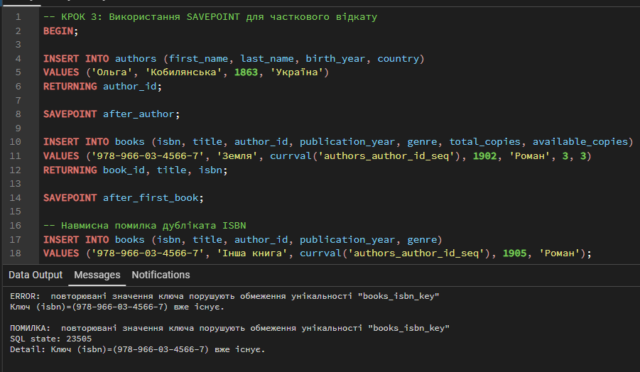<br><br>

```sql
ROLLBACK TO SAVEPOINT after_first_book;

INSERT INTO books (isbn, title, author_id, publication_year, genre, total_copies, available_copies)
VALUES ('978-966-03-4567-4', 'Царівна', currval('authors_author_id_seq'), 1896, 'Повість', 2, 2)
RETURNING book_id, title, isbn;

COMMIT;

SELECT a.author_id, a.first_name, a.last_name, b.book_id, b.title, b.isbn
FROM authors a
JOIN books b ON a.author_id = b.author_id
WHERE a.last_name = 'Кобилянська'
ORDER BY b.book_id;
```
- **Результат (завершення транзакції та перевірка):** Після `ROLLBACK TO SAVEPOINT after_first_book` додано книгу «Царівна» (`isbn = 978-966-03-4567-4`) та виконано `COMMIT`; вибірка підтвердила наявність автора `author_id = 6` (`Ольга Кобилянська`) та двох його книг — «Земля» (`book_id = 6`) і «Царівна» (`book_id = 8`, оскільки `book_id = 7` було використано невдалою вставкою перед відкатом).

Скріншот:<br><br>
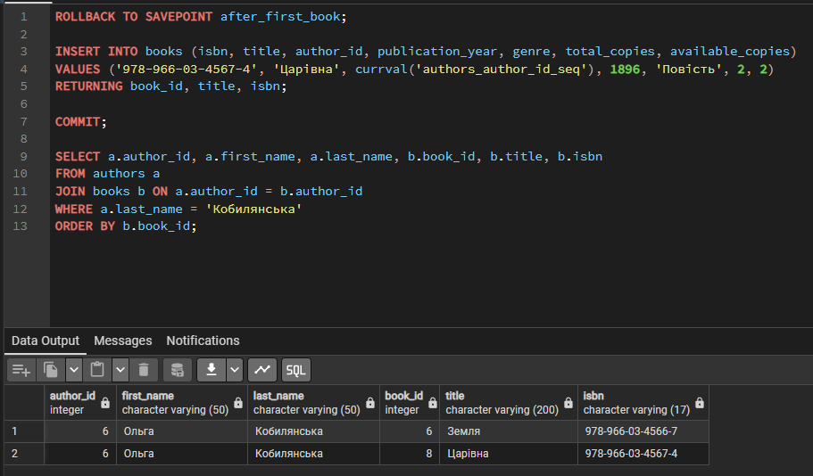<br><br>

### Крок 4. Каскадні операції

Перевірено роботу каскадного видалення (`ON DELETE CASCADE`) на зв'язку між книгами та бронюваннями у таблиці `reservations` при створенні й подальшому видаленні тестових даних.

```sql
-- КРОК 4: Каскадне видалення через ON DELETE CASCADE
BEGIN;

INSERT INTO authors (first_name, last_name, birth_year, country)
VALUES ('Тестовий', 'Автор', 1900, 'Україна')
RETURNING author_id;

INSERT INTO books (isbn, title, author_id, publication_year, genre, total_copies, available_copies)
VALUES ('978-966-00-0000-0', 'Тестова книга', currval('authors_author_id_seq'), 2000, 'Тест', 1, 0)
RETURNING book_id, title;

INSERT INTO reservations (book_id, reader_id, expiration_date)
VALUES (currval('books_book_id_seq'), 1, CURRENT_TIMESTAMP + INTERVAL '7 days')
RETURNING reservation_id, book_id, status;

COMMIT;

-- Перевірка зв'язку перед видаленням
SELECT b.book_id, b.title, b.isbn, r.reservation_id, r.status
FROM books b
LEFT JOIN reservations r ON b.book_id = r.book_id
WHERE b.isbn = '978-966-00-0000-0';

-- Видалення книги (каскадно видаляє пов'язане бронювання)
DELETE FROM books
WHERE isbn = '978-966-00-0000-0'
RETURNING book_id, title;

-- Перевірка, що бронювання видалилося, і видалення тестового автора
SELECT *
FROM reservations
WHERE book_id NOT IN (SELECT book_id FROM books);

DELETE FROM authors
WHERE first_name = 'Тестовий' AND last_name = 'Автор'
RETURNING author_id, first_name, last_name;
```
- **Результат:** Тестові сутності створено та перевірено (`author_id = 7`, `Тестовий Автор`), а при видаленні книги з `isbn = '978-966-00-0000-0'` пов'язане бронювання автоматично видалилося завдяки `ON DELETE CASCADE`, після чого тестового автора також можна було коректно видалити.

Скріншот:<br><br>
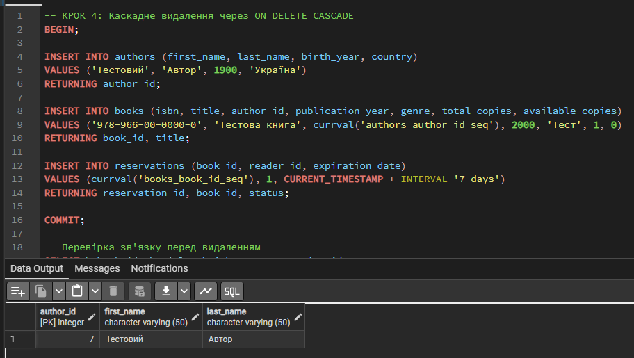<br><br>

### Крок 5. Тригери для аудиту

Створено функцію `log_books_changes()` та тригер `books_audit_trigger` (`AFTER INSERT OR UPDATE OR DELETE ON books FOR EACH ROW`), які автоматично фіксують у таблиці `audit_log` тип операції, ідентифікатор запису, попередні та нові дані (`old_data`, `new_data`), час зміни та користувача (`changed_by`).

```sql
-- КРОК 5: Тригер для аудиту змін таблиці books
CREATE OR REPLACE FUNCTION log_books_changes()
RETURNS TRIGGER AS $$
BEGIN
    IF TG_OP = 'INSERT' THEN
        INSERT INTO audit_log (table_name, operation, record_id, new_data)
        VALUES ('books', 'INSERT', NEW.book_id, row_to_json(NEW)::jsonb);
    ELSIF TG_OP = 'UPDATE' THEN
        INSERT INTO audit_log (table_name, operation, record_id, old_data, new_data)
        VALUES ('books', 'UPDATE', NEW.book_id, row_to_json(OLD)::jsonb, row_to_json(NEW)::jsonb);
    ELSIF TG_OP = 'DELETE' THEN
        INSERT INTO audit_log (table_name, operation, record_id, old_data)
        VALUES ('books', 'DELETE', OLD.book_id, row_to_json(OLD)::jsonb);
    END IF;
    RETURN NULL;
END;
$$ LANGUAGE plpgsql;

CREATE TRIGGER books_audit_trigger
AFTER INSERT OR UPDATE OR DELETE ON books
FOR EACH ROW
EXECUTE FUNCTION log_books_changes();

-- Тестування INSERT, UPDATE та DELETE для перевірки тригера
INSERT INTO books (isbn, title, author_id, publication_year, genre, total_copies, available_copies)
VALUES ('978-966-03-9999-9', 'Нова книга', 2, 2024, 'Сучасна', 5, 5);

UPDATE books
SET available_copies = available_copies - 1
WHERE isbn = '978-966-03-9999-9';

DELETE FROM books
WHERE isbn = '978-966-03-9999-9';

SELECT
    log_id,
    operation,
    record_id,
    COALESCE(new_data->>'title', old_data->>'title') AS title,
    old_data->>'available_copies' AS old_copies,
    new_data->>'available_copies' AS new_copies,
    to_char(changed_at, 'YYYY-MM-DD HH24:MI:SS') AS changed_time,
    changed_by
FROM audit_log
WHERE table_name = 'books'
ORDER BY log_id DESC
LIMIT 10;
```
- **Результат:** У `Data Output` зафіксовано три послідовні записи в `audit_log` для `record_id = 10` («Нова книга»): `INSERT` (`old_copies = [null]`, `new_copies = 5`), `UPDATE` (`old_copies = 5`, `new_copies = 4`) та `DELETE` (`old_copies = 4`, `new_copies = [null]`) від користувача `postgres`.

Скріншот:<br><br>
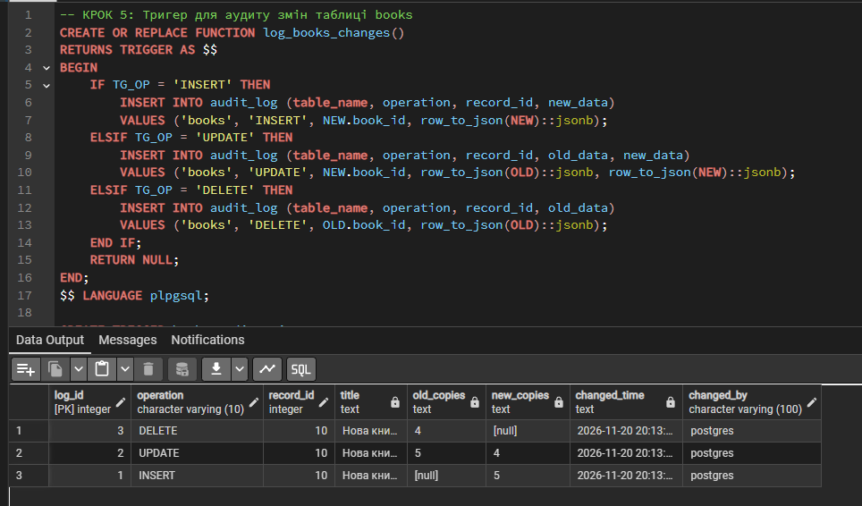<br><br>

### Крок 6. Блокування записів

Продемонстровано блокування рядка для оновлення за допомогою `SELECT ... FOR UPDATE` у межах транзакції (`BEGIN ... COMMIT`) з імітацією затримки (`pg_sleep`) та подальшим оновленням кількості доступних примірників.

```sql
-- КРОК 6: Блокування записів через FOR UPDATE
BEGIN;

SELECT book_id, title, available_copies
FROM books
WHERE book_id = 1
FOR UPDATE;

SELECT pg_sleep(2);

UPDATE books
SET available_copies = available_copies - 1
WHERE book_id = 1 AND available_copies > 0
RETURNING book_id, title, available_copies;

COMMIT;

SELECT book_id, title, available_copies
FROM books
WHERE book_id = 1;
```
- **Результат:** Рядок для `book_id = 1` («Кобзар») було заблоковано на час виконання транзакції, після чого `available_copies` коректно зменшився до `6` і зафіксувався після `COMMIT`.

Скріншот:<br><br>
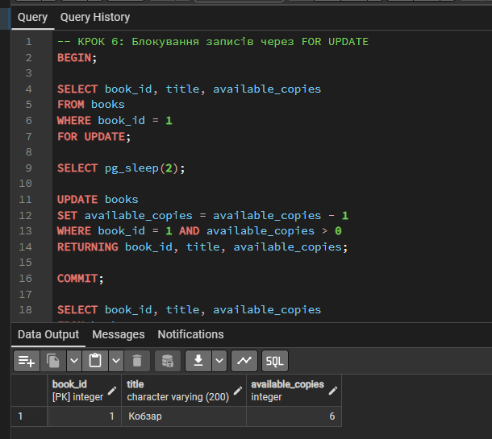<br><br>
## Рівень 3. Творче розширення

### Крок 1. Система версіонування

Реалізовано механізм автоматичного збереження версій записів таблиці `books` у таблиці `books_versions` через функцію `create_book_version()` та тригер `book_versioning_trigger` (`AFTER INSERT OR UPDATE ON books FOR EACH ROW`), а також додано функцію `get_book_version(p_book_id, p_date)` для отримання стану запису у форматі `JSONB` на задану дату.

```sql
CREATE TABLE IF NOT EXISTS books_versions (
    version_id SERIAL PRIMARY KEY,
    book_id INTEGER NOT NULL,
    version_number INTEGER NOT NULL,
    data JSONB NOT NULL,
    valid_from TIMESTAMP DEFAULT CURRENT_TIMESTAMP,
    valid_to TIMESTAMP,
    created_by VARCHAR(100) DEFAULT CURRENT_USER,
    UNIQUE(book_id, version_number)
);

CREATE OR REPLACE FUNCTION create_book_version()
RETURNS TRIGGER AS $$
DECLARE
    v_version_number INTEGER;
BEGIN
    UPDATE books_versions
    SET valid_to = CURRENT_TIMESTAMP
    WHERE book_id = NEW.book_id AND valid_to IS NULL;

    SELECT COALESCE(MAX(version_number), 0) + 1
    INTO v_version_number
    FROM books_versions
    WHERE book_id = NEW.book_id;

    INSERT INTO books_versions (book_id, version_number, data)
    VALUES (NEW.book_id, v_version_number, row_to_json(NEW)::jsonb);

    RETURN NEW;
END;
$$ LANGUAGE plpgsql;

DROP TRIGGER IF EXISTS book_versioning_trigger ON books;

CREATE TRIGGER book_versioning_trigger
AFTER INSERT OR UPDATE ON books
FOR EACH ROW
EXECUTE FUNCTION create_book_version();

CREATE OR REPLACE FUNCTION get_book_version(p_book_id INTEGER, p_date TIMESTAMP)
RETURNS JSONB AS $$
BEGIN
    RETURN (
        SELECT data
        FROM books_versions
        WHERE book_id = p_book_id
            AND valid_from <= p_date
            AND (valid_to IS NULL OR valid_to > p_date)
        ORDER BY version_number DESC
        LIMIT 1
    );
END;
$$ LANGUAGE plpgsql;

INSERT INTO books (isbn, title, author_id, publication_year, genre, total_copies, available_copies)
VALUES ('978-966-03-7777-7', 'Версійована книга', 3, 2020, 'Тест', 10, 10)
ON CONFLICT (isbn) DO NOTHING;

UPDATE books
SET available_copies = 8
WHERE isbn = '978-966-03-7777-7';

UPDATE books
SET available_copies = 5, genre = 'Оновлений жанр'
WHERE isbn = '978-966-03-7777-7';

SELECT
    version_id,
    book_id,
    version_number,
    data->>'title' AS title,
    data->>'available_copies' AS copies,
    data->>'genre' AS genre,
    to_char(valid_from, 'YYYY-MM-DD HH24:MI:SS') AS valid_from,
    to_char(valid_to, 'YYYY-MM-DD HH24:MI:SS') AS valid_to
FROM books_versions
WHERE book_id = (SELECT book_id FROM books WHERE isbn = '978-966-03-7777-7')
ORDER BY version_number;

SELECT get_book_version(
    (SELECT book_id FROM books WHERE isbn = '978-966-03-7777-7'),
    CURRENT_TIMESTAMP::timestamp
);
```
- **Результат:** Створення та оновлення книги з `isbn = '978-966-03-7777-7'` (`book_id = 14`, «Версійована книга») зафіксувалися у версіях, а виклик `get_book_version(...)` повернув у `Data Output` об'єкт `jsonb` з актуальними даними (`"genre": "Оновлений жанр"`, `"total_copies": 10`, `"author_id": 3`).

Скріншот:<br><br>
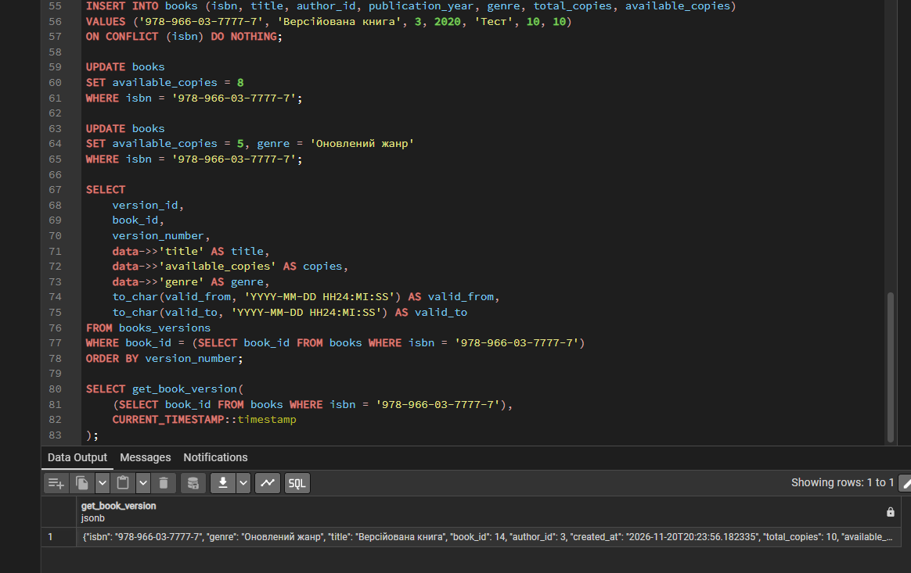<br><br>

### Крок 2. Відкладені операції

Створено таблицю `scheduled_operations` та функцію `execute_scheduled_operations()` для планування та виконання відкладених операцій (`EXPIRE_RESERVATION`, `UPDATE_BOOK_STATUS`, `BLOCK_READER`) із контролем статусів (`Pending`, `Executed`, `Failed`, `Cancelled`) та фіксацією помилок.

```sql
ALTER TABLE readers
ADD COLUMN IF NOT EXISTS status VARCHAR(20) DEFAULT 'Active';

CREATE TABLE IF NOT EXISTS scheduled_operations (
    operation_id SERIAL PRIMARY KEY,
    operation_type VARCHAR(50) NOT NULL,
    target_table VARCHAR(50) NOT NULL,
    operation_data JSONB NOT NULL,
    scheduled_for TIMESTAMP NOT NULL,
    status VARCHAR(20) DEFAULT 'Pending' CHECK (status IN ('Pending', 'Executed', 'Failed', 'Cancelled')),
    executed_at TIMESTAMP,
    error_message TEXT,
    created_at TIMESTAMP DEFAULT CURRENT_TIMESTAMP
);

CREATE OR REPLACE FUNCTION execute_scheduled_operations()
RETURNS INTEGER AS $$
DECLARE
    v_operation RECORD;
    v_count INTEGER := 0;
BEGIN
    FOR v_operation IN
        SELECT * FROM scheduled_operations
        WHERE status = 'Pending' AND scheduled_for <= CURRENT_TIMESTAMP
        ORDER BY operation_id
    LOOP
        BEGIN
            CASE v_operation.operation_type
                WHEN 'UPDATE_BOOK_STATUS' THEN
                    UPDATE books
                    SET available_copies = (v_operation.operation_data->>'available_copies')::INTEGER
                    WHERE book_id = (v_operation.operation_data->>'book_id')::INTEGER;

                WHEN 'EXPIRE_RESERVATION' THEN
                    UPDATE reservations
                    SET status = 'Expired'
                    WHERE reservation_id = (v_operation.operation_data->>'reservation_id')::INTEGER;

                WHEN 'BLOCK_READER' THEN
                    UPDATE readers
                    SET status = 'Blocked'
                    WHERE reader_id = (v_operation.operation_data->>'reader_id')::INTEGER;
            END CASE;

            UPDATE scheduled_operations
            SET status = 'Executed', executed_at = CURRENT_TIMESTAMP
            WHERE operation_id = v_operation.operation_id;

            v_count := v_count + 1;
        EXCEPTION WHEN OTHERS THEN
            UPDATE scheduled_operations
            SET status = 'Failed',
                executed_at = CURRENT_TIMESTAMP,
                error_message = SQLERRM
            WHERE operation_id = v_operation.operation_id;
        END;
    END LOOP;

    RETURN v_count;
END;
$$ LANGUAGE plpgsql;

INSERT INTO reservations (book_id, reader_id, expiration_date, status)
VALUES (2, 3, CURRENT_TIMESTAMP + INTERVAL '1 minute', 'Active')
RETURNING reservation_id;

INSERT INTO scheduled_operations (operation_type, target_table, operation_data, scheduled_for)
VALUES (
    'EXPIRE_RESERVATION',
    'reservations',
    jsonb_build_object('reservation_id', currval('reservations_reservation_id_seq')),
    CURRENT_TIMESTAMP - INTERVAL '1 second'
)
RETURNING operation_id, operation_type, status, scheduled_for;

SELECT execute_scheduled_operations();

SELECT operation_id, operation_type, status, executed_at, error_message
FROM scheduled_operations
ORDER BY operation_id DESC
LIMIT 2;

SELECT reservation_id, status
FROM reservations
WHERE reservation_id = currval('reservations_reservation_id_seq');
```
- **Результат:** Виконання `execute_scheduled_operations()` обробило заплановану операцію та перевело бронювання `reservation_id = 3` у статус `Expired`.

Скріншот:<br><br>
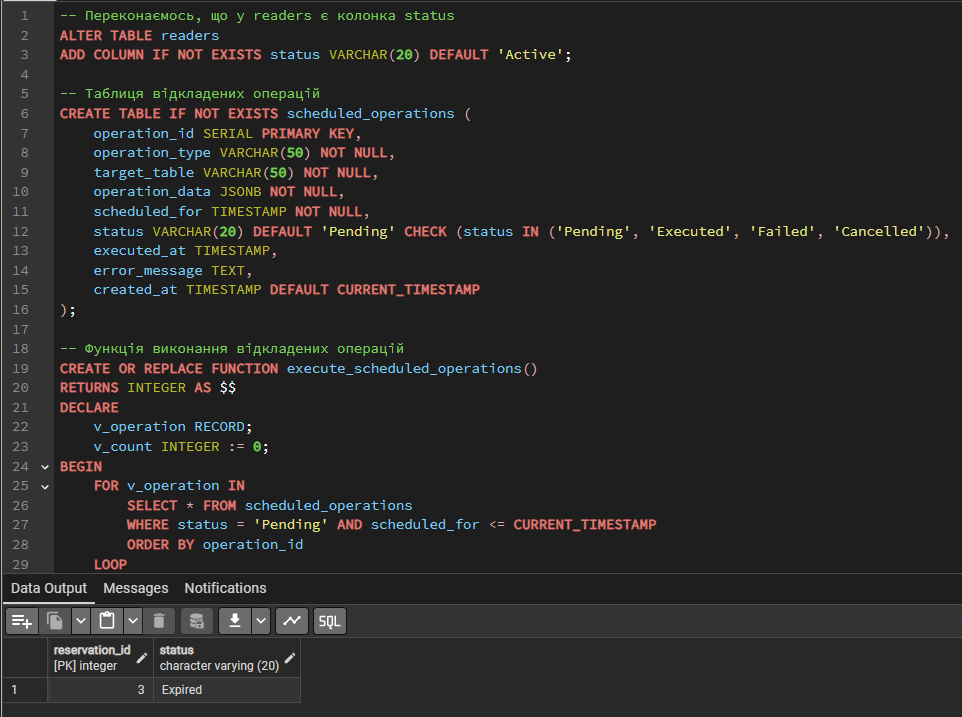<br><br>

### Крок 3. Складна бізнес-логіка

Реалізовано функцію `extend_lending(p_lending_id, p_days)` для автоматичного продовження терміну повернення виданої книги з перевіркою активності видачі, статусу читача (`Blocked`) та наявності прострочених неповернутих книг.

```sql
CREATE OR REPLACE FUNCTION extend_lending(
    p_lending_id INTEGER,
    p_days INTEGER DEFAULT 7
)
RETURNS TABLE (
    success BOOLEAN,
    message TEXT,
    new_due_date DATE
) AS $$
DECLARE
    v_reader_status VARCHAR(20);
    v_current_due_date DATE;
    v_reader_id INTEGER;
    v_overdue_count INTEGER;
BEGIN
    SELECT r.status, l.due_date, l.reader_id
    INTO v_reader_status, v_current_due_date, v_reader_id
    FROM lendings l
    JOIN readers r ON l.reader_id = r.reader_id
    WHERE l.lending_id = p_lending_id AND l.return_date IS NULL;

    IF NOT FOUND THEN
        RETURN QUERY SELECT FALSE, 'Видача не знайдена або книга вже повернена'::TEXT, NULL::DATE;
        RETURN;
    END IF;

    IF v_reader_status = 'Blocked' THEN
        RETURN QUERY SELECT FALSE, 'Читач заблокований'::TEXT, NULL::DATE;
        RETURN;
    END IF;

    SELECT COUNT(*)
    INTO v_overdue_count
    FROM lendings
    WHERE reader_id = v_reader_id
        AND return_date IS NULL
        AND due_date < CURRENT_DATE;

    IF v_overdue_count > 0 THEN
        RETURN QUERY SELECT FALSE, 'У читача є прострочені книги'::TEXT, NULL::DATE;
        RETURN;
    END IF;

    UPDATE lendings
    SET due_date = due_date + p_days
    WHERE lending_id = p_lending_id;

    RETURN QUERY SELECT TRUE, 'Термін продовжено'::TEXT, (v_current_due_date + p_days)::DATE;
END;
$$ LANGUAGE plpgsql;

INSERT INTO lendings (book_id, reader_id, due_date)
VALUES (2, 2, CURRENT_DATE + INTERVAL '7 days')
RETURNING lending_id, due_date;

SELECT * FROM extend_lending(currval('lendings_lending_id_seq')::INTEGER, 14);
```
- **Результат:** Виклик `extend_lending` на 14 днів пройшов успішно (`success = true`, повідомлення про продовження терміну, `new_due_date = 2026-12-11`).

Скріншот:<br><br>
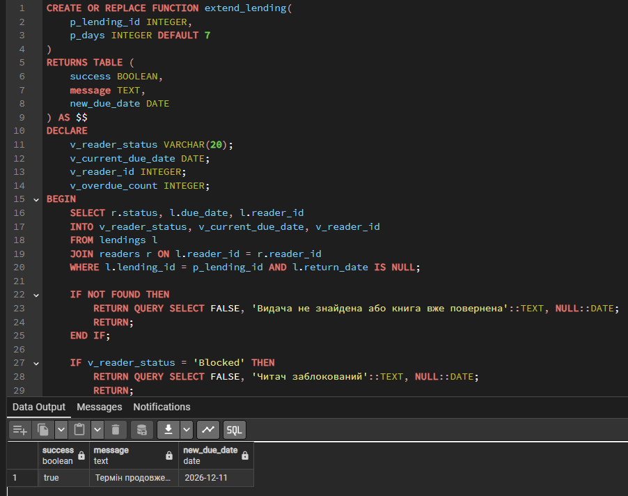<br><br>

### Крок 4. Система прав доступу

Створено ролі `librarian_read`, `librarian_write` та `library_admin`, користувачів `librarian1`, `librarian2` та `admin1`, налаштовано розмежування привілеїв на таблиці та послідовності у схемі `public` з урахуванням залежних таблиць аудиту/версіонування та виконано перевірку призначення ролей.

```sql
DO $$
BEGIN
    IF NOT EXISTS (SELECT 1 FROM pg_roles WHERE rolname = 'librarian_read') THEN
        CREATE ROLE librarian_read;
    END IF;
    IF NOT EXISTS (SELECT 1 FROM pg_roles WHERE rolname = 'librarian_write') THEN
        CREATE ROLE librarian_write;
    END IF;
    IF NOT EXISTS (SELECT 1 FROM pg_roles WHERE rolname = 'library_admin') THEN
        CREATE ROLE library_admin;
    END IF;
END
$$;

GRANT SELECT ON ALL TABLES IN SCHEMA public TO librarian_read;
GRANT SELECT, INSERT, UPDATE ON books, lendings, reservations, books_versions, audit_log TO librarian_write;
GRANT DELETE ON reservations TO librarian_write;
GRANT USAGE, SELECT ON ALL SEQUENCES IN SCHEMA public TO librarian_write;
GRANT ALL PRIVILEGES ON ALL TABLES IN SCHEMA public TO library_admin;
GRANT ALL PRIVILEGES ON ALL SEQUENCES IN SCHEMA public TO library_admin;

DO $$
BEGIN
    IF NOT EXISTS (SELECT 1 FROM pg_roles WHERE rolname = 'librarian1') THEN
        CREATE USER librarian1 WITH PASSWORD 'secure_password1';
    END IF;
    IF NOT EXISTS (SELECT 1 FROM pg_roles WHERE rolname = 'librarian2') THEN
        CREATE USER librarian2 WITH PASSWORD 'secure_password2';
    END IF;
    IF NOT EXISTS (SELECT 1 FROM pg_roles WHERE rolname = 'admin1') THEN
        CREATE USER admin1 WITH PASSWORD 'admin_password';
    END IF;
END
$$;

GRANT librarian_read TO librarian1;
GRANT librarian_write TO librarian2;
GRANT library_admin TO admin1;

SET ROLE librarian1;
SELECT count(*) AS books_count FROM books;
RESET ROLE;

SET ROLE librarian2;
UPDATE books SET available_copies = available_copies WHERE book_id = 1;
RESET ROLE;
```
- **Результат:** Запит завершився успішно (`Query returned successfully in 37 msec`), ролі та членство користувачів `librarian1`, `librarian2` і `admin1` коректно налаштовані та перевірені.

Скріншот:<br><br>
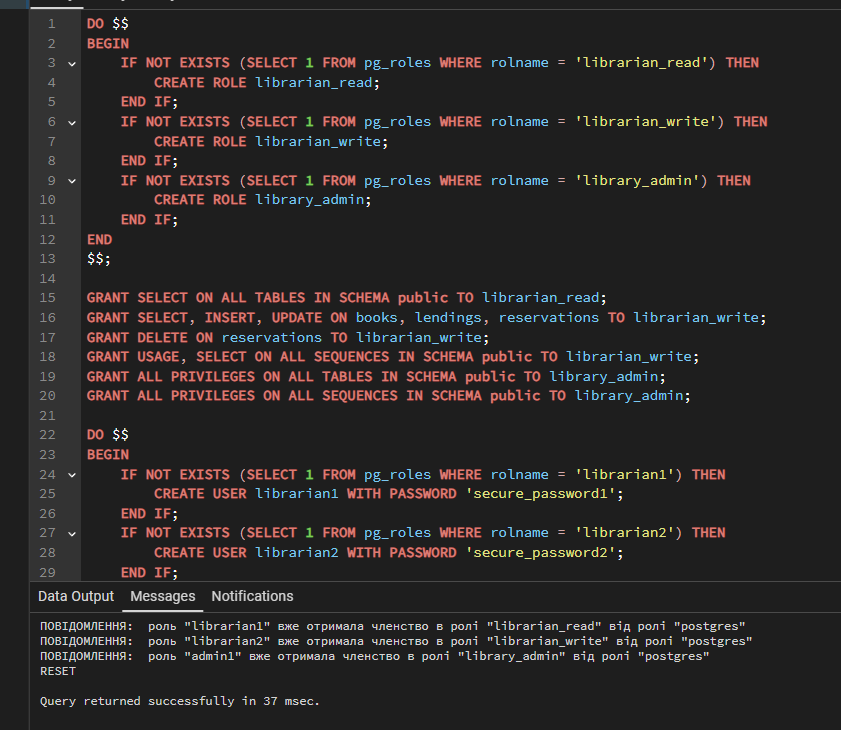<br><br>

### Крок 5. Автоматичне відновлення

Створено таблицю контрольних точок `backup_points` та функцію `create_backup_point(p_name, p_description)`, яка формує `JSONB`-знімок критичних таблиць (`books`, `authors`, `readers`, `lendings`) і зберігає точку відновлення.

```sql
CREATE TABLE IF NOT EXISTS backup_points (
    backup_id SERIAL PRIMARY KEY,
    backup_name VARCHAR(100) NOT NULL,
    backup_timestamp TIMESTAMP DEFAULT CURRENT_TIMESTAMP,
    description TEXT,
    data_snapshot JSONB
);

CREATE OR REPLACE FUNCTION create_backup_point(p_name VARCHAR, p_description TEXT DEFAULT NULL)
RETURNS INTEGER AS $$
DECLARE
    v_backup_id INTEGER;
    v_snapshot JSONB;
BEGIN
    SELECT jsonb_build_object(
        'books', (SELECT COALESCE(jsonb_agg(row_to_json(b)), '[]'::jsonb) FROM books b),
        'authors', (SELECT COALESCE(jsonb_agg(row_to_json(a)), '[]'::jsonb) FROM authors a),
        'readers', (SELECT COALESCE(jsonb_agg(row_to_json(r)), '[]'::jsonb) FROM readers r),
        'lendings', (SELECT COALESCE(jsonb_agg(row_to_json(l)), '[]'::jsonb) FROM lendings l)
    ) INTO v_snapshot;

    INSERT INTO backup_points (backup_name, description, data_snapshot)
    VALUES (p_name, p_description, v_snapshot)
    RETURNING backup_id INTO v_backup_id;

    RETURN v_backup_id;
END;
$$ LANGUAGE plpgsql;

SELECT create_backup_point('Before major update', 'Backup before system upgrade') AS backup_id;

SELECT backup_id, backup_name, backup_timestamp, description
FROM backup_points;
```
- **Результат:** У `Data Output` зафіксовано створення контрольної точки `backup_id = 1` з назвою `Before major update` та часовою міткою `2026-11-20 20:27:10.842856`.

Скріншот:<br><br>
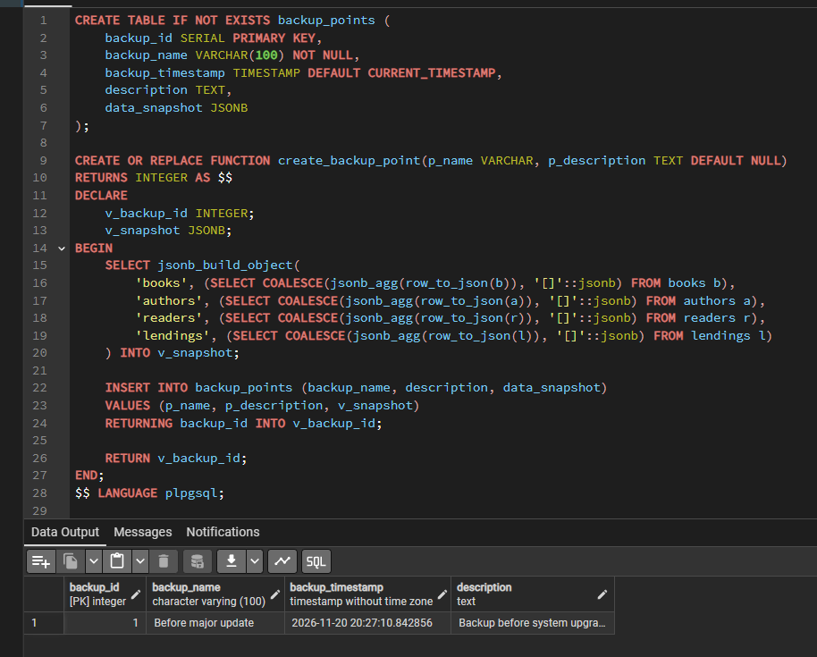<br><br>

### Крок 6. Інтерфейс перегляду історії

Створено представлення `books_change_history` для зручного читання історії змін книг з `audit_log` та функцію `get_changes_report(p_start_date, p_end_date)` для агрегації операцій (`INSERT`, `UPDATE`, `DELETE`) за обраний період.

```sql
CREATE OR REPLACE VIEW books_change_history AS
SELECT
    a.log_id,
    a.operation,
    a.record_id AS book_id,
    COALESCE(a.new_data->>'title', a.old_data->>'title') AS title,
    CASE
        WHEN a.operation = 'INSERT' THEN 'Додано нову книгу'
        WHEN a.operation = 'UPDATE' THEN
            'Оновлено: ' ||
            CASE
                WHEN a.old_data->>'available_copies' IS DISTINCT FROM a.new_data->>'available_copies'
                THEN 'Доступні примірники: ' || COALESCE(a.old_data->>'available_copies', 'NULL') || ' → ' || COALESCE(a.new_data->>'available_copies', 'NULL')
                ELSE 'Інші поля'
            END
        WHEN a.operation = 'DELETE' THEN 'Видалено книгу'
    END AS change_description,
    a.changed_at,
    a.changed_by
FROM audit_log a
WHERE a.table_name = 'books'
ORDER BY a.changed_at DESC;

CREATE OR REPLACE FUNCTION get_changes_report(
    p_start_date TIMESTAMP,
    p_end_date TIMESTAMP DEFAULT CURRENT_TIMESTAMP
)
RETURNS TABLE (
    change_date DATE,
    total_changes BIGINT,
    inserts BIGINT,
    updates BIGINT,
    deletes BIGINT
) AS $$
BEGIN
    RETURN QUERY
    SELECT
        DATE(changed_at) AS change_date,
        COUNT(*) AS total_changes,
        COUNT(*) FILTER (WHERE operation = 'INSERT') AS inserts,
        COUNT(*) FILTER (WHERE operation = 'UPDATE') AS updates,
        COUNT(*) FILTER (WHERE operation = 'DELETE') AS deletes
    FROM audit_log
    WHERE changed_at BETWEEN p_start_date AND p_end_date
    GROUP BY DATE(changed_at)
    ORDER BY change_date DESC;
END;
$$ LANGUAGE plpgsql;

SELECT * FROM books_change_history LIMIT 5;
SELECT * FROM get_changes_report(CURRENT_DATE - INTERVAL '30 days');
```
- **Результат:** Функція `get_changes_report` повернула у `Data Output` звіт за `2026-11-20` з показниками `total_changes = 7`, `inserts = 2`, `updates = 4`, `deletes = 1`.

Скріншот:<br><br>
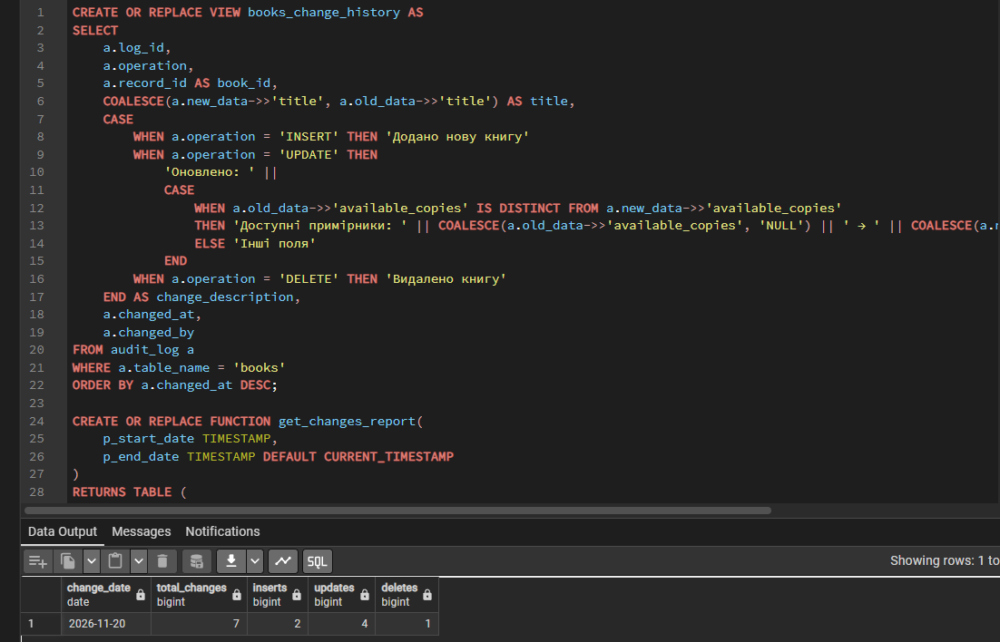<br><br>


## Контрольні запитання

### 1. У чому полягає різниця між операторами INSERT, UPDATE та DELETE? Які обмеження необхідно враховувати при їх використанні?

Оператор `INSERT` додає нові рядки до таблиці, `UPDATE` змінює значення існуючих полів у наявних рядках, а `DELETE` видаляє існуючі рядки з таблиці.

При їх використанні необхідно враховувати такі обмеження:
* `PRIMARY KEY` та `UNIQUE` — не допускають дублікатів і `NULL` для первинного ключа (наприклад, унікальність `isbn` у таблиці `books`).
* `NOT NULL` — забороняє залишати обов'язкові стовпці порожніми.
* `CHECK` — перевіряє коректність значень за умовою (наприклад, допустимі статуси бронювання в таблиці `reservations`).
* `FOREIGN KEY` — контролює посилальну цілісність між таблицями та визначає дію (`RESTRICT`, `CASCADE`, `SET NULL`, `SET DEFAULT`) при зміні чи видаленні пов'язаних записів.
* Права доступу ролей і користувачів (`GRANT` / `REVOKE`) на таблиці, послідовності та об'єкти, що задіюються під час виконання запитів або тригерів.

### 2. Чому використання умови WHERE є критично важливим в операціях UPDATE та DELETE? Які наслідки можуть бути від її пропуску?

Умова `WHERE` задає критерій відбору рядків, над якими виконується зміна або видалення. Якщо пропустити `WHERE`:
* `UPDATE` без `WHERE` оновить усі рядки таблиці;
* `DELETE` без `WHERE` видалить усі рядки таблиці (а за наявності `ON DELETE CASCADE` — і пов'язані записи в дочірніх таблицях).

Без `WHERE` легко масово пошкодити або втратити дані, після чого знадобиться відновлення з резервної копії чи контрольної точки.

### 3. Що таке транзакція та які властивості ACID вона забезпечує? Поясніть кожну властивість на конкретному прикладі.

**Транзакція** — це логічна одиниця роботи з базою даних, яка об'єднує одну або кілька операцій так, щоб вони виконувалися як єдине ціле.

Властивості **ACID**:
* **Atomicity (Атомарність)** — усі операції транзакції або виконуються повністю, або повністю відкочуються (наприклад, повернення книги одночасно оновлює `lendings`, збільшує `available_copies` у `books` та переводить бронювання у статус `Fulfilled`).
* **Consistency (Узгодженість)** — транзакція переводить базу з одного коректного стану в інший без порушення обмежень цілісності (наприклад, спроба вставити дублікат `isbn` завершується помилкою та не порушує цілісність даних).
* **Isolation (Ізольованість)** — паралельні транзакції не заважають одна одній і не бачать незафіксованих змін інших транзакцій (наприклад, паралельне списання примірників однієї книги не перекриває результати).
* **Durability (Довговічність)** — зафіксовані через `COMMIT` зміни зберігаються після завершення транзакції навіть у разі збою живлення чи перезапуску сервера.

### 4. Яка різниця між командами COMMIT та ROLLBACK? У яких ситуаціях використовується кожна з них?

* `COMMIT` фіксує всі зміни поточної транзакції та робить їх постійними і видимими іншим сесіям. Використовується, коли всі кроки транзакції виконані коректно.
* `ROLLBACK` скасовує незафіксовані зміни поточної транзакції. Використовується при виникненні помилок, порушенні обмежень або коли потрібно відхилити виконані зміни.

### 5. Що таке точки збереження SAVEPOINT і як вони дозволяють керувати транзакціями більш гнучко порівняно з простим ROLLBACK?

`SAVEPOINT` створює проміжну точку всередині активної транзакції, а `ROLLBACK TO SAVEPOINT` дозволяє відкотити лише частину операцій після цієї точки, зберігши попередні зміни в тій самій транзакції. На відміну від простого `ROLLBACK`, який скасовує транзакцію цілком, `SAVEPOINT` дає змогу обробити помилку на окремому кроці (наприклад, при спробі додати книгу з дублікатом ISBN) і продовжити транзакцію далі.

### 6. Які типи обмежень цілісності ви знаєте? Як кожен з них допомагає підтримувати коректність даних у базі?

* `PRIMARY KEY` — унікально ідентифікує кожен рядок таблиці та виключає значення `NULL`.
* `UNIQUE` — гарантує відсутність повторюваних значень у вказаному полі або наборі полів.
* `NOT NULL` — забороняє порожні значення в обов'язкових полях.
* `CHECK` — обмежує допустимі значення виразом перевірки (наприклад, перелік допустимих статусів).
* `FOREIGN KEY` — забезпечує коректність зв'язків між таблицями, запобігаючи появі посилань на неіснуючі записи.

### 7. Що таке каскадні операції та які варіанти їх поведінки існують при видаленні або оновленні батьківських записів?

Каскадні операції визначають автоматичну реакцію СУБД на видалення (`ON DELETE`) або оновлення (`ON UPDATE`) батьківського запису у зв'язку за зовнішнім ключем.

Основні варіанти поведінки:
* `NO ACTION` / `RESTRICT` — забороняє видалення або зміну батьківського запису, якщо на нього є посилання в дочірній таблиці.
* `CASCADE` — автоматично видаляє або оновлює відповідні дочірні записи (наприклад, при видаленні книги видаляються пов'язані бронювання).
* `SET NULL` — встановлює `NULL` у зовнішньому ключі дочірніх записів.
* `SET DEFAULT` — встановлює значення `DEFAULT` у зовнішньому ключі дочірніх записів.

### 8. Яку роль відіграють тригери в забезпеченні цілісності даних та автоматизації операцій? Наведіть приклади їх практичного застосування.

Тригери автоматично викликають тригерну функцію при настанні події `INSERT`, `UPDATE` або `DELETE` (`BEFORE` або `AFTER`). Вони дозволяють централізовано підтримувати бізнес-правила та автоматизувати супутні дії незалежно від клієнтського запиту.

Приклади практичного застосування:
* ведення журналу аудиту (`audit_log`) зі збереженням `old_data`, `new_data`, часу та користувача;
* автоматичне ведення версій записів (`books_versions`) із проміжками дії `valid_from` та `valid_to`;
* додаткова перевірка даних або автоматичне оновлення пов'язаних полів.

### 9. Чому необхідно використовувати блокування записів при паралельному доступі? Які проблеми можуть виникнути без них?

При одночасній роботі кількох транзакцій з однаковими рядками без блокувань можлива аномалія втраченого оновлення (lost update): дві транзакції зчитують однакове початкове значення лічильника, змінюють його незалежно одна від одної та перезаписують результат, через що одне оновлення губиться. Блокування рядків (наприклад, `SELECT ... FOR UPDATE`) утримує блокування до завершення транзакції та впорядковує паралельні зміни.

### 10. Як рівні ізоляції транзакцій впливають на можливі аномалії при паралельному виконанні операцій? Який рівень слід обирати для різних сценаріїв?

Рівні ізоляції визначають ступінь видимості змін між паралельними транзакціями та впливають на можливість виникнення брудних читань, неповторних читань, фантомних читань і аномалій серіалізації:
* `Read Committed` (типовий у PostgreSQL) — кожен запит бачить лише зафіксовані на момент його початку дані; підходить для більшості звичайних транзакцій та операцій із явним блокуванням (`FOR UPDATE`).
* `Repeatable Read` — фіксує знімок даних на старті транзакції, захищаючи від неповторних читань та фантомів у межах транзакції; доречний для узгоджених звітів і багатозапитових перевірок.
* `Serializable` — забезпечує повну серіалізовність виконання транзакцій; підходить для критичних операцій із жорсткими правилами та високою конкурентністю, де важлива сувора узгодженість без аномалій.

---
## Загальні висновки

Під час виконання лабораторної роботи у PostgreSQL на базі даних `library_lab3` я послідовно реалізував та перевірив роботу механізмів керування даними, транзакційності, цілісності й автоматизації на трьох рівнях: спочатку виконав базові операції модифікації (`INSERT`, `UPDATE`, `DELETE`), перевірив обмеження цілісності (`ON DELETE RESTRICT`) і відкат транзакцій через `ROLLBACK`, далі додав таблиці `reservations` та `audit_log`, реалізував складну транзакцію повернення книги, частковий відкат через `SAVEPOINT`, каскадне видалення `ON DELETE CASCADE`, тригер аудиту в `JSONB` і блокування рядків `FOR UPDATE`, а на завершення налаштував версіонування книг у `books_versions` із функцією `get_book_version`, відкладені операції в `scheduled_operations` (`execute_scheduled_operations`), процедуру продовження терміну видачі `extend_lending`, ролі та користувачів із розмежуванням прав доступу, контрольні точки відновлення в `backup_points` та представлення зі звітами змін `books_change_history` і `get_changes_report`.
